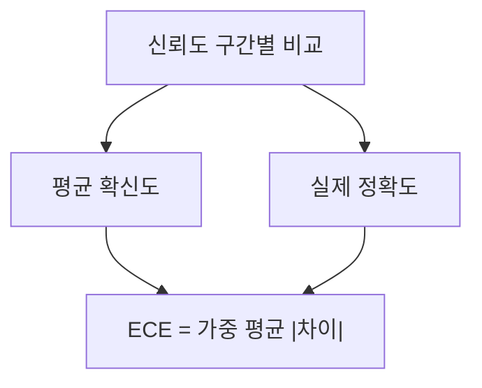

# 예측 확률 보정

> 모델이 "확률 80%"라고 말한 예측이 실제로 약 80% 맞도록 확률값을 맞춰 주는 후처리다. 확률이 실제 확률과 맞아야 라벨 오류 탐지, 확신도 기반 분배, 위험 판단에서 확률을 믿고 쓸 수 있다.

## 쉽게 말하면
일기예보가 "비 올 확률 80%"라고 한 날 열 번 중 여덟 번 실제로 비가 와야 좋은 예보다. 보정은 예보관의 말투가 과장되거나 소심한 경향을 실제 적중률에 맞춰 고쳐 주는 일이다.

## 자세히
(Guo 등 논문 arXiv 1706.04599 초록을 직접 열어 확인하고, scikit-learn으로 직접 실험.)
- **현상(Guo 등, 2017)**: 최신 신경망은 약 10년 전 신경망과 달리 **보정이 잘 안 돼** 확신도가 실제로 맞는 빈도와 일치하지 않는다. 깊이·너비·가중치 감쇠·배치 정규화가 보정에 영향을 주는 요인으로 확인됐다.
- **온도 스케일링(temperature scaling)**: 플랫 스케일링의 **단일 매개변수** 변형으로, 대부분의 데이터셋에서 놀랄 만큼 잘 보정한다고 보고(초록).
- **측정**: 신뢰도 구간별로 (평균 확신도 − 실제 정확도)의 절댓값을 평균하는 ECE(기대 보정 오차). 값이 작을수록 잘 보정.
- **직접 실험(scikit-learn, 합성 이진 분류 6,000개, 반으로 나눠 학습·시험)**
  | 모델 | 정확도 | ECE |
  |---|---|---|
  | GaussianNB(원본) | 0.831 | 0.048 |
  | 로지스틱 회귀 | 0.853 | 0.028 |
  | NB + isotonic 보정 | 0.835 | **0.010** |
  | NB + sigmoid 보정 | 0.833 | 0.036 |
  정확도는 거의 그대로인데 isotonic 보정으로 ECE가 0.048→0.010으로 줄었다. sigmoid는 이 설정에서 개선 폭이 작았다. 합성 데이터 한 번의 결과이며 방법의 우열을 일반화하지 말 것.
- **중요한 점**: 보정은 **순위(정확도)** 를 바꾸지 않고 **확률 값**만 바꾼다. 보정은 학습과 별도의 보정 세트(또는 교차 검증)에서 해야 한다(제안).
- **연결**: [표본 밖 예측 확률](#out-of-sample-pred-probs)이 좋은 확률이어야 라벨 오류 탐지가 정확하고, [확신도 기반 검수 분배](#confidence-routed-review)는 보정된 확신도를 전제로 한다.

## 그림으로 보기



## 예시
```python
from sklearn.calibration import CalibratedClassifierCV
from sklearn.naive_bayes import GaussianNB
cal = CalibratedClassifierCV(GaussianNB(), method="isotonic", cv=5)
cal.fit(X_train, y_train)
p = cal.predict_proba(X_test)[:, 1]
```
- 사내 이탈 예측 모델: "이탈 확률 70% 이상 고객에게 연락"처럼 확률을 의사결정에 쓰기 전에 보정 점검.

## 헷갈리는 것과 비교
| 개념 | 차이 |
|---|---|
| 정확도 | 맞힌 비율 |
| 보정 | 확률이 실제 빈도와 맞는 정도 |
| ECE | 보정 오차를 숫자로 요약 |
| 온도 스케일링 | 로짓을 하나의 온도로 나누는 가장 단순한 보정 |

## 더 읽을거리
- [On Calibration of Modern Neural Networks (arXiv 1706.04599)](https://arxiv.org/abs/1706.04599) — 보정 실패 요인·온도 스케일링(초록 확인).
