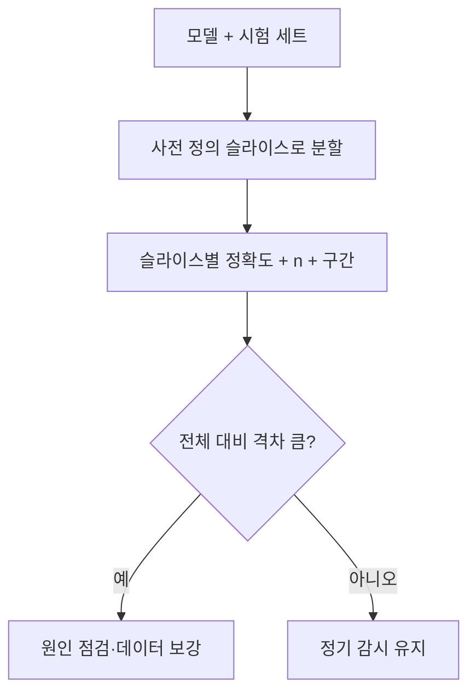
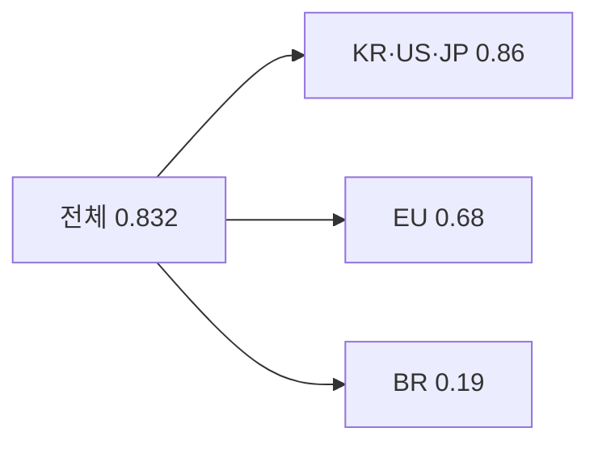

# 사전 정의 슬라이스 평가

> 전체 점수만 보지 않고 **미리 정해 둔 속성(지역·기기·연령대 등)별로 데이터를 나눠 성능을 따로 재는** 평가다. 평균에 묻힌 약한 집단을 드러내며, 슬라이스가 작으면 신뢰구간으로 불확실성을 함께 본다.

## 쉽게 말하면
반 평균이 83점이어도 모둠별로 보면 한 모둠은 19점일 수 있다. 처음부터 모둠(속성)을 정해 두고 각 모둠 점수를 표로 만들어 보는 것이다.

## 자세히
- **근거(TensorFlow Model Analysis 문서)**: TFMA는 전체 학습·보류 데이터에 대한 지표, 시간에 따른 지표 추적, **특성 슬라이스별 모델 품질**, 모델 검증을 제공한다. 문서는 정확도만 보는 것으로는 충분하지 않다고 말한다(예: 95%가 양성이면 항상 양성이라 답해도 정확도가 오르지만 견고한 분류기가 아니다).
- **직접 시뮬레이션(scikit-learn 1.9.1, 합성: 지역 KR 45%·US 30%·JP 15%·EU 7%·BR 3%, EU는 라벨 잡음이 큼, BR은 입력-라벨 관계가 다름, 로지스틱 회귀, 테스트 3,200개)**
  | 슬라이스 | 테스트 n | 정확도 | 95% Wilson 구간 |
  |---|---|---|---|
  | 전체 | 3,200 | **0.832** | — |
  | KR | 1,485 | 0.863 | 0.845~0.880 |
  | US | 924 | 0.866 | 0.842~0.886 |
  | JP | 488 | 0.865 | 0.832~0.892 |
  | EU | 208 | 0.678 | 0.612~0.738 |
  | BR | 95 | **0.189** | 0.123~0.280 |
  전체 0.832만 보면 괜찮아 보이지만 BR은 우연 수준보다도 낮고 EU는 눈에 띄게 낮다. BR은 표본이 95개라 구간 폭이 0.16이지만 하한과 상한 모두 다른 지역과 겹치지 않아 **차이가 확실**하다.
- **절차(제안)**
  1. **슬라이스를 사전에 정의**: 도메인·공정성·운영 위험에서 중요한 속성(국가, 기기, 언어, 사용자 유형, 시간대). 데이터를 본 뒤 만들면 우연한 패턴에 걸릴 수 있다(다중 비교).
  2. **슬라이스별 지표 + 표본 수 + 신뢰구간**을 표로.
  3. **전체 대비 격차**와 **슬라이스 크기**를 함께 본다(작은 슬라이스의 점수는 불확실).
  4. 격차가 크면 원인 점검: 데이터 부족, 라벨 오류([라벨 품질](#cleanlab-label-quality-score)), 분포 차이([그룹별 점수 분석](#per-group-score-analysis)).
  5. 슬라이스 기준을 운영 감시([감시 표본](#classifier-monitoring-sampling))에도 연결.
- **한계**: 사전에 정한 속성만 본다. 정의하지 못한 약점은 놓치므로 슬라이스 자동 탐색(slice discovery)이 보완한다. 슬라이스를 너무 많이 만들면 다중 비교 문제로 우연한 격차가 생긴다.
- 한 합성 설정의 결과이며 실제 격차 크기는 데이터마다 다르다.

## 그림으로 보기



## 예시
```python
import pandas as pd
df = pd.DataFrame({"region": region_test, "ok": (pred == y_test)})
print(df.groupby("region")["ok"].agg(["mean", "count"]))
```
- 얼굴 인식·음성 인식에서 성별·억양·조명별 오류율을 따로 보고(공정성 점검의 기본 단계).
- 교육: 평균의 함정(심슨의 역설과 유사한 평균 은폐)을 설명하는 소재.

## 헷갈리는 것과 비교
| 개념 | 차이 |
|---|---|
| 사전 정의 슬라이스 평가 | 미리 정한 속성으로 나눠 평가 |
| 슬라이스 자동 탐색 | 약한 부분집합을 데이터에서 찾아냄 |
| [그룹별 점수 분석](#per-group-score-analysis) | 그룹 단위 교차검증의 그룹별 점수 |
| [슬라이스별 통계](#data-statistics-slicing) | 데이터 기술 통계를 슬라이스별로 |

## 더 읽을거리
- [TensorFlow Model Analysis 가이드](https://www.tensorflow.org/tfx/guide/tfma) — 슬라이스별 모델 품질, 지표 추적.
- [Saito & Rehmsmeier 2015](https://journals.plos.org/plosone/article?id=10.1371/journal.pone.0118432) — 불균형에서 단일 지표의 한계.
