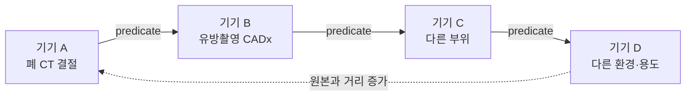

# predicate 사슬 문제

> FDA 510(k)에서 새 기기가 predicate를 인용하고, 그 기기가 다시 다음 기기의 predicate가 되는 식으로 연쇄 비교가 이어지면서, 최신 기기가 원래 기기와 용도·기술이 멀어지는 현상(predicate creep 또는 stretch)에 대한 우려.

## 쉽게 말하면
"A와 비슷하다"로 B가 허가되고, "B와 비슷하다"로 C가, "C와 비슷하다"로 D가 허가된다. 한 걸음씩은 비슷해도 D는 A와 꽤 다른 물건이 될 수 있다. 각 단계는 통과했지만 전체 사슬은 아무도 다시 묻지 않는다.

## 자세히
- **용어 주의**: "predicate creep"이라는 정확한 학술 용어를 검색에서 확인하지는 못했다. 비슷한 문제가 "predicate network", "predicate stretch"로 다뤄진다. 이 글은 관련 자료를 모은 해설이다.
- **업계 분석(Innolitics, 2026-08-15, 열어서 읽음, 비동료심사)**: AI/ML 표시 1,457건을 6개 축에서 측정했다. 최소 85건이 다른 신체 부위의 predicate를 인용, 최소 35건이 촬영 방식을 바꿨고(예: 유방촬영 CADx가 폐 CT predicate 인용), 최소 34건은 사용 환경을 바꿨으며(전문 시설→가정·소비자), 최소 60건은 의도 용도를 넘었다. AI 510(k) 5건 중 1건 이상이 다른 product code의 predicate를 인용한다. 수치는 모두 "최소"값이며 저자의 코퍼스 기준이다.
- **사례(같은 글)**: Aidoc 두개 CT 분류 허가가 경추·복부 유리가스·갈비뼈 골절 분류의 predicate가 됐고, 소변검사 분석기가 휴대폰 카메라 시험지 판독 앱의 predicate가 됐다.
- **한계 신호**: 용도 변경이 한 단계면 일상적이지만 예후·자율성 같은 여러 단계 도약은 De Novo가 필요한 경향이 있다고 글은 말한다. 저자가 제안한 100점 거리 점수는 저자의 틀이며 공식 기준이 아니다.
- **임상 검증 공백(JAMA Health Forum, 2025-08-22, 열어서 읽음)**: FDA 허가 AI 기기 950개 중 60개(6.3%)에서 리콜 182건. 리콜의 43.4%가 허가 12개월 안에 발생(전체 510(k) 기기의 약 2배라고 논문이 보고). 임상 검증 보고가 없는 기기는 리콜이 평균 3.4건으로 회고 검증 1.9건, 전향 검증 2.0건보다 많았다. 단, 이 논문은 predicate 사슬 결과는 다루지 않는다. 사슬과 리콜의 인과를 말할 수는 없다.
- **정책 대응**: 2023년 FDA가 predicate 선택과 임상 데이터 필요 시점을 다루는 초안 지침 3건을 냈다는 검색 요약(원문 미확인).

## 그림으로 보기

## 예시
- 점검 질문: "내 predicate는 어떤 predicate를 인용했는가? 몇 단계 위가 원본이고 용도·환경이 달라졌는가?"
- 교육용 활동: 허가 데이터베이스에서 한 AI 기기의 predicate 사슬을 3단계 따라가 용도 변화를 표로 정리.

## 헷갈리는 것과 비교
| 개념 | 차이 |
|---|---|
| [predicate 기기](#predicate-device) | 비교 대상 자체, 사슬 문제는 연쇄 효과 |
| [실질적 동등성](#substantial-equivalence) | 한 단계 비교 판단 기준 |
| De Novo | predicate 없이 신규 분류, 도약이 크면 이 경로 |
| [변경 관리 계획(PCCP)](#pccp) | 허가 후 AI 업데이트 관리 |

## 더 읽을거리
- [How Far Can a 510(k) Predicate Stretch? (Innolitics, 2026-08-15)](https://innolitics.com/articles/how-far-can-a-k-predicate-stretch/) — 거리 축별 집계와 사례(열어서 확인, 비동료심사)
- [Early Recalls and Clinical Validation Gaps in AI-Enabled Medical Devices (JAMA Health Forum, 2025)](https://pmc.ncbi.nlm.nih.gov/articles/PMC12374217) — 950개 기기 리콜·검증 연구(열어서 확인)
