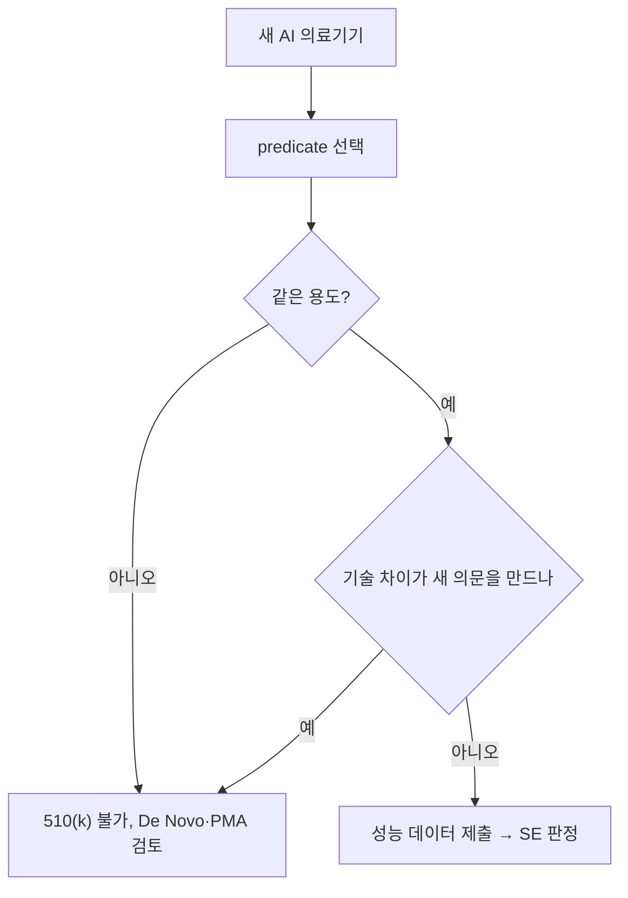

# predicate 기기

> FDA 510(k) 심사에서 "새 기기가 이것과 실질적으로 동등하다"고 비교하는 기준이 되는, 이미 합법적으로 시판 중인 기기.

## 쉽게 말하면
새 식당이 인허가를 받을 때 "저기 이미 허가받은 식당과 같은 종류, 같은 안전 수준"이라고 비교 대상을 대는 것과 같다. 비교 대상(predicate)이 있어야 간이 심사 경로를 쓸 수 있다.

## 자세히
출처: FDA 510(k) 안내 페이지(2026-11-15 확인).
- **실질적 동등성(SE)**: 새 기기가 predicate와 ① 같은 의도 용도이고 ② 기술적 특성이 같거나, 다르더라도 새로운 안전·효과 의문을 일으키지 않아야 하며 predicate만큼 안전하고 효과적임을 보여야 한다. 동일할 필요는 없다.
- **predicate가 될 수 있는 것**: 1976-05-28 이전 시판 기기(크게 변경 안 됨), III류에서 I·II류로 재분류된 기기, 510(k)로 SE 판정받은 기기, 510(k) 면제가 아닌 De Novo 허가 기기. 최근 허가된 것일 필요는 없고 FD&C 법을 위반하는 기기는 안 된다.
- **제출 자료**: 성능 데이터가 주장을 뒷받침해야 한다. 임상 데이터와 비임상 시험(공학 시험, 멸균, 전자파 적합성, 소프트웨어 검증, 생체적합성) 모두 가능. 페이지는 언제 임상 데이터가 필수인지는 적지 않았다.
- **일정**: SE 판정은 보통 90일 이내, SE 서한을 받기 전에는 판매 불가. 판매 90일 전까지 제출.
- **AI 의미**: AI 기기도 대부분 이 경로로 들어온다([FDA AI 기기 목록](#fda-ai-enabled-device-list)). predicate 사슬이 길어지면 원래 기기와 알고리즘 성능이 많이 달라질 수 있다는 우려가 정책 논의에 있다(이 페이지 내용 아님).

## 그림으로 보기

## 예시
- 흉부 X선 폐결절 탐지 AI: 이미 허가된 유사 탐지 소프트웨어를 predicate로 삼아 같은 용도·성능 시험 결과를 제출.
- 완전히 새로운 용도(예: 새 질환 진단 AI)로 비교 대상이 없다면 De Novo.

## 헷갈리는 것과 비교
| 경로 | 차이 |
|---|---|
| 510(k) | predicate와 동등성 입증 |
| De Novo | predicate 없는 신규, 저·중위험 분류 요청 |
| PMA | 고위험, 임상 근거로 승인 |
| [FDA 경로 비교](#fda-510k-de-novo-pma) | 상위 노드 |

## 더 읽을거리
- [FDA Premarket Notification 510(k)](https://www.fda.gov/medical-devices/premarket-submissions-selecting-and-preparing-correct-submission/premarket-notification-510k) — SE와 predicate 정의
