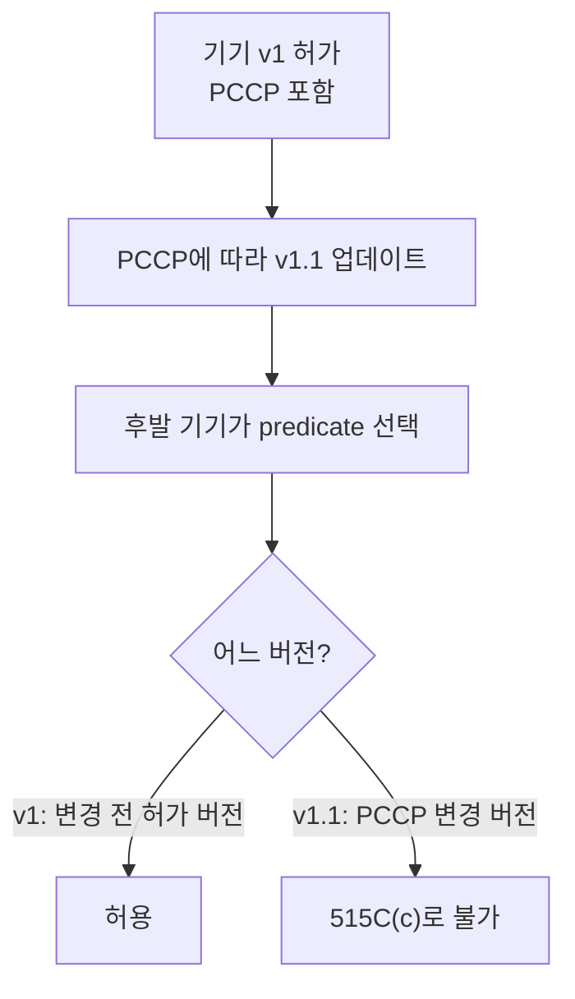

# 변경 전 버전 predicate 규칙

> FD&C Act 515C(c)의 규칙. PCCP에 따라 변경된 기기 버전은 다른 기기의 실질적 동등성 판단에서 predicate로 쓸 수 없고, **계획된 변경 이전에 허가·승인된 버전만** predicate가 될 수 있다.

## 쉽게 말하면
어떤 앱이 업데이트를 거듭해 원래와 많이 달라졌다고 하자. 경쟁사가 "최신 버전과 비슷하다"며 허가를 받으면 비교 기준이 계속 미끄러진다. 이 규칙은 비교 기준을 "심사받았던 원래 버전"에 고정한다.

## 자세히
출처: 21 U.S.C. 360e-4(c)(Cornell LII, 열어서 읽음). FDORA(Pub. L. 117-328, 2022-12-29) §3308(a)로 신설.
- **조문 요지(c)**: 실질적 동등성(21 U.S.C. 360c(i))을 판단할 때, 확립된 PCCP에 따라 시행된 **변경된 버전**을 predicate로 취급할 수 없다. PCCP 변경 전에 허가·승인된 버전만 predicate로 쓸 수 있다.
- **왜 중요한가(해설)**: 허가 후 AI 업데이트가 PCCP로 자주 바뀌면, 그 최신 버전이 다음 기기의 predicate가 되는 연쇄에서 원본과 거리가 벌어질 수 있다. 이 조항은 그 연쇄의 한 경로를 막는다. [predicate 사슬 문제](#predicate-creep)가 지적하는 우려와 연결된다(둘의 관계는 이 지도의 해석).
- **한계(조문 범위)**: 이 조항은 **PCCP 하의 변경 버전**만 다룬다. PCCP 없이 별도 510(k)로 허가된 변경 기기가 predicate가 되는 일반 경로는 이 조항이 막지 않는다.
- **같이 읽을 요건**: 510(k) 기기의 PCCP는 변경 후에도 predicate와 실질적 동등성이 유지돼야 승인된다(515C(b)). 변경은 의도한 용도 안에 머물러야 한다.
- 법률 해석은 전문가 확인이 필요하다.

## 그림으로 보기

## 예시
- A사 영상 AI가 PCCP로 재학습 모델 v1.1을 배포. B사가 510(k)에서 predicate로 A사 기기를 인용하려면 PCCP 변경 전에 허가된 v1을 인용해야 한다.
- 점검: 후발 제출 때 predicate의 허가 번호·버전이 PCCP 변경 이전 것인지 확인.

## 헷갈리는 것과 비교
| 개념 | 차이 |
|---|---|
| [FD&C Act 515C](#section-515c) | 조항 전체, (c)가 이 규칙 |
| [predicate 기기](#predicate-device) | 비교 대상의 일반 개념 |
| [predicate 사슬 문제](#predicate-creep) | 연쇄 비교로 멀어지는 우려, 이 규칙은 그 일부를 막음 |
| [FDORA](#fdora) | 이 규칙을 만든 법 |

## 더 읽을거리
- [21 U.S.C. 360e-4 (Cornell LII)](https://www.law.cornell.edu/uscode/text/21/360e-4) — 515C(c) 조문(열어서 확인)
