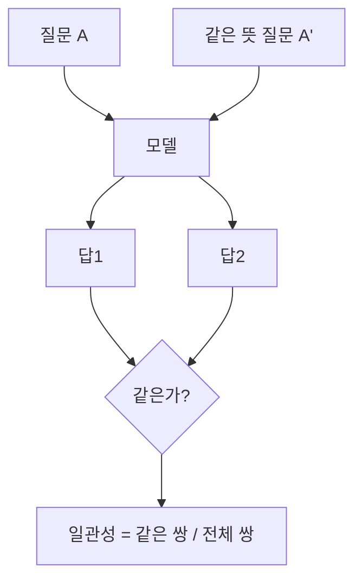
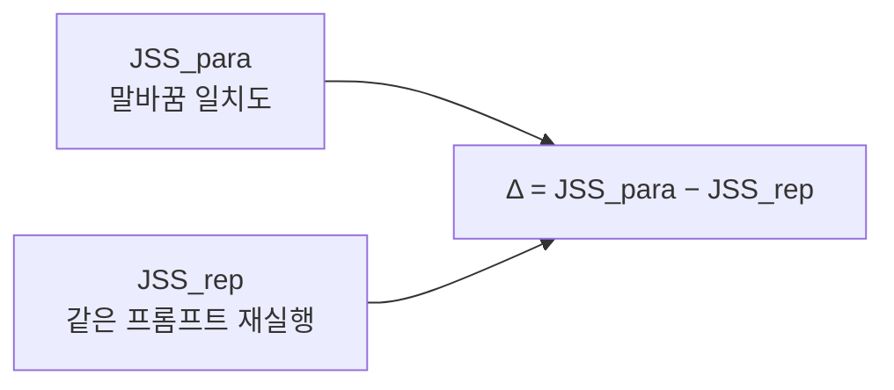

# 예측 일관성 지표

> 같은 뜻의 입력을 살짝 바꿨을 때(말 바꿔 쓰기, 오타, 같은 질문 재전송) **모델의 답이 같게 유지되는 비율**이다. 정답률이 아니라 **안정성**을 잰다.

## 쉽게 말하면
같은 질문을 "서울에서 부산까지 거리는?"과 "부산과 서울 사이 거리 알려줘"로 물었는데 답이 달라지면 믿기 어렵다. 일관성 지표는 이런 쌍 중에서 같은 답이 나온 비율이다. 맞는지는 모르지만 흔들리는지는 안다.

## 자세히
- **JSS (JudgeSense, arXiv 2604.23478, 2026, 열어서 확인)**: LLM 심사위원(LLM-as-a-Judge)이 같은 질문을 다르게 말한 프롬프트 쌍에서 **같은 판정**을 내는 비율을 Judge Sensitivity Score로 정의한다. 1.0이면 모든 쌍에서 동일. **정확도가 아닌 안정성**을 잰다. 같은 템플릿을 두 번 보냈을 때의 자기 일치도(JSS_rep)를 빼서 샘플링 노이즈와 말바꿈 효과를 분리하고, 반복 상한이 0.90 미만인 칸은 해석하지 않는다.
  - 설정: 880개 항목, 4과제(사실성 TruthfulQA, 일관성 SummEval, 관련성 TREC-COVID, 선호도 MT-Bench), 6개 제공사 25개 심사 모델.
  - 결과(논문 보고, 합산 Δ JSS): 일관성 과제 −0.181, 사실성 −0.057, 선호도 −0.045, 관련성 −0.034. 말만 바꿔도 모든 과제에서 일치도가 떨어졌다.
  - 저자가 밝힌 한계: 쌍이 정말 같은 질문인지 독립 검증하지 않았고, 영어만 썼으며, 이전 철회 버전은 답 극성 반전 템플릿 때문에 불일치가 부풀려졌었다.
- **최악 프롬프트 성능(RobustAlpacaEval, arXiv 2406.10248 v4, 2024-10-30, 열어서 확인)**: GPT-4가 만든 10개 말바꿈을 사람이 검수해 질의당 11개 프롬프트. 패러프레이즈 중 **가장 낮은 점수**를 하한으로 본다. Llama-2-70B-chat은 최고·최저 승률 차이가 45.48포인트, 최악은 9.38%.
- **계산(제안)**: 일관성 = (변형 전후 예측이 같은 쌍 수) / (전체 쌍 수). 이미지 분류의 Flip Rate(예측이 뒤집히는 비율, [ImageNet-C·ImageNet-P](#imagenet-c-p))가 이와 반대 방향의 지표다.
- **주의**: 높은 일관성이 정확하다는 뜻은 아니다(틀린 답을 일관되게 낼 수 있다). 변형이 정말 의미를 보존하는지 확인해야 한다.

## 그림으로 보기

## 예시
- LLM 심사위원으로 답변을 채점할 때 평가 지시문을 말만 바꿔 일치도를 측정해 심사 모델을 선택.
- 교육 소재: 같은 질문을 5가지로 바꿔 챗봇에 물어 답이 몇 번 갈리는지 표로 정리.

## 헷갈리는 것과 비교
| 개념 | 차이 |
|---|---|
| 일관성 | 변형 전후 답이 같은 비율(안정성) |
| 정확도 | 정답과 맞는 비율 |
| 최악 프롬프트 성능 | 말바꿈 중 가장 낮은 점수 |
| [변형 강도 단계](#perturbation-severity-levels) | 변형을 단계별로 올리는 설계 |
| [Flip Rate](#flip-rate) | 이미지 시퀀스에서 예측이 뒤집히는 비율 |

## 더 읽을거리
- [JudgeSense (arXiv 2604.23478)](https://arxiv.org/html/2604.23478) — JSS 정의·결과·한계(앞 100,000자 직접 확인).
- [On the Worst Prompt Performance of LLMs (arXiv 2406.10248)](https://arxiv.org/html/2406.10248v4) — RobustAlpacaEval(직접 확인).
