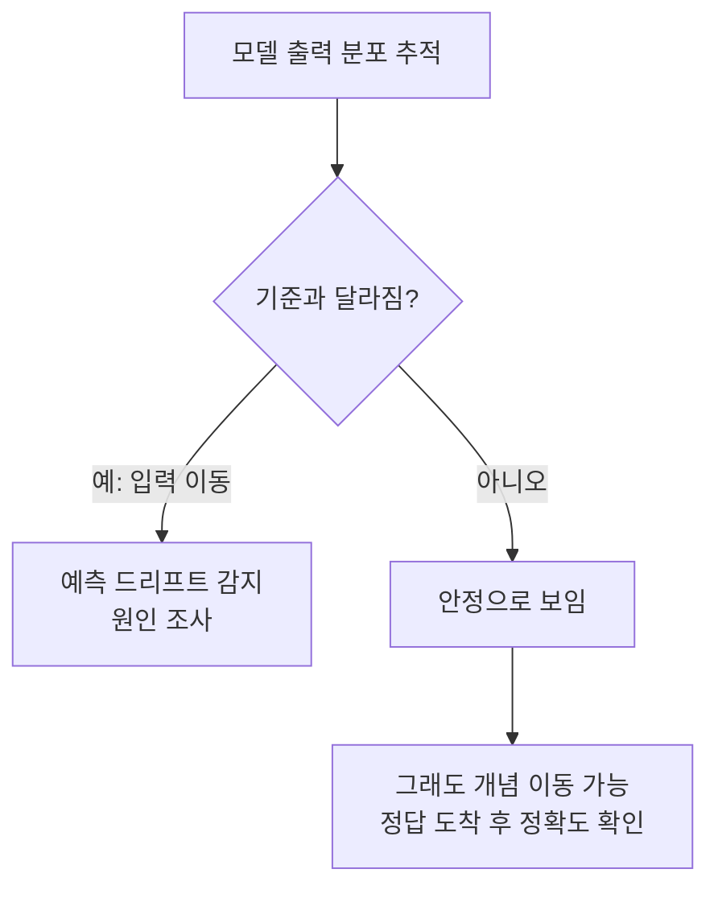

# 예측 드리프트

> 모델이 내놓는 **출력(예측) 분포**가 기준 기간과 달라지는 현상. 정답 라벨이 없어도 볼 수 있어서 정확도를 바로 잴 수 없을 때 가장 좋은 대리 신호로 쓰인다. 다만 모든 성능 저하를 잡아내지는 못한다.

## 쉽게 말하면
의사가 어제까지 환자 절반에게 "고위험" 판정을 하다가 오늘 열 명 중 여덟 명에게 하면 이상하다. 진짜 환자가 늘었을 수도, 판정 기준이 틀어졌을 수도 있다. 이유는 모르지만 "달라졌다"는 사실은 정답 없이도 알 수 있다.

## 자세히
출처: Evidently AI 가이드(열어서 읽음: 예측 드리프트는 출력 분포 변화이며 라벨이 없을 때 최선의 대리 지표인 경우가 많고, 드리프트가 곧 성능 저하는 아니다) + 이 세션의 직접 실험(합성 데이터, scikit-learn 로지스틱 회귀).
- **정의(Evidently)**: 데이터 드리프트(입력 분포), 개념 드리프트(입력-정답 관계)와 구분되는 **출력 분포의 변화**. 라벨이 늦게 오는 상황에서 조기 신호로 쓴다([지연 라벨 모니터링](#delayed-label-monitoring)).
- **직접 실험(2만 건, 두 특성, 로지스틱 회귀 학습 후)**:
  - **기준**: 양성 예측률 0.502, 평균 확률 0.502, 정확도 0.768.
  - **입력 이동**(x0 평균 +1): 양성 예측률 **0.816**, 평균 확률 0.749 → 예측 분포가 크게 움직여 **예측 드리프트가 감지**된다. 이 경우 진짜 양성이 늘어난 것인지(모델이 올바르게 반응) 모델이 틀리는지는 라벨 없이 알 수 없다.
  - **개념 이동**(입력은 그대로, x0의 정답 규칙 부호 반전): 양성 예측률은 **0.502 그대로**지만 정확도는 **0.351**로 급락(기준 0.768). **입력·예측 분포가 같아서 예측 드리프트로는 못 잡는다.**
  - 한 번의 합성 설정 결과이며 일반적 크기를 뜻하지 않는다.
- **시사점**: 예측 드리프트는 유용한 경보지만 **충분조건이 아니다**. 정답 관계가 조용히 바뀌는 개념 드리프트는 라벨이 도착해야 보인다([개념 드리프트](#concept-drift)).
- **주의(Evidently)**: 예측 드리프트가 모델이 실제 세계 변화(예: 사기 증가)에 맞게 적응한 결과일 수도 있다. 드리프트를 곧 열화로 단정하지 말고 조사의 방아쇠로 쓴다.
- **측정**: 양성 예측률, 평균 확률, 점수 분포의 [PSI](#psi)나 KS 거리 등을 시계열로 추적한다.

## 그림으로 보기

## 예시
- 대출 승인 모델의 일 단위 승인율과 평균 점수를 대시보드로 보며, 승인율이 기준 대비 ±10%p를 벗어나면 조사.
- 점검: 예측 드리프트 경보 후 입력 분포와 데이터 품질을 먼저 확인하고, 일부 표본의 사후 정답으로 정확도를 재계산.

## 헷갈리는 것과 비교
| 개념 | 차이 |
|---|---|
| 예측 드리프트 | 출력 분포 변화, 라벨 없이 감지 |
| [데이터 드리프트](#data-drift) | 입력 분포 변화 |
| [개념 드리프트](#concept-drift) | 입력-정답 관계 변화, 예측 분포에 안 나타날 수 있음 |
| [지연 라벨 모니터링](#delayed-label-monitoring) | 예측 드리프트를 대리 신호로 쓰는 상황 |

## 더 읽을거리
- [Data drift (Evidently AI)](https://www.evidentlyai.com/ml-in-production/data-drift) — 예측 드리프트와 라벨 지연 시 조언(열어서 확인)
