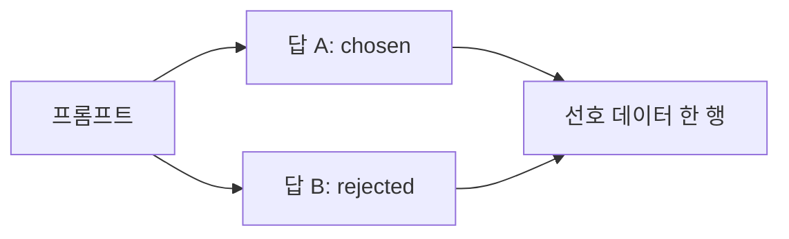
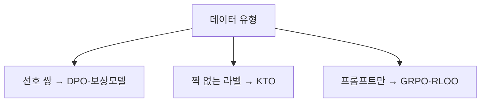

# 선호 데이터셋

> 같은 프롬프트에 대한 **좋은 답(chosen)과 나쁜 답(rejected)**을 짝지은 정렬용 데이터. DPO·보상모델 학습의 기본 재료다. (Hugging Face TRL 문서 열람 2026-11-28)

## 쉽게 말하면
"같은 질문에 대한 두 답 중 어느 쪽이 더 나은가"를 사람이 표시해 모은 채점 기록이다. 모델은 좋은 쪽을 따라 하고 나쁜 쪽을 피하도록 학습한다.

## 자세히
- **형식(format)**: 표준(plain text)과 대화형(conversational, `role`·`content` 메시지). **유형(type)**: 언어 모델링, 프롬프트만, 프롬프트-완성, **선호(preference)**, 짝 없는 선호.
- 선호 유형의 열: `prompt`, `chosen`, `rejected`. 프롬프트가 `chosen`·`rejected`에 포함된 **암묵적 프롬프트** 변형도 있으나 문서는 가능하면 **명시적 프롬프트**를 권한다.
  ```json
  {"prompt":"The sky is","chosen":" blue.","rejected":" green."}
  ```
- **짝 없는 선호(unpaired)**: `prompt`, `completion`, `label`(True/False). KTO에 쓰인다([KTO](#kto)).
- 트레이너 대응(문서의 표): DPOTrainer = 선호(명시적 프롬프트 권장), KTOTrainer = 짝 없는 선호 또는 선호, RewardTrainer = 선호(암묵적 프롬프트 권장), GRPO·RLOO = 프롬프트만, SFTTrainer = 언어 모델링 또는 프롬프트-완성.
- 변환 주의(문서의 경고): 선호 쌍을 짝 없는 데이터로 풀 때 **chosen이 모두 좋고 rejected가 모두 나쁘다고 볼 수 있는지** 먼저 확인해야 한다. 둘 다 좋거나 둘 다 나쁠 수 있으므로 보상 모델의 절대 점수 등으로 점검한다.
- 데이터 품질: 편향된 라벨러·길이 편향이 데이터에 섞일 수 있다([SimPO](#simpo)의 길이 정규화 배경, 해석).
- 공개 데이터 예: UltraFeedback을 변환해 쓰는 예제가 문서에 있다(문서는 열·모델·측면이 달라 변환 스크립트가 필요하다고 설명).

## 그림으로 보기



## 예시
- 챗봇 답 두 개를 사람이 비교해 `chosen`/`rejected`로 저장.
- 교육: 같은 질문에 AI 답 2개를 만들고 수강생이 고른 결과로 작은 선호 데이터셋 만들기.

## 헷갈리는 것과 비교
| 개념 | 차이 |
|---|---|
| 선호 데이터셋 | 짝(chosen/rejected) |
| 짝 없는 선호 | 답 하나와 True/False |
| 지시 데이터셋 | 질문-정답 하나(SFT용) |

## 더 읽을거리
- [TRL: Dataset formats and types](https://huggingface.co/docs/trl/dataset_formats) — 형식·유형·트레이너 표(읽음).
