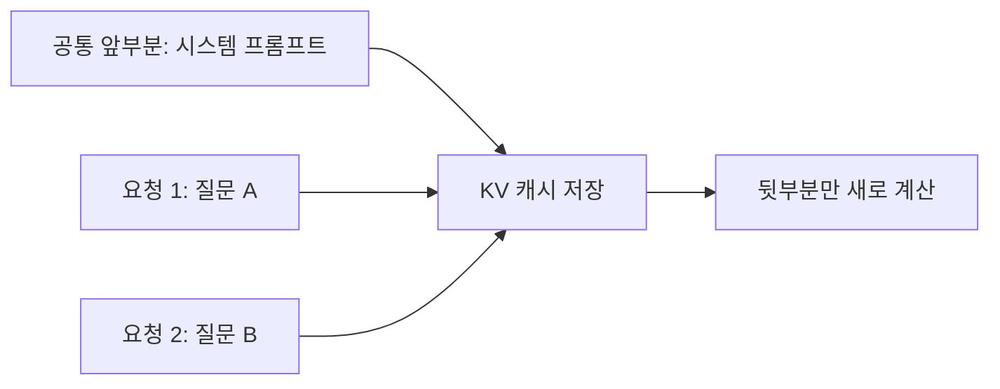
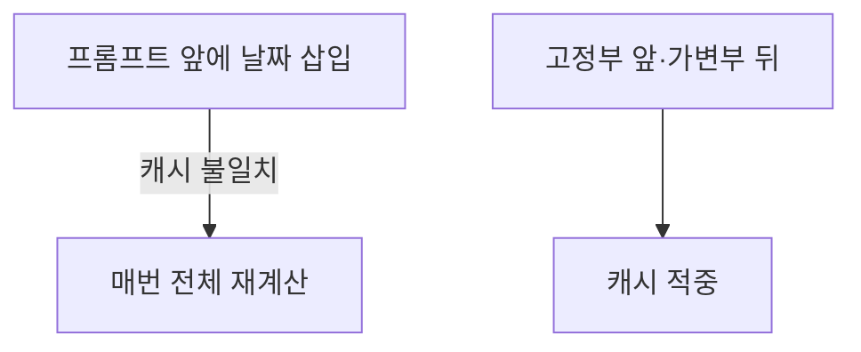

# 프리픽스 캐싱

> **프리픽스 캐싱**은 여러 요청이 **같은 앞부분(시스템 프롬프트·문서)** 을 공유할 때 그 부분의 계산 결과(KV 캐시)를 **재사용**해 비용과 지연을 줄이는 기법이다.

## 쉽게 말하면
같은 설명서를 매번 처음부터 읽는 대신, 이미 읽고 정리해 둔 메모를 꺼내 쓰고 새로 들어온 질문만 읽는 것이다.

## 자세히
- **vLLM 문서**: 지원 기능으로 **프리픽스 캐싱**을 나열하며, KV 메모리를 [PagedAttention](#paged-attention)으로 관리한다. 논문(arXiv 2309.06180 초록)은 요청 **내·요청 간 KV의 유연한 공유**를 강조한다.
- **효과**(일반 지식): 긴 시스템 프롬프트·고정 문서가 반복되는 서비스에서 첫 토큰까지의 시간과 연산이 줄어든다. 일부 API 제공사도 "프롬프트 캐싱"으로 반복 입력의 비용을 낮춘다(제공사별 조건·가격은 문서 확인).
- **조건**: 앞부분이 **정확히 같아야** 재사용된다. 앞에 변하는 내용(날짜·사용자 이름)을 넣으면 캐시가 깨지므로 고정부를 앞에, 가변부를 뒤에 둔다(권고).
- 구체적인 해시·블록 매칭 방식은 이 글에서 확인하지 않았다.

## 그림으로 보기

## 예시
- 사내 규정 40쪽을 시스템 프롬프트로 고정하고 수백 개 질문을 처리: 규정 부분을 한 번만 계산.
- 프롬프트 구성: [고정 지침][고정 문서][사용자 질문] 순서.

## 헷갈리는 것과 비교
| 개념 | 차이 |
|---|---|
| 프리픽스 캐싱 | 같은 앞부분의 KV 재사용 |
| 응답 캐싱 | 같은 질문의 답 자체 저장 |
| [KV 캐시](#kv-cache) | 프리픽스 캐싱이 재사용하는 대상 |
| [vLLM](#vllm) | 이 기능을 제공하는 엔진 |

## 더 읽을거리
- [vLLM 문서](https://docs.vllm.ai/en/latest/)
- [PagedAttention 논문](https://arxiv.org/abs/2309.06180)
