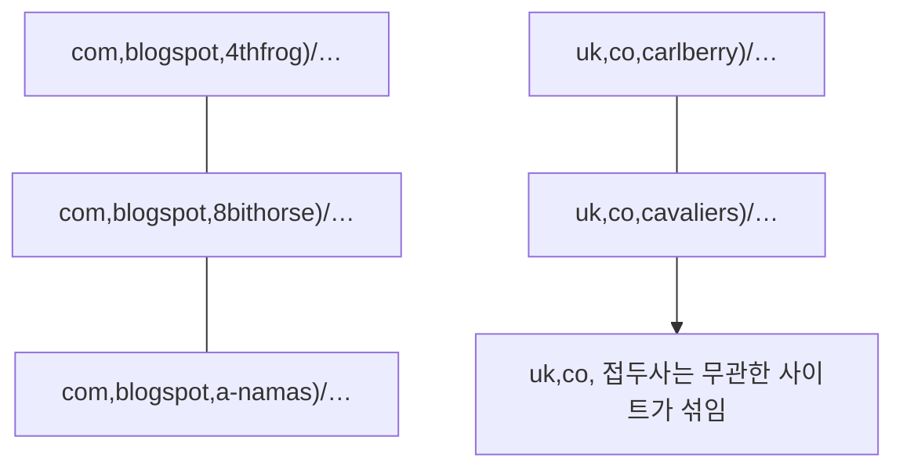

# 접두사 범위 조회

> SURT 키처럼 **호스트를 거꾸로 적은 정렬 키**를 쓰면, "이 도메인 전체(모든 서브도메인·경로)"가 키 정렬 목록에서 **연속된 구간**이 된다. 그래서 이진 탐색으로 구간의 시작·끝을 찾는 접두사 범위 조회가 매우 빠르다.

## 쉽게 말하면
전화번호부가 성(姓)순으로 정렬돼 있으면 "김"씨를 모두 찾을 때 "김"으로 시작하는 구간만 펼치면 된다. URL도 도메인을 큰 단위(`com`)부터 쓰면 같은 사이트의 주소가 한곳에 모인다.

## 자세히
- 원리: 일반 URL(`blog.example.com`)은 서브도메인이 앞이라 같은 도메인 URL이 정렬 목록에서 흩어진다. SURT는 `com,example,blog)/…`처럼 **최상위 → 하위 순**으로 써서([URL 정규화](#url-normalization)) 같은 도메인이 **같은 접두사**를 갖게 한다. 접두사 `com,blogspot,`로 시작하는 키가 목록에서 **연속 구간**이므로 `bisect_left(keys, prefix)`와 `bisect_left(keys, prefix+최대문자)`로 구간을 얻는다.
- 직접 실행(내가 받은 WET 앞 2MB의 `WARC-Target-URI` 587개 → SURT 키 585개 정렬):
  - 상위 최상위 도메인: com 267, org 37, ru 30, net 27, fr 21.
  - 접두사 `com,blogspot,` → **31개 키**(모두 `…blogspot.com` 서브도메인 블로그, 예: `com,blogspot,4thfrog)/2011/11/catch-up-haiku.html`).
  - 같은 31개를 원본 URL 문자열에서 `blogspot.com` 부분 문자열로 찾아도 31개였다(이 표본에서는 오탐 0). 그러나 부분 문자열 검색은 `example.com.evil.net`이나 쿼리 안의 도메인 같은 URL도 잡을 수 있는 구조적 위험이 있다(이번 표본에서는 나타나지 않음).
  - **속도**: 585개 키에서 이진 탐색 한 번 약 0.12µs, 선형 스캔 약 13.9µs(작은 목록이라 절대값은 의미 없고 **로그 대 선형** 차이만 참고). 수십억 건 색인에서는 이 차이가 결정적이다(일반적 설명; 이번에 측정하지 않음).
- **주의 — 등록 도메인 경계**: 접두사 `uk,co,`로 조회하자 **서로 무관한 사이트 7개**(`candlemakersuk`, `carlberry`, `cavaliers`, `cliff-ruddell`, `daybrookesslt`, `holidayfrancedirect`, `woolwicharsenal`)가 한 구간에 묶였다. `co.uk`는 개별 사이트가 아니라 공용 접미사이기 때문이다. 한 사이트만 조회하려면 접두사에 **등록 도메인까지**(`uk,co,carlberry,`) 포함해야 하고, 이를 판단하려면 [공개 접미사 목록](#public-suffix-list)이 필요하다.
- 접두사 끝에 `,`나 `)`를 붙이는 이유: `com,blog`는 `com,blogspot`과 `com,blogger`를 모두 포함하므로 경계 문자를 붙여 구분한다(제안).
- 활용: 삭제·옵트아웃 요청이 "example.com 전체"일 때 색인에서 해당 구간을 한 번에 뽑아 제외([데이터셋 삭제 요청](#dataset-removal-request)), 사이트별 통계, 도메인 단위 샘플링.
- 한계: 정렬 키 기반 접근이라 **부분 문자열·중간 일치**(경로에 특정 단어)는 못 찾는다. 이 실험의 표본은 크롤 한 파일의 일부다.

## 그림으로 보기



## 예시
```python
lo = bisect.bisect_left(keys, 'com,blogspot,')
hi = bisect.bisect_left(keys, 'com,blogspot,\U0010ffff')
domain_keys = keys[lo:hi]
```
- 교육: 정렬 순서를 설계하면 검색 연산이 단순해진다는 자료구조 사례.

## 헷갈리는 것과 비교
| 개념 | 차이 |
|---|---|
| 접두사 범위 조회 | 정렬 키의 연속 구간 |
| 부분 문자열 검색 | 어느 위치든 일치(오탐 위험) |
| 해시 조회 | 정확히 같은 키만(범위 불가) |

## 더 읽을거리
- [Python bisect](https://docs.python.org/3/library/bisect.html) — 이진 탐색.
- 직접 실행: WET 샘플 SURT 키 585개 접두사 조회.
