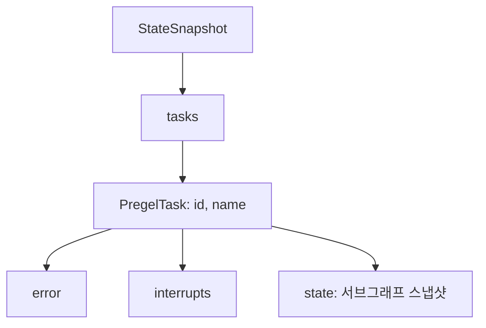

# PregelTask

> `StateSnapshot.tasks`에 들어 있는, 그 super-step에 실행되도록 예약된 작업 하나. `id`·`name`·`error`·`interrupts`(필요 시 `state`)를 가진다.

## 쉽게 말하면
식당 주방의 주문표 한 장이다. "몇 번 주문(id), 무슨 요리(name), 실패했나(error), 손님 확인 대기 중인가(interrupts)"가 적혀 있다. 한 시점에 주문표가 여러 장일 수 있고(병렬 노드), 스냅샷은 그 묶음을 `tasks` 튜플로 보여 준다.

## 자세히
Checkpointers 문서 기준(확인 2026-11-12).
- `tasks`의 타입은 `tuple[PregelTask, ...]`.
- 필드: `id`, `name`(노드 이름), `error`(실패 시 오류), `interrupts`(그 task에서 발생한 interrupt 목록).
- `state`: `get_state(config, subgraphs=True)`로 조회하면 서브그래프의 스냅샷이 들어간다. `parent_state.tasks[0].state.config`로 서브그래프 config를 얻는다.
- `interrupts`는 스냅샷 최상위가 아니라 **task 안에** 있다.
- 문서는 `path` 필드를 나열하지 않았다. 확인하지 못했다.
- 이름의 Pregel은 LangGraph의 실행 엔진이 따르는 Pregel식 super-step 모델에서 온 것으로 보인다(주장).

## 그림으로 보기


## 예시
```python
interrupted = next(s for s in history
    if s.tasks and any(t.interrupts for t in s.tasks))
sub_cfg = graph.get_state(config, subgraphs=True).tasks[0].state.config
```
사람 승인에서 멈춘 체크포인트를 찾아, 어느 노드가 기다리는지 `t.name`으로 확인한다.

## 헷갈리는 것과 비교
| 개념 | 차이 |
|---|---|
| `next` | 다음에 실행될 노드 **이름** 튜플 |
| `tasks` | 같은 대상의 **상세** 객체(오류·interrupt 포함) |
| [metadata.source](#snapshot-metadata-source) | 체크포인트가 만들어진 방식 |
| [StateSnapshot](#langgraph-state-snapshot) | 부모 객체 |

## 더 읽을거리
- [LangGraph Checkpointers](https://docs.langchain.com/oss/python/langgraph/checkpointers.md) — PregelTask 필드와 서브그래프 예시
