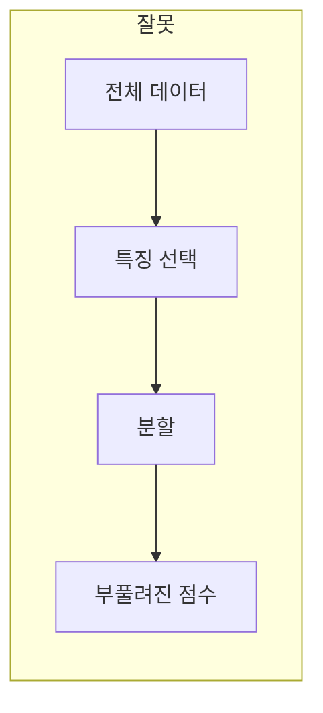
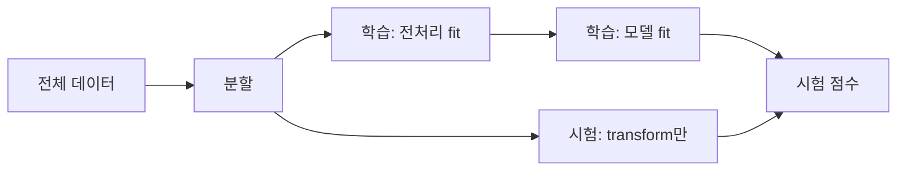

# 전처리 누수와 Pipeline

> 정규화·특징 선택 같은 전처리를 데이터를 나누기 전에 전체에 적용하면 시험 세트의 정보가 학습에 새어 점수가 부풀려진다. 분할 후 학습 데이터로만 `fit`하고, `Pipeline`으로 묶으면 교차 검증 안에서도 자동으로 안전해진다.

## 쉽게 말하면
시험 문제를 미리 훑어보고 "이 부분이 중요해 보이네" 하며 공부 계획을 세운 뒤, 같은 시험을 치르면 점수가 잘 나온다. 계획 수립(전처리)에 시험지가 개입했기 때문이다. 시험지는 계획을 다 세운 뒤에야 열어야 한다.

## 자세히
(scikit-learn Common pitfalls 문서를 직접 열어 확인하고 같은 실험을 직접 재현.)
- **규칙**: 모든 전처리·특징 선택은 학습 데이터에서만 학습한다. 먼저 분할 → 학습 세트에만 `fit`/`fit_transform` → 시험 세트엔 `transform`만.
- **문서의 실험**: 표본 200개, 무작위 특징 10,000개, 무작위 이진 타깃(진짜 정확도는 약 0.5). 전체 데이터에 `SelectKBest(k=25).fit_transform(X, y)`를 한 뒤 나누면 시험 정확도가 **0.76**(누수). 분할 후 학습 세트로만 선택하면 **0.5**.
- **직접 재현(scikit-learn 1.9.1, 시드 42·1)**: 누수 방식 **0.82**, 올바른 방식 **0.46**, 5겹 교차 검증 Pipeline **0.43**. 숫자는 시드마다 다르지만 방향은 같다 — 의미 없는 데이터인데 누수만으로 0.8대가 나온다.
- **Pipeline**: `make_pipeline(SelectKBest(k=25), HistGradientBoostingClassifier(random_state=1))`처럼 묶으면 `fit`·`predict`가 알맞은 부분집합만 쓰고, `cross_val_score` 안에서도 폴드마다 전처리를 다시 학습한다. 문서의 평균 정확도는 0.43±0.05.
- 누수가 되는 전처리 예: 표준화(전체 평균·분산), 결측값 대치, 특징 선택, 차원 축소(PCA), 중복·이상치 기준 계산, 범주 인코딩(타깃 인코딩).
- 같은 계열: [데이터 누수](#data-leakage)의 한 종류(전처리 누수).

## 그림으로 보기



## 예시
```python
from sklearn.pipeline import make_pipeline
from sklearn.feature_selection import SelectKBest
from sklearn.ensemble import HistGradientBoostingClassifier
from sklearn.model_selection import cross_val_score
pipe = make_pipeline(SelectKBest(k=25), HistGradientBoostingClassifier(random_state=1))
scores = cross_val_score(pipe, X, y)   # 폴드마다 선택을 새로 학습
```
- 점검 요령: 무의미한 무작위 라벨로도 높은 점수가 나오면 누수를 의심한다.

## 헷갈리는 것과 비교
| 개념 | 차이 |
|---|---|
| 전처리 누수 | 분할 전 전체로 fit한 변환 |
| [데이터 누수](#data-leakage) | 시험 정보가 학습에 들어가는 모든 경우 |
| [증강본 그룹 누수](#augmentation-group-leak) | 같은 원본의 변형이 양쪽에 |
| [학습-서빙 편향](#training-serving-skew) | 학습과 운영의 처리 불일치 |

## 더 읽을거리
- [scikit-learn: Common pitfalls and recommended practices](https://scikit-learn.org/stable/common_pitfalls.html) — Data leakage during preprocessing 절(열어 확인).
