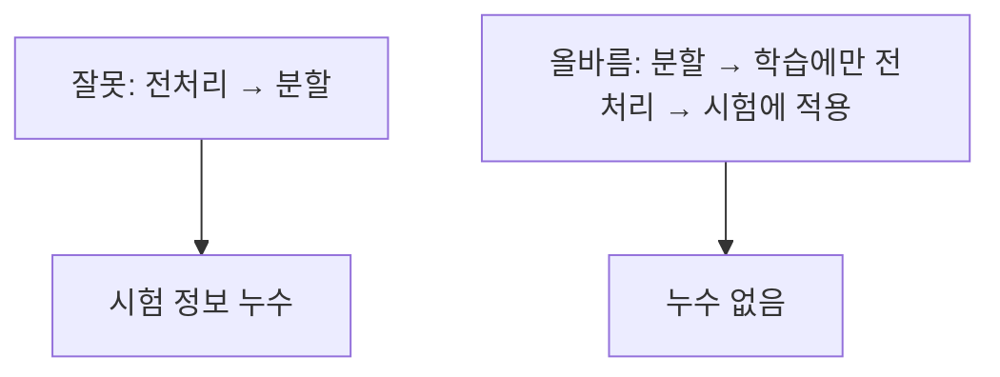

# 전처리 누수

> **분할 전에** 전체 데이터로 표준화·PCA 같은 변환을 맞추면 시험 데이터의 통계가 학습으로 새어 들어가는 누수다.

## 쉽게 말하면
시험 문제를 보고 나서 "평균 점수 기준"을 정한 뒤 학생을 채점하면 이미 시험 정보가 섞인다. 기준은 연습 데이터만으로 정해야 한다.

## 자세히
(TheoremPath 페이지를 직접 읽었다.)
- **누수(페이지)**: 스케일러(평균·표준편차)나 PCA를 **전체 데이터**에 맞추면 시험 통계가 학습에 들어간다.
- **올바른 순서(페이지)**: **분할 먼저**, 전처리는 **학습 세트에만** 맞추고 그 맞춘 변환을 검증·시험에 적용.
- **예(페이지)**: 샘플 10,000개 전체에 PCA 후 8,000/2,000 분할 → 누수. 8,000개 학습 샘플에만 PCA를 맞춘다.
- **같은 종류(페이지)**: 타깃 인코딩을 전체 데이터로 계산하면 시험 타깃이 특징으로 샌다.
- **점검 신호(페이지)**: 평범치 않게 높은 성능, 한 특징이 예측력의 95%를 차지하는 비정상 중요도.

## 그림으로 보기

## 예시
- scikit-learn에서는 Pipeline 안에 전처리를 넣고 교차검증하면 매 폴드에서 학습분에만 맞춰진다(일반 지식, 이 페이지엔 코드 없음).

## 헷갈리는 것과 비교
| 개념 | 차이 |
|---|---|
| 전처리 누수 | 변환 통계가 새어 듦 |
| 타깃 누수 | 정답 정보가 특징에 포함 |
| [적대적 검증](#adversarial-validation) | 분포 차이로 누수를 탐지 |

## 더 읽을거리
- [TheoremPath](https://theorempath.com/topics/train-test-split-and-data-leakage) — 직접 읽음.
