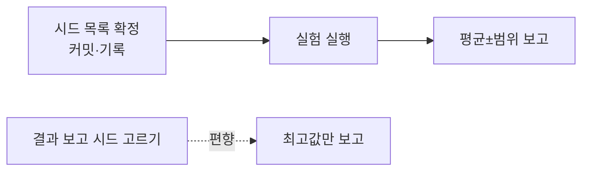

# 사전에 정한 시드

> 결과를 보기 **전에** 사용할 시드(또는 시드 목록)를 정해 기록해 두는 습관. 좋은 점수가 나올 때까지 시드를 바꿔 가며 고르는 선택 편향을 구조적으로 막는다.

## 쉽게 말하면
복권을 사기 전에 번호를 적어 두면 "당첨 번호를 보고 그에 맞춰 산 것처럼" 꾸밀 수 없다. 시드도 결과를 보기 전에 적어 두면 사후에 골라 맞출 수 없다.

## 자세히
- **직접 실행**(scikit-learn 1.9.1, make_classification 1,000개, RandomForest 30그루, 분할 시드 100개의 테스트 정확도):

| 보고 방식 | 정확도 |
|---|---|
| 100개 시드 전체 평균(참고 기준) | 0.884 |
| 시드 10개 시도 후 **최고값 보고**(2,000회 평균) | **0.908** (+0.024 부풀음) |
| 사전에 정한 시드 0 한 개 | 0.900 |
| 사전에 정한 시드 0~9의 평균 | 0.874 |

  최고값 선택은 평균보다 일관되게 높게 나온다. 사전 시드 한 개(0.900)는 어쩌다 평균과 가깝지 않았을 뿐이므로, 단일 시드보다 **사전에 정한 시드 목록의 평균±범위**를 보고하는 편이 낫다. 이 수치는 한 데이터셋·한 모델의 결과다.
- **방법**: ① 코드·설정 파일에 `SEEDS = [0,1,2,3,4]`로 고정하고 커밋, ② 결과 확인 후 변경 금지(변경하면 사유와 이전 결과를 남김), ③ 시드 수는 계산 가능한 한 크게, ④ 최종 보고에 시드 목록과 개수 명시.
- 사전 등록(preregistration)은 과학계의 가설·분석 계획 사전 공개 관행에서 온 아이디어다. ML에서는 코드·설정 해시, 실험 추적 도구의 기록으로 대체할 수 있다.

## 그림으로 보기


## 예시
```python
SEEDS = [0, 1, 2, 3, 4]          # 결과를 보기 전에 커밋
scores = [run(seed=s) for s in SEEDS]
print(f"{np.mean(scores):.3f} (min {min(scores):.3f}, max {max(scores):.3f}, n={len(SEEDS)})")
```

## 헷갈리는 것과 비교
| 개념 | 차이 |
|---|---|
| 사전에 정한 시드 | 선택을 결과 이전으로 고정 |
| [시드 골라 쓰기](#seed-cherry-picking) | 결과를 보고 시드를 고르는 관행 |
| [시드 스윕 보고](#seed-sweep-reporting) | 여러 시드를 모두 돌려 요약 |
| [승자의 저주](#winners-curse) | 최고값 선택이 점수를 부풀리는 원리 |

## 더 읽을거리
- [Center for Open Science: Preregistration](https://www.cos.io/initiatives/prereg) — 사전 등록의 취지.
- [scikit-learn: Controlling randomness](https://scikit-learn.org/stable/common_pitfalls.html#controlling-randomness) — random_state 지침.
