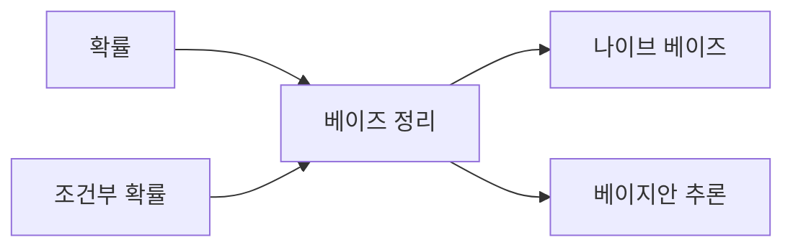
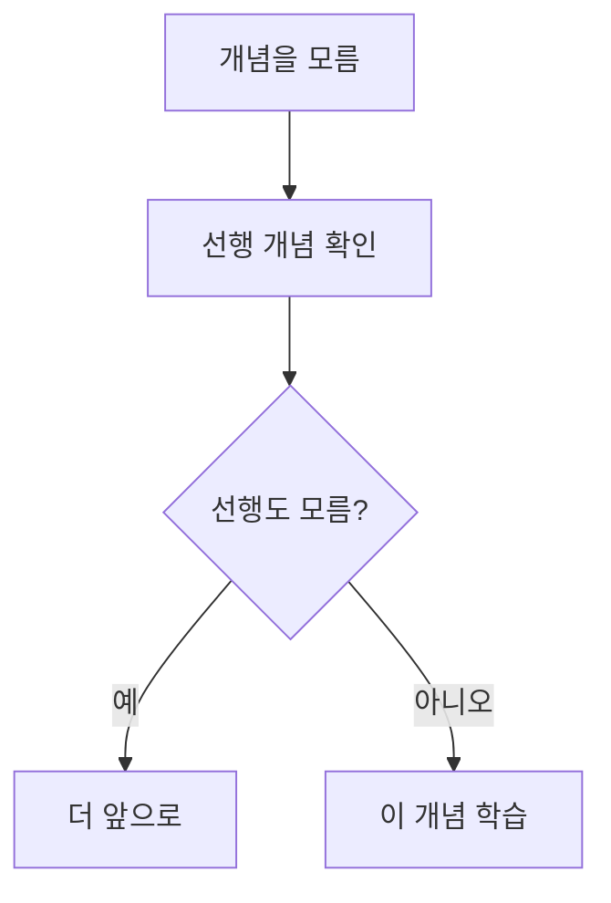

# 선행 개념 그래프

> 개념 사이의 **"이걸 알아야 저걸 안다"** 관계를 방향 있는 선으로 그린 지도. 학습 순서를 정하고 막힌 지점을 찾는 데 쓴다.

## 쉽게 말하면
게임의 스킬 트리와 같다. 앞 스킬을 찍어야 뒤 스킬이 열린다. 모르는 개념이 있으면 그 화살표를 거슬러 올라가 어디서부터 모르는지 찾을 수 있다.

## 자세히
(검색 결과 요약 기준.)
- 연구 흐름: 선행 관계 학습은 **그래프 기반**(개념 노드에 GNN)과 **텍스트 기반**(교재·위키피디아에서 근거 추출) 두 갈래로 발전해 왔다.
- LLM으로 추출: 2026 IJCAI 논문은 LLM이 문서에서 개념 설명과 맥락 근거를 뽑고 개념-문서 관계를 모델링해 선행 여부를 판단한다. 2025 arXiv 논문(2504.08856)은 GPT 모델로 강좌 개념을 생성하고 개념 쌍의 선행 의존을 -1~1로 점수화한다.
- 관계 유형: 한 2026 논문은 의존을 방향 엣지로 두고 **depends-on(선행)**과 **part-of(구성)** 두 유형으로 제한한다.
- 수작업 비용: 교육용 지식 그래프를 손으로 만들면 전문가가 개념을 정의하고 모든 개념 쌍의 선행 여부를 확인해야 해 느리다.
- 학습 경로: 2024 논문(arXiv 2402.14293, CGLLM/TutorQA)은 LLM이 복원한 개념 그래프를 시험했으며, 지식 구조 없이는 LLM 답이 너무 일반적이라고 보고. RPKT(arXiv 2508.11892)는 미리 만든 그래프 없이 학습자 질문에서 GPT-4o로 선행 개념을 즉석 추출해 학습 경로를 만든다.
- 한계: LLM이 추출한 선행 관계는 틀릴 수 있어 전문가 검토가 필요하다. 지식공간이론(KST)은 이번 검색에서 다루지 않았다.

## 그림으로 보기

## 예시
- 이 개념 지도 사이트처럼 노드의 부모·관련 연결이 학습 순서를 암시한다.
- 교육: 수강생이 "RAG를 알려면 필요한 개념"을 직접 그려 보게 한다.

## 헷갈리는 것과 비교
| 개념 | 차이 |
|---|---|
| 선행 개념 그래프 | 학습 의존 관계(방향) |
| 지식 그래프 | 일반 사실의 개체·관계 |
| [지식 추적](#knowledge-tracing) | 학습자 상태 추정 |

## 더 읽을거리
- [Concept graphs with LLMs (arXiv 2402.14293)](https://arxiv.org/pdf/2402.14293.pdf) — 개념 그래프 시험(검색 결과 확인).
- [RPKT (arXiv 2508.11892)](https://arxiv.org/pdf/2508.11892v2) — 즉석 선행 추출(검색 결과 확인).
