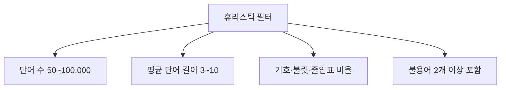

# 사전학습 데이터 필터링

> 웹에서 긁어 온 방대한 텍스트에서 LLM 학습에 쓸 만하지 않은 문서를 단순하고 설명 가능한 규칙(휴리스틱)과 분류기로 걸러내는 단계다. 사전학습 데이터 파이프라인에서 규모에 비해 성능을 좌우하는 작업이다.

## 쉽게 말하면
쌀 도정과 같다. 돌과 쭉정이를 먼저 체로 걸러내야 밥맛이 난다. 체의 구멍 크기(규칙)를 너무 촘촘히 하면 좋은 쌀까지 버리고, 너무 헐겁게 하면 돌이 섞인다.

## 자세히
(DeepMind Gopher 논문 arXiv:2112.11446 부록 A.1의 MassiveText 데이터 파이프라인 서술을 PDF에서 직접 읽어 정리.)
- **파이프라인 단계(Gopher, MassiveWeb)**: 콘텐츠 필터링(비영어 제거, Google SafeSearch 통과 못한 페이지 제거) → HTML 트리 구조 기반 텍스트 추출 → **품질 필터링** → **반복 제거** → 문서 중복 제거 → 시험 세트 필터링. 다른 하위 데이터(책·뉴스·코드·C4·Wikipedia)는 콘텐츠 필터링·중복 제거·시험 세트 필터링만 적용.
- **SafeSearch를 쓴 이유**: 수동 금지어 목록은 소수 집단 관련의 무해한 콘텐츠까지 불균형하게 걸러낸다는 연구(Dodge 등, 2021)가 있어서.
- **품질 휴리스틱(논문에 적힌 값)**: 단어 수가 50~100,000개를 벗어나는 문서 제거 / 평균 단어 길이가 3~10자를 벗어나면 제거 / `#` 또는 줄임표의 기호-단어 비율이 0.1 초과면 제거 / 90% 넘는 줄이 불릿으로 시작하거나 30% 넘는 줄이 줄임표로 끝나면 제거 / 단어의 80%가 알파벳을 하나 이상 포함해야 함 / 불용어 필터: `the, be, to, of, and, that, have, with` 중 **두 개 이상** 포함해야 통과(겉보기엔 영어인데 일관된 영어 텍스트가 없는 문서 제거).
- **반복 제거(Table A1 임계값)**: 중복 줄 비율 0.30, 중복 문단 비율 0.30, 중복 줄 문자 비율 0.20, 중복 문단 문자 비율 0.20, 상위 2-gram 문자 비율 0.20 / 3-gram 0.18 / 4-gram 0.16, 중복 5-gram 0.15 … 10-gram 0.10 — 하나라도 넘으면 제거.
- **모델 우도 기반 필터는 쓰지 않음**: 모델이 높은 우도를 주는 문서가 반드시 고품질은 아니고(반복 텍스트가 예), 비용이 크며 편향 위험이 있다고 논문이 설명한다.
- **문서 중복 제거**: 정확 중복 제거 후 MinHash로 13-gram Jaccard 유사도 0.8 초과면 하나 제거([근접 중복 제거](#near-duplicate-removal)). **시험 세트 필터링**: 평가 데이터(Wikitext103, C4, Curation Corpus, LAMBADA)와 비슷한 학습 문서도 같은 방식으로 제거([벤치마크 오염](#benchmark-contamination)).
- **후속 흐름**: FineWeb은 이 휴리스틱을 일부 가져오고 C4 필터와 자체 필터를 더했으며([FineWeb·FineWeb-Edu](#fineweb)), 이후엔 LLM으로 점수를 매겨 분류기를 학습하는 방식으로 이동했다.
- **한계**: 규칙은 영어 기준이라 다른 언어·코드·표 데이터에는 그대로 맞지 않는다(일반적 지적). 값은 Gopher의 선택이지 보편 정답이 아니다.

## 그림으로 보기



## 예시
```python
# Gopher 규칙의 일부를 단순화한 개념 코드 (논문 값 사용)
def keep(doc):
    words = doc.split()
    if not (50 <= len(words) <= 100_000): return False
    mean = sum(map(len, words)) / len(words)
    return 3 <= mean <= 10
```
교육 소재: 사내 문서 코퍼스에도 "너무 짧은 문서, 중복 문단 비율 높은 문서"를 같은 방식으로 걸러 RAG 품질을 올릴 수 있다(제안).

## 헷갈리는 것과 비교
| 개념 | 차이 |
|---|---|
| 휴리스틱 필터 | 길이·기호·반복 등 단순 규칙 |
| 분류기 필터 | 모델이 점수를 매겨 선별(FineWeb-Edu 방식) |
| [근접 중복 제거](#near-duplicate-removal) | 중복을 줄임, 품질 필터와 별개 단계 |
| [AI용 데이터 품질](#data-quality-for-ai) | 항목별 품질 측정 틀 |

## 더 읽을거리
- [Scaling Language Models: Gopher (arXiv:2112.11446)](https://arxiv.org/abs/2112.11446) — 부록 A.1 MassiveText 파이프라인과 임계값 표(PDF 직접 확인).
- [FineWeb Datasets (arXiv:2406.17557)](https://arxiv.org/abs/2406.17557) — 후속 파이프라인(본문 앞부분 직접 확인).
