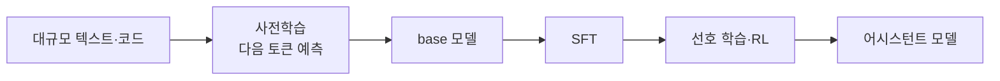
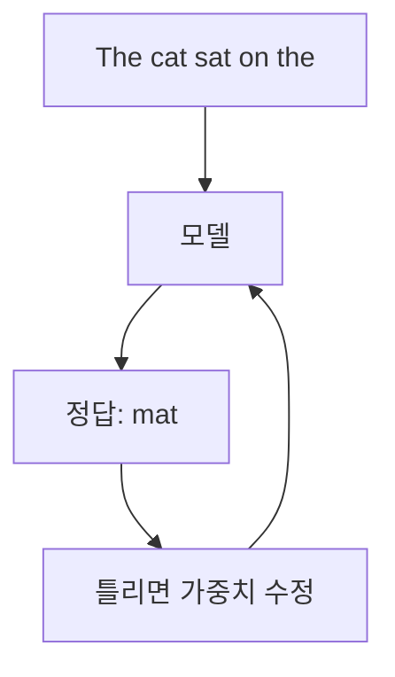

# 사전학습 (Pretraining)

> 사전학습은 LLM이 인터넷 규모의 텍스트에서 "다음 토큰 맞히기"를 반복하며 언어·지식·패턴을 가중치에 새기는 첫 훈련 단계다. 이 단계가 끝난 모델이 기반(base) 모델이다.

## 쉽게 말하면
의사가 되기 전에 의대에서 방대한 교과서를 읽는 시기와 같다. 아직 "환자 응대 방법"(지시를 따르는 법)은 모르지만 의학 지식 자체는 몸에 배어 있다. 그 뒤의 전공의 수련이 [SFT](#sft)·강화학습 같은 후속 훈련이다.

## 자세히
- 목표: 자기지도 인과 언어모델링. 정답 라벨을 사람이 달 필요 없이, 텍스트의 다음 토큰이 곧 정답이다(Hugging Face LLM 강의 설명). 가중치는 무작위에서 시작해 수 주 걸리는 대규모 학습으로 만들어진다.
- 재료: 웹 크롤, 책, 코드, 논문 등. 중복 제거·품질 필터링·유해물 제거 같은 **데이터 정제**가 성능을 크게 좌우한다고 알려져 있다.
- 결과물인 base 모델은 질문에 답하기보다 **글을 이어 쓴다**. 지시를 따르는 비서가 되려면 후속 단계가 필요하다 → [llm-training-stages](#llm-training-stages).
- 비용: 모델 크기·데이터·연산이 함께 커져야 성능이 오른다는 경험칙이 있다(스케일링 법칙). 훈련은 대형 GPU 클러스터에서 수주~수개월, 비용이 매우 커서 대부분의 조직은 공개된 사전학습 모델을 받아 미세조정한다.
- 지식 마감일(knowledge cutoff): 사전학습 데이터가 끝난 시점. 그 뒤의 일은 모르므로 검색·[RAG](#rag)로 보완한다.
- 한계: 데이터의 편향·오류도 같이 학습한다([ai-bias-ethics](#ai-bias-ethics)). 훈련 데이터와 벤치마크가 겹치면 평가가 부풀려진다([data-contamination](#data-contamination)).

## 그림으로 보기

## 예시
- base 모델에 "서울의 수도는" 대신 "대한민국의 수도는"까지만 주면 "서울이다"를 이어 쓰지만, "수도를 알려줘"라는 명령엔 엉뚱하게 질문 목록을 이어 쓸 수 있다 → 지시 튜닝이 필요한 이유.
- 업무 판단: "우리 회사 문서를 사전학습부터?" → 거의 항상 아니오. 공개 모델 + [RAG](#rag) 또는 미세조정이 현실적이다.

## 헷갈리는 것과 비교
| 개념 | 차이 |
|---|---|
| 사전학습 | 처음부터, 거대 데이터, 다음 토큰 예측 |
| 미세조정 | 사전학습된 모델에 작은 데이터로 추가 훈련 |
| [SFT](#sft) | 사람이 쓴 모범 답안으로 지시 따르기 학습 |
| RAG | 훈련 없이 답할 때 외부 자료를 끼워 넣음 |

## 더 읽을거리
- [Hugging Face LLM Course: Transformers, what can they do?](https://huggingface.co/learn/llm-course/chapter1/4) — 사전학습 vs 미세조정, 인과 언어모델링(열어서 확인).
