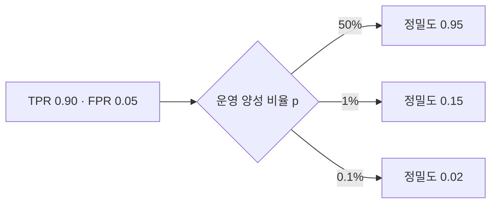

# 유병률 보정 정밀도

> 정밀도(precision)는 **양성 비율(유병률)** 에 따라 달라진다. 테스트셋의 양성 비율이 운영 환경과 다르면, 비율에 둔감한 TPR·FPR로부터 운영 비율에서의 정밀도를 `TPR·p / (TPR·p + FPR·(1−p))`로 다시 계산해야 한다.

## 쉽게 말하면
"사기 거래를 90% 잡고 정상 거래를 5%만 오탐"하는 탐지기가 있다. 사기가 절반인 시험장에서는 훌륭해 보이지만, 사기가 1,000건 중 1건뿐인 실제 서비스에서는 경보 대부분이 오탐이 된다.

## 자세히
- 정밀도 = TP / (TP + FP). TPR(재현율)과 FPR은 각 클래스 안에서 계산하므로 클래스 비율이 달라도 거의 그대로지만, 정밀도는 양성·음성의 수 비율에 직접 의존한다.
- **계산**(TPR 0.90, FPR 0.05 가정, 직접 계산):

| 운영 양성 비율 p | 정밀도 |
|---|---|
| 50% | 0.947 |
| 10% | 0.667 |
| 1% | 0.154 |
| 0.1% | 0.018 |

  같은 모델이 양성 비율이 0.1%이면 경보 100건 중 약 2건만 진짜 양성이다.
- **전제**: 운영 환경에서도 TPR·FPR이 테스트와 같다고 가정한다(분포 이동이 없다는 뜻). 이 가정이 깨지면 보정도 틀린다. 운영에서 라벨 일부를 확보해 실제 정밀도를 확인한다.
- **용도**: 리소스 계획(경보 대응 인력), 임계값 선택, 이해관계자에게 "경보 중 진짜 비율"을 설명할 때.

## 그림으로 보기


## 예시
```python
def adj_precision(tpr, fpr, p):
    return tpr*p / (tpr*p + fpr*(1-p))
print(adj_precision(0.90, 0.05, 0.01))   # 0.154
```
- 의료 선별검사, 사기 탐지, 콘텐츠 필터처럼 양성이 드문 업무의 경보 대응량 추정에 쓴다.

## 헷갈리는 것과 비교
| 개념 | 차이 |
|---|---|
| TPR·FPR | 클래스 비율과 무관한 비율 |
| 정밀도 | 양성 비율에 의존 |
| [기저율 오류](#base-rate-fallacy) | 이 현상을 놓치는 사고 오류 |
| [PR 곡선 vs ROC](#pr-curve-vs-roc-imbalance) | 불균형에서의 곡선 해석 |

## 더 읽을거리
- [Wikipedia: Base rate fallacy](https://en.wikipedia.org/wiki/Base_rate_fallacy) — 기저율 무시의 예.
- [scikit-learn: Precision, recall and F-measures](https://scikit-learn.org/stable/modules/model_evaluation.html#precision-recall-and-f-measures) — 지표 정의.
