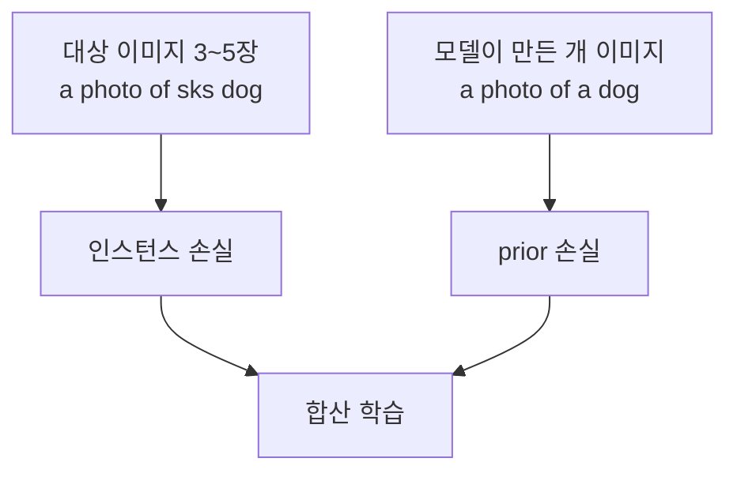

# Prior preservation loss

> DreamBooth 학습 때 모델이 직접 생성한 같은 클래스(예: "개")의 이미지를 함께 학습시켜, 새 대상을 배우면서 클래스의 일반 지식을 잊지 않게 하는 보조 손실이다.

## 쉽게 말하면
우리 집 강아지 사진만 보여 주며 가르치면 "개 = 우리 집 강아지"로 착각하게 된다. 그래서 다양한 개 사진도 섞어 보여 주며 "개는 원래 이렇게 다양하다"는 기억을 지키게 한다.

## 자세히
HF diffusers DreamBooth 가이드(v0.42.1) 기준:
- 모델 자신이 생성한 샘플로 더 다양한 이미지를 만들도록 돕는다. 같은 클래스의 생성 이미지가 클래스 지식을 유지하고, 그 지식으로 새 구도를 만들게 한다.
- 플래그: `--with_prior_preservation`, `--prior_loss_weight`(영향 크기), `--class_data_dir`(클래스 이미지 폴더), `--class_prompt`(클래스 설명 프롬프트).
- 클래스 이미지가 없으면 스크립트가 `class_prompt`로 직접 생성한다(`num_class_images`).
- 과적합에 민감한 DreamBooth의 안전장치. 가이드는 하이퍼파라미터에 매우 민감해 과적합되기 쉽다고 경고.
- 트레이드오프: 클래스 이미지 생성·학습으로 시간과 메모리가 늘어난다.

## 그림으로 보기


## 예시
```bash
accelerate launch train_dreambooth.py \
  --with_prior_preservation --prior_loss_weight=1.0 \
  --class_data_dir=./class_dog --class_prompt="a photo of a dog" \
  --instance_data_dir=./dog --instance_prompt="a photo of sks dog"
```

## 헷갈리는 것과 비교
| 개념 | 차이 |
|---|---|
| prior preservation | 클래스 지식 유지(과적합 방지) |
| [텍스트 인버전](#textual-inversion) | 임베딩만 학습, 모델 가중치 불변 |
| [LoRA 대상 모듈](#target-modules) | 어디를 학습할지 |

## 더 읽을거리
- [HF DreamBooth 학습 가이드](https://huggingface.co/docs/diffusers/training/dreambooth) — 플래그와 예시.
