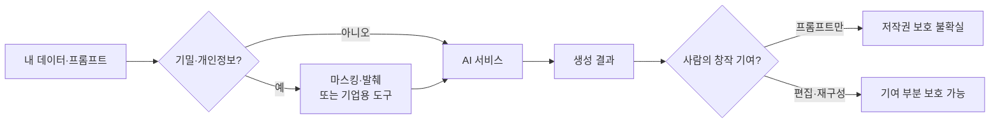

# 개인정보와 저작권

> AI에 넣어도 되는 정보의 경계(개인정보·기밀)와, AI가 만든 결과물에 누가 어떤 권리를 갖는지의 문제.

## 쉽게 말하면
AI 서비스는 외부 업체의 우편함이다. 편지(프롬프트)를 넣으면 업체 서버로 간다. 주민번호나 고객 명단처럼 남에게 보이면 안 되는 내용은 처음부터 넣지 않거나, 보관·학습 사용 여부를 계약으로 막은 우편함만 써야 한다. 한편 결과물은 "내가 시켰으니 내 저작물"이 아닐 수 있다.

## 자세히
**1) 입력 쪽(개인정보·기밀)**
- 무엇을 보내는지: 개인 식별 정보, 고객 데이터, 소스코드, 계약서.
- 확인할 것: 데이터 보관 기간, 모델 학습에 쓰이는지(개인용과 기업용 약관이 다르다), 기업용 요금제의 학습 제외 여부.
- 실무 습관: 이름·번호 마스킹, 필요한 부분만 발췌, 사내 승인된 도구만 사용.
- 외부 문서를 읽는 에이전트는 [프롬프트 인젝션](#prompt-injection) 위험도 있다.

**2) 출력 쪽(저작권)**
- 미국 저작권청 2025년 1월 보고서: 텍스트 프롬프트만으로 생성된 결과는, 아무리 정교해도 현행법상 저작권 보호 대상이 아니다. 프롬프트는 "아이디어를 전하는 지시"로 본다.
- 사람이 결과를 선택·배열·수정하는 등 **실질적 창작 기여**가 있으면 그 부분은 보호될 수 있다. 등록 시 AI 사용 부분을 밝혀야 한다.
- 학습 데이터로 쓰인 저작물 문제는 별도 쟁점이다([데이터 출처와 저작권](#data-provenance)). 국가마다 다르므로 법률 자문이 필요하다(이 글은 법률 조언이 아니다).

## 그림으로 보기

## 예시
- 고객 상담 로그를 요약시킬 때 이름·전화번호를 치환한 뒤 입력한다.
- AI가 쓴 이미지를 그대로 로고로 등록하면 보호받기 어렵다. 직접 수정·합성한 부분을 기록해 둔다.

## 헷갈리는 것과 비교
| 개념 | 차이 |
| --- | --- |
| 개인정보 보호 | 입력 데이터의 유출·목적 외 사용 문제 |
| 기밀 유지 | 회사 비밀(코드·전략)의 문제. 개인정보가 아니어도 해당 |
| 저작권 | 결과물·학습 데이터의 권리 문제 |

## 더 읽을거리
- [Copyright Office says AI-generated works based on text prompts are not protected (Barnes & Thornburg)](https://btlaw.com/en/insights/alerts/2025/copyright-office-says-ai-generated-works-based-on-text-prompts-are-not-protected) — 2025년 1월 보고서 요약
- [Copyright Office Issues Guidance on AI-Generated Works (Skadden)](https://skadden.com/insights/publications/2023/03/copyright-office-issues-guidance-on-ai-generated-works) — 2023년 등록 지침
