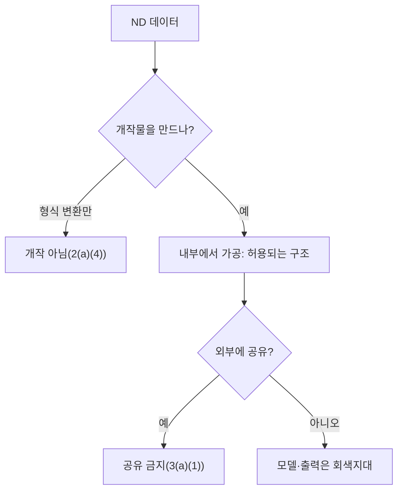

# 비공개 개작의 회색지대

> NoDerivatives(ND) 라이선스는 **개작물을 공유하는 것**을 막는다. 그렇다면 ND 데이터를 **내부에서만** 가공·학습에 쓰는 것은 되는가? 라이선스 문구는 "개작은 허용, 공유는 불가"에 가깝지만, 학습된 모델이나 파생 산출물의 지위는 확정되지 않아 회색지대가 남는다.

## 쉽게 말하면
"이 그림을 고쳐서 남에게 보여 주지 마세요"라는 조건은, 집에서 혼자 고쳐 보는 것까지는 막지 않는 것처럼 읽힌다. 문제는 그 그림을 바탕으로 만든 결과물(예: 그림을 보고 배운 AI)을 남에게 주는 순간 어떻게 되느냐다.

## 자세히
(CC BY-NC-ND 4.0 법적 문서 원문을 직접 열어 확인. BY-ND 4.0 원문은 이번에 열지 않았다. 법률 자문이 아니다.)
- **원문의 구조(BY-NC-ND 4.0)**: 2(a)(1)은 원본을 **비상업 목적으로만** 복제·공유하게 허락하고, 개작물은 **"만들고 복제할 수 있으나 공유(Share)할 수 없다"**고 정한다(2(a)(1)(B)). 3(a)(1)은 "이 공개 라이선스 아래에서는 개작물을 공유할 권한이 없다"고 쓴다. 원문은 "private(비공개)"라는 단어를 쓰지 않지만 개작물을 **만드는 것 자체는 허용하고 공유만 막는** 구조다. 데이터베이스 권리(4항)도 개작물을 공유하지 않는 경우에만 비상업 목적의 추출·재사용을 허락한다.
- **개작물 정의(1항)**: "원본에서 파생되었거나 원본을 바탕으로 한" 자료로, 저작권 허락이 필요한 방식으로 변경된 것. 또 2(a)(4)는 허락된 형식 변환 같은 **기술적 수정만으로는 개작물이 생기지 않는다**고 밝힌다. 따라서 파일 형식 변환, 인코딩 변경은 개작이 아니다.
- **회색지대(제안, 원문에서 확정되지 않은 부분)**
  | 질문 | 이 문서들로 확인된 것 | 남은 불확실성 |
  |---|---|---|
  | 내부에서 정제·분류·주석을 붙임 | 개작물 생성은 허용, 공유만 금지(BY-NC-ND 원문) | 상업적 내부 사용이면 NC 조건 별도 문제 |
  | 정제된 데이터를 외부 협력사에 전달 | 개작물 공유에 해당할 수 있음 | "공유" 범위(계열사·외주·클라우드 업체) |
  | 그 데이터로 모델을 미세조정 | 확인하지 못함 | 모델이 개작물인지, 모델 공개·API 제공이 공유인지 |
  | 모델 출력이 원본과 유사 | 확인하지 못함 | 출력이 개작물로 취급되는지 |
  CC FAQ는 라이선스 조건이 **적용 가능한 예외·제한(예: 공정 이용)이 허락하는 사용에는 발동하지 않는다**고 설명한다. 즉 어떤 AI 학습은 라이선스 이전에 저작권법 예외로 처리될 수 있지만, 이는 관할마다 다르며 이번에 확인하지 않았다.
- **실무 원칙(제안)**: ① ND 데이터는 **사용 목적(상업/비상업)과 공유 여부**를 먼저 표로 정리 ② 내부 가공본은 외부로 나가지 않게 접근 통제 ③ 가공본·모델을 외부에 제공하는 시나리오가 있으면 사전 법무 검토 ④ 판단 근거와 일자를 [데이터 카드의 라이선스 기록](#data-card-license-record)에 기록 ⑤ 애매하면 다른 라이선스 데이터로 대체하거나 권리자에게 별도 허락 요청.
- **한계**: 이 글은 원문 구조를 읽은 것이며 판례·관할별 해석은 다루지 않았다.

## 그림으로 보기

## 예시
- ND 라이선스 법률 문서 말뭉치를 내부 분류 모델 학습에 쓰고 모델은 내부 직원만 사용: 구조상 가능해 보이나 상업 사용 여부(NC 여부)와 모델 제공 범위를 확인.
- 교육 소재: "ND 데이터로 AI를 만들어도 되는가"를 가정 시나리오 4개로 토론(라이선스 리터러시).

## 헷갈리는 것과 비교
| 개념 | 차이 |
|---|---|
| 비공개 개작의 회색지대 | 내부 가공은 가능해 보이나 파생물 지위가 불확실 |
| [카피레프트 오픈 데이터](#copyleft-open-data) | SA는 개작 공유 시 같은 조건 요구 |
| [주석·라벨은 개작인가](#annotation-as-derivative) | 원본을 안 담은 라벨 파일의 지위 |
| [CC NoDerivatives](#cc-noderivatives) | ND 조항 자체 |

## 더 읽을거리
- [CC BY-NC-ND 4.0 법적 문서](https://creativecommons.org/licenses/by-nc-nd/4.0/legalcode.en) — 개작물 정의, 공유 금지, 기술적 수정(직접 확인).
- [Creative Commons FAQ](https://creativecommons.org/faq/) — 라이선스는 적용 가능한 예외에 따른 사용에는 발동하지 않는다는 설명(직접 확인).
