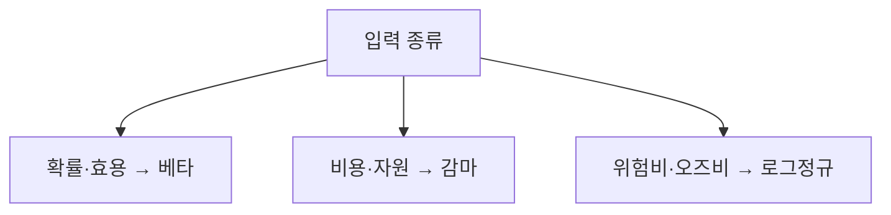

# 확률적 민감도 분석 PSA

> 확률적 민감도 분석(PSA)은 모델의 모든 불확실한 입력을 범위가 아니라 확률분포로 두고, 분포에서 수천~수만 번 동시에 추출해 계산해서 결과(ICER·순효과 등)의 불확실성을 한꺼번에 구하는 방법이다. 보건경제 분야에서 쓰는 이름이며, AI ROI의 [몬테카를로 시뮬레이션](#monte-carlo-roi)과 같은 계열이다.

## 쉽게 말하면
일원·이원 분석이 변수를 한두 개씩 손으로 돌려 보는 실험이라면, PSA는 모든 변수를 주사위처럼 한꺼번에 굴리는 실험을 1만 번 반복하는 것이다. 결과가 "대체로 이 범위"라는 분포로 나온다.

## 자세히
- **횟수와 분포(Vreman 등, PharmacoEconomics 2020, 열람)**: PSA의 통상 반복 횟수로 10,000회를 든다. 사례 연구에서는 생존율·비용에 정규분포, 생존 위험비에 로그정규, 효용에 베타, 개입 비용·할인율에 균등분포를 썼다. 이 논문은 PSA를 주로 배경으로 다루며 본문은 결정론적 분석 방법이 중심이다.
- **장점(같은 논문)**: 모수들의 결합 불확실성을 포착하고 ICER의 불확실성 구간을 준다. **단점**: "개별 모수에 대한 정보를 주지 않는다." 그래서 [토네이도 차트](#tornado-chart) 같은 개별 영향 분석을 병행한다.
- **분포 고르기(ParCC R 튜토리얼, 열람 — 튜토리얼이지 ISPOR 권고가 아님)**: 확률·효용은 0~1 구간이 필요해 베타, 비용·자원 사용은 비음수이고 오른쪽으로 치우쳐 감마, 위험비·오즈비는 곱셈 구조라 로그정규를 쓴다. 잘못된 분포는 1을 넘는 확률이나 음수 비용 같은 불가능한 값을 만든다.
- **베타 모수 구하기(같은 튜토리얼, 적률법)**: 평균 μ, 표준오차 SE일 때 c = μ(1−μ)/SE² − 1, α = μc, β = (1−μ)c. 예: μ=0.76, SE=0.03이면 α≈153.3, β≈48.4(직접 재계산해 일치).
- **범위만 있을 때**: "Rule of 4"로 SE ≈ (상한 − 하한)/4로 근사한다(범위가 약 ±2 SE라는 가정). 위험비의 로그정규는 로그 척도 신뢰구간으로 구한다.
- **지침(검색 요약, 본문 미열람)**: ISPOR-SMDM 모델링 모범 연구 보고서 6(Briggs 2012)은 결정론적·확률적 분석을 모두 권하고, 결정 불확실성은 비용효과 수용 곡선(CEAC)과 정보가치(EVPI)로 제시하라고 안내한다고 정리됐다.
- **상관**: 서로 상관된 모수(예: 생존 곡선의 두 모수)는 함께 추출해야 한다(검색 요약).

## 그림으로 보기

## 예시
- AI 도입 ROI: 사용률은 베타, 인당 월 절감 시간은 파일럿 평균·표준오차로 감마, 라이선스 비용은 견적 범위의 균등분포로 두고 1만 번 돌려 "순효과가 0 미만일 확률"을 구한다.
- 교육 활용: 같은 문제를 일원 분석(어떤 변수가 중요한가)과 PSA(전체 결과가 어떤 범위인가)로 풀어 두 방법의 질문이 다름을 보여 준다.

## 헷갈리는 것과 비교
| 개념 | 차이 |
| --- | --- |
| [몬테카를로 ROI](#monte-carlo-roi) | 같은 원리를 ROI에 적용한 글. PSA는 보건경제 용어와 분포 선택 관행 |
| [일원 민감도 분석](#one-way-sensitivity) | 개별 변수 영향을 보여 줌. PSA는 개별 정보를 주지 않음 |
| [시나리오 분석](#scenario-analysis-roi) | 소수의 이름 붙은 미래. PSA는 연속적 분포 |

## 더 읽을거리
- [Vreman 등: The Application and Implications of Novel Deterministic Sensitivity Analysis Methods (PMC7790801)](https://pmc.ncbi.nlm.nih.gov/articles/PMC7790801) — PSA 배경과 한계
- [ParCC: Parameterizing Distributions for PSA](https://cran.r-project.org/web/packages/ParCC/vignettes/psa-distributions.html) — 분포 선택과 베타 모수 구하기
