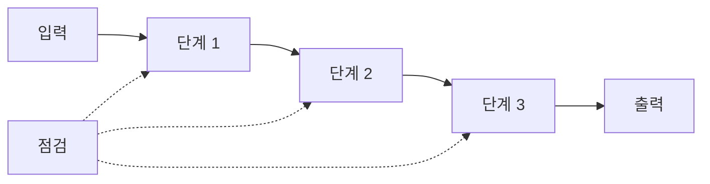
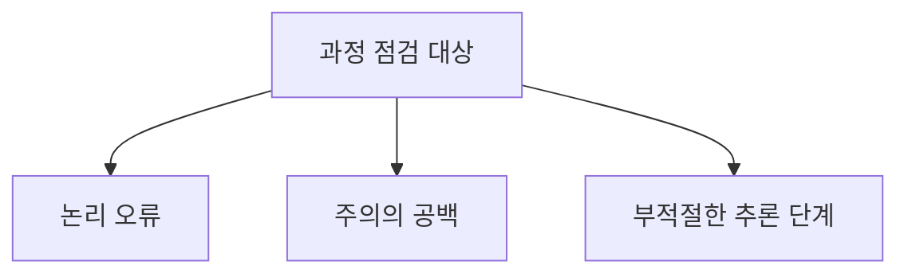

# 과정 평가

> **AI가 결과에 이른 방식**을 평가하는 역량(Process Discernment). 논리 오류, 주의 놓침, 부적절한 추론 단계를 찾는다. (Anthropic AI Fluency 용어 요약 열람 2026-11-28)

## 쉽게 말하면
수학 답이 맞아도 풀이 과정에서 우연히 맞은 건 아닌지 보는 것이다. 결과가 그럴듯해도 과정에 구멍이 있으면 다음에는 틀린다.

## 자세히
- 정의(문서): AI가 **출력에 이른 과정**을 평가해 **논리 오류, 주의의 공백, 부적절한 추론 단계**를 살핀다.
- 주의: AI가 보여 주는 생각이 실제 판단 근거와 다를 수 있다. Chen 외(arXiv 2505.05410, 초록 읽음)는 힌트 실험에서 모델이 힌트 사용을 밝히는 비율이 흔히 20% 미만이었다고 보고했다([생각의 충실성](#thinking-faithfulness)). 따라서 과정 평가는 "적힌 풀이를 읽는 것"만으로 충분하지 않고 결과 검증과 함께 해야 한다(내 해석).
- 과정 감독 연구: *Let's Verify Step by Step*(arXiv 2305.20050, 초록 읽음)은 수학에서 중간 단계에 피드백을 주는 과정 감독이 결과 감독보다 낫다고 보고했다([과정 보상 모델](#process-reward-model)). 사람이 AI의 단계를 점검하는 일도 같은 아이디어다.
- 실무 방법(내 제안): 단계별 근거를 요구하기, 핵심 가정에 번호 붙이기, 중간 결과를 독립 도구(계산기·코드)로 재계산, 다른 방식으로 같은 문제를 다시 풀어 비교.
- 한계: 과정이 보이지 않는 도구 호출·긴 에이전트 작업에서는 어렵다. 로그와 중간 산출물을 남기도록 설계한다.

## 그림으로 보기

## 예시
- AI가 낸 비용 계산에서 중간 가정(환율·세율)이 맞는지 단계별로 확인.
- 교육: AI의 풀이를 단계별로 나눠 "맞음/의심/틀림" 표시하는 실습.

## 헷갈리는 것과 비교
| 개념 | 차이 |
|---|---|
| 과정 평가 | 방식·단계 점검 |
| [결과물 평가](#product-discernment) | 산출물의 질 점검 |
| [생각의 충실성](#thinking-faithfulness) | 보인 과정이 실제 근거와 같은가 |

## 더 읽을거리
- [AI Fluency 용어 요약(Anthropic PDF)](https://www-cdn.anthropic.com/4396730ed190e691a3712cf2fd6bfe35509deca2.pdf) — 정의(읽음).
- [Reasoning Models Don't Always Say What They Think](https://arxiv.org/abs/2505.05410) — 보인 과정의 한계(초록 읽음).
