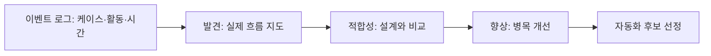
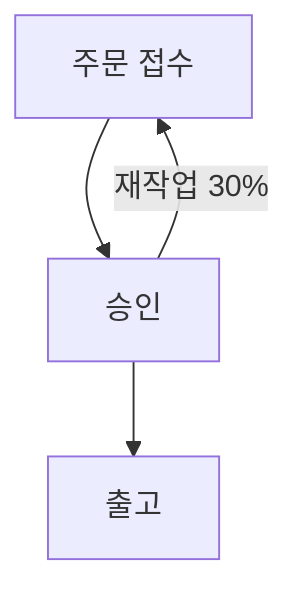

# 프로세스 마이닝

> **프로세스 마이닝**은 시스템에 남은 **이벤트 로그**에서 실제 업무 흐름을 찾아내고(발견), 설계와 비교하고(적합성 검사), 병목을 개선하는(향상) 기법이다. 자동화할 업무를 고르는 데 쓴다.

## 쉽게 말하면
회사 직원에게 "어떻게 일하세요?"라고 묻는 대신, 시스템에 남은 클릭·승인 기록을 따라가 실제 지도를 그려 보는 것이다. 사람들이 말하는 절차와 실제 절차가 다를 때가 많다.

## 자세히
(van der Aalst CACM 글 등 검색 요약 기반, 원문 전체는 열지 않음)
- **출발점**: 각 이벤트가 하나의 **활동**(업무 단계)과 하나의 **케이스**(프로세스 인스턴스)에 대응하는 이벤트 로그.
- **발견(discovery)**: 사전 모델 없이 로그에서 프로세스 모델을 만든다.
- **적합성 검사(conformance)**: 기존 모델과 로그를 비교해 어디서 어긋나는지 본다.
- **향상(enhancement)**: 모델에 시간 정보 등을 더해 병목을 드러낸다.
- 반 데르 알스트의 저서 부제가 "업무 프로세스의 발견·적합성·향상"이다. 남은 흐름 시간 예측, 다음 단계 추천 같은 기법도 소개된다.
- 상용 도구(Celonis 등)의 구현은 이 글에서 확인하지 않았다.
- 자동화 연결(일반 지식): 반복이 많고 변형이 적은 경로를 자동화 후보로, 병목·재작업 구간을 개선 후보로 삼는다.

## 그림으로 보기

## 예시
- 송장 처리 시스템 로그에서 "승인 후 반려→재입력" 경로가 잦다는 사실을 발견하고, 그 구간을 자동 검증 규칙으로 줄이기.

## 헷갈리는 것과 비교
| 개념 | 차이 |
|---|---|
| 프로세스 마이닝 | 로그로 실제 흐름 발견 |
| 업무 인터뷰·모델링 | 사람의 설명 기반 |
| RPA | 정해진 절차를 자동 수행 |
| [GUI 에이전트](#gui-agent) | 화면을 보고 조작하는 AI |

## 더 읽을거리
- [Process Mining (CACM)](https://cacm.acm.org/research/process-mining) — 발견·적합성·향상 개요.
- [Process mining (Wikipedia)](https://en.wikipedia.org/wiki/Process_mining)
