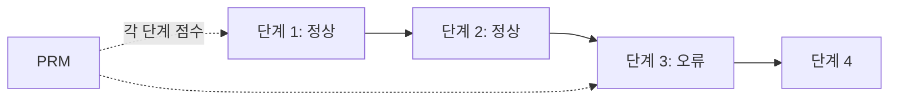
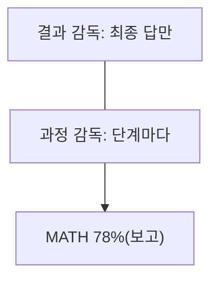

# 과정 보상 모델

> 최종 답이 아니라 **추론의 각 단계에 점수를 매기는** 보상(검증) 모델(PRM). 풀이 도중 어디서 틀렸는지 짚는다.

## 쉽게 말하면
수학 시험 채점에서 정답만 보고 O/X를 주는 것(결과 감독)과 풀이 한 줄 한 줄에 점수를 주는 것(과정 감독)의 차이다. 과정 채점은 "어느 줄에서 틀렸는지"를 알려 준다.

## 자세히
- 논문: Lightman 외 *Let's Verify Step by Step*(arXiv 2305.20050, 초록 읽음).
  - **결과 감독**은 최종 결과에만 보상, **과정 감독**은 중간 단계마다 피드백.
  - 저자들은 MATH 데이터셋 문제에서 "과정 감독이 결과 감독을 **크게 능가**한다"고 보고. 과정 감독 모델이 MATH 테스트셋의 대표 부분집합에서 **78%**를 풀었다.
  - **능동 학습**이 과정 감독을 더 개선했다.
  - **PRM800K**: 개별 추론 단계에 대한 **사람 라벨 80만 개**를 공개했고, 이 라벨로 최고 보상 모델을 학습했다.
- 쓰임: [Best-of-N](#best-of-n)에서 여러 풀이 중 단계별 점수가 좋은 것을 고르거나, [테스트 시점 연산](#test-time-compute)의 검증기로 쓴다(Snell 외 초록에서 "과정 기반 검증기 보상모델로 검색").
- 한계: 단계 라벨링 비용이 크다(PRM800K 80만 라벨이 그 규모를 보여 준다). 수학처럼 단계 구분이 분명한 영역에서의 결과이며 일반 과제로의 확장은 이 출처로 확인하지 못했다. 2023년 연구다.

## 그림으로 보기

## 예시
- 풀이 8개를 생성하고 PRM이 단계 점수 곱이 가장 높은 풀이를 선택.
- 교육: 같은 풀이에 결과 채점과 과정 채점을 해 보고 피드백의 차이를 비교.

## 헷갈리는 것과 비교
| 개념 | 차이 |
|---|---|
| 과정 보상 모델 | 단계별 점수 |
| 결과 보상 모델 | 최종 답 점수 |
| [검증 가능한 보상 RL](#rl-verifiable-rewards) | 정답 자동 채점으로 학습 |

## 더 읽을거리
- [Let's Verify Step by Step](https://arxiv.org/abs/2305.20050) — 과정 vs 결과 감독, PRM800K(초록 읽음).
