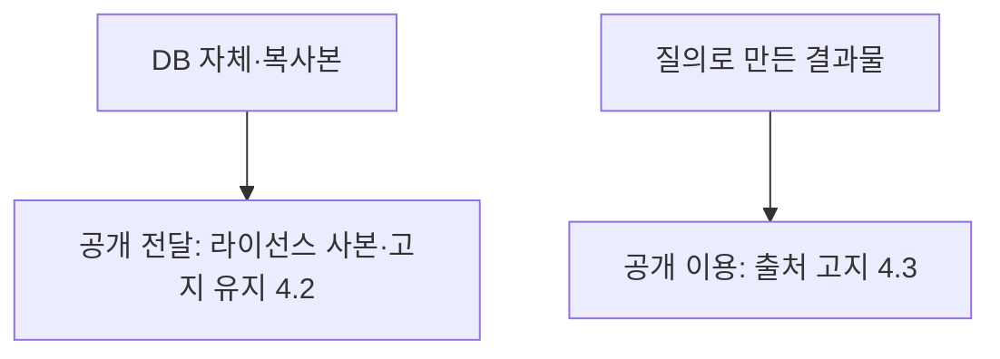

# 산출물(Produced Work) 정의

> ODC-By 1.0에서 **산출물(Produced Work)**은 데이터베이스 내용의 전부 또는 상당 부분을 **검색·질의 등으로 이용해 만든 작업물**이다. 데이터베이스 자체나 그 복사본이 아니라 거기서 뽑아 만든 결과물을 가리킨다. (법률 자문이 아니다.)

## 쉽게 말하면
도서관 카탈로그(데이터베이스)에서 조건에 맞는 책을 검색해 만든 "이달의 추천 도서 목록"이 산출물이다. 카탈로그를 통째로 복사한 것과는 다르다.

## 자세히
(ODC-By 1.0 전문 페이지를 직접 읽음)
- **정의(1.0)**: Produced Work는 "Contents의 **전부 또는 상당 부분(whole or a Substantial part)**을 검색이나 다른 질의로 이용해" 만든 작업물이다. Database는 체계적으로 배열된 자료의 모음, Contents는 그 안의 정보·저작물이다.
- **고지 규칙(4.3)**: 산출물을 **만드는 것**만으로는 고지가 필요 없다. 그러나 산출물을 **공개 이용(Publicly Use)**하면 그 산출물과 연결된 고지를 붙여 출처와 라이선스를 사람들이 알 수 있게 해야 한다. 전문의 예시 고지는 "Contains information from DATABASE NAME which is made available …"로 시작한다([산출물 고지 규칙](#produced-work-notice-rule), [공개적으로의 의미](#publicly-definition)).
- **데이터베이스 vs 산출물**: 데이터베이스(또는 파생 데이터베이스)를 공개 전달하면 라이선스 사본 포함과 기존 고지 유지(4.2)가 요구된다. 산출물은 더 가벼운 고지(4.3)다.
- **ODbL과의 차이**: ODbL 요약은 "수정한 데이터베이스나 그로부터 만든 작품을 공개 사용하면 수정 데이터베이스를 같은 조건으로 제공"하는 share-alike를 포함한다([Share-alike](#share-alike)). ODC-By에는 share-alike가 없다는 점이 큰 차이다.
- **AI 데이터에서의 예(제안, 법적 판단 아님)**: 
  | 결과물 | 산출물 여부(해석 후보) |
  |---|---|
  | 데이터셋에서 질의로 뽑은 통계 차트 | 산출물 후보 |
  | 데이터셋 일부를 재배포 | 데이터베이스 전달 후보 |
  | 데이터로 학습한 모델 | 산출물인지 파생물인지 쟁점 |
- **경계 질문**: "상당 부분"의 기준과 학습 모델의 지위는 정의만으로 결정되지 않는다. 이 글은 정의를 정리했을 뿐 결론을 내리지 않는다([학습 모델은 파생물인가](#model-as-derivative-question)).
- 한계: 전문의 정의를 읽었고 판례·관할별 해석은 확인하지 못했다.

## 그림으로 보기

## 예시
| 행위 | 적용 조항(전문 기준) |
|---|---|
| DB 사본 재배포 | 4.2 |
| 질의 결과 차트를 보고서에 게시 | 4.3 |
| 질의 결과를 내부에서만 사용 | 공개 이용이 아니면 고지 불필요(확인 필요) |
- 업무 장면: 교육 자료의 통계 슬라이드에 "Contains information from …" 형태의 출처 문구를 넣고, 법무에 문구 적절성을 확인한다.

## 헷갈리는 것과 비교
| 개념 | 차이 |
|---|---|
| 산출물 | 질의로 뽑아 만든 결과물 |
| 파생 데이터베이스 | 데이터베이스를 수정·확장한 또 다른 DB |
| [공개적으로의 의미](#publicly-definition) | 공개 여부의 기준 |
| [산출물 고지 규칙](#produced-work-notice-rule) | 공개 이용 시 지켜야 할 고지 |

## 더 읽을거리
- [ODC-By 1.0 전문](https://opendatacommons.org/licenses/by/1-0/) — 정의와 4.2·4.3(직접 읽음).
- [ODbL 요약](https://opendatacommons.org/licenses/odbl/summary/) — share-alike와의 대비(직접 읽음).
