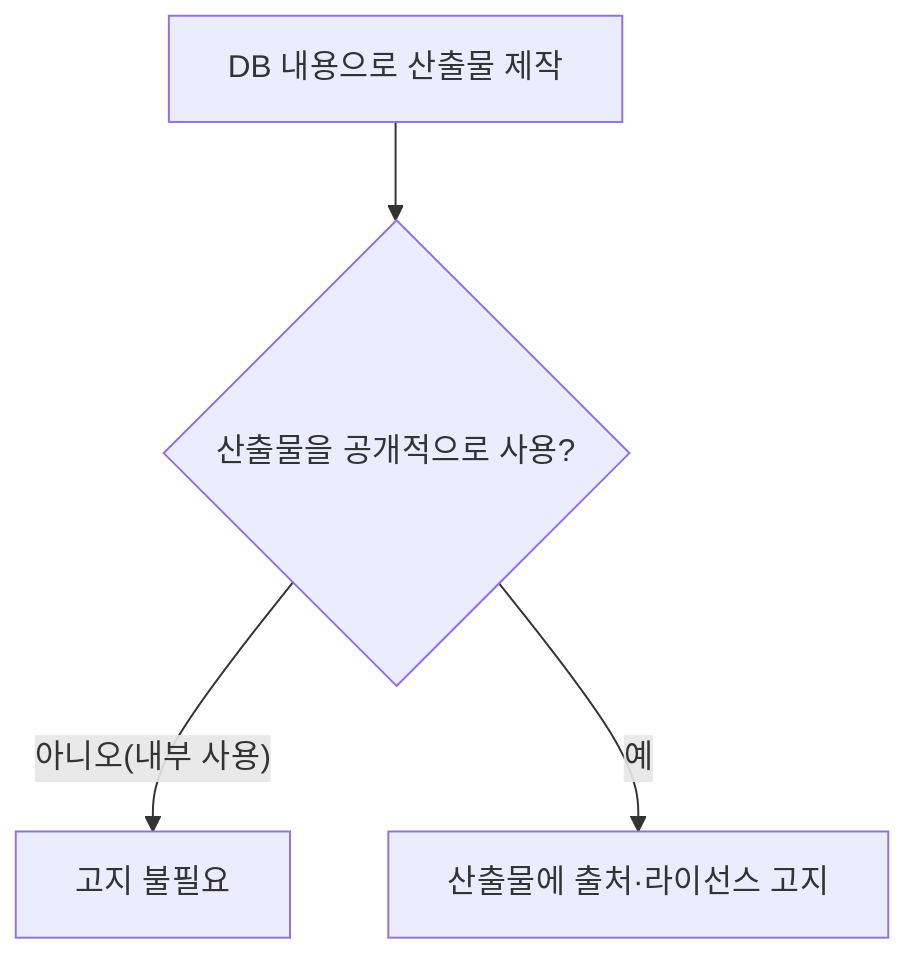
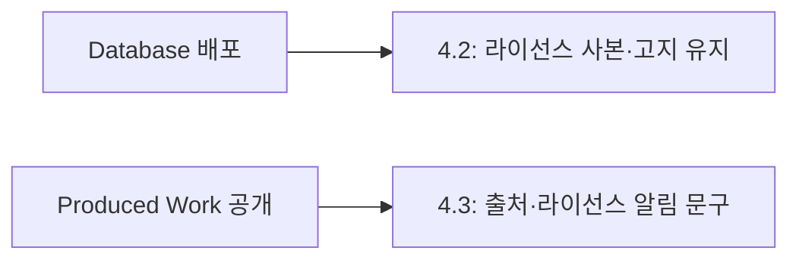

# 산출물 고지 의무

> ODC-By 라이선스에서 **데이터베이스 내용으로 만든 산출물(Produced Work)을 외부에 공개해 쓸 때**는, 산출물에 "이 정보는 해당 데이터베이스에서 얻었고 ODC 출처 표시 라이선스로 제공된다"는 고지를 붙여야 한다. 만드는 것·내부 사용만으로는 이 고지가 필요 없다.

## 쉽게 말하면
도서관 자료로 만든 전시 포스터를 일반에게 공개한다면 포스터에 "이 자료는 ○○ 도서관 자료로 만들었고 □□ 조건으로 제공된다"는 작은 글씨를 달아야 한다는 규칙이다. 집에서 혼자 보고 쓰는 정리 노트에는 필요 없다.

## 자세히
(ODC-By 1.0 라이선스 전문 4.2~4.3항과 정의 조항을 직접 읽음. 법률 자문이 아니며 정확한 의무는 전문과 데이터셋 약관을 확인한다)
- **산출물(Produced Work)의 정의**: 이 데이터베이스(또는 파생 DB·집합 DB의 일부)의 **내용의 전부 또는 상당 부분을 검색·질의로 이용해** 만든 이미지·영상·텍스트·소리 같은 작업물.
- **4.3 산출물 고지**: 산출물을 **만들고 쓰는 것** 자체는 4.2항의 고지가 필요 없다. 하지만 **산출물을 "공개적으로(Publicly)" 사용**하면 산출물과 연결된 고지를 포함해야 한다. 고지는 산출물을 사용·열람·접근하는 사람이 **내용이 그 데이터베이스에서 얻어졌고 이 라이선스로 제공된다는 점을 알 수 있게** 합리적으로 설계돼야 한다.
- **"공개적으로"의 의미**: 자신 또는 지분 50% 초과·활동 지휘권이 있는 통제 하의 사람이 **아닌** 사람에게(예: 독립 컨설턴트와 계약해도 통제 하로 봄) 사용하는 것.
- **예시 고지 문구(전문)**: "Contains information from DATABASE NAME which is made available under the ODC Attribution License." DATABASE NAME 자리에 데이터베이스 이름과 위치 링크를, "ODC Attribution License"에는 라이선스 URI 링크를 넣고, 링크가 불가능하면 URI를 평문으로 적는다.
- **4.2 데이터베이스 자체를 공개 배포할 때**: ① 이 라이선스 조건으로만 배포 ② 라이선스 사본 또는 URI 포함 ③ 저작권·데이터베이스권·라이선스 관련 고지 유지 ④ 파일 구조상 고지가 어려우면 사용자가 볼 만한 위치(디렉터리 등)에 포함.
- 모델에 적용하는 해석(제안, 법적으로 확정되지 않음): ODC-By 데이터(예: FineWeb)로 학습한 모델이나 그 출력이 "산출물"에 해당하는지는 법적 해석 문제다. 안전하게는 모델 카드·문서에 데이터 출처와 라이선스를 표시하고 약관(Common Crawl 이용약관 병행)을 확인한다([FineWeb 이용 조건](#fineweb-pii-removal)).

## 그림으로 보기



## 예시
```
Contains information from FineWeb (https://huggingface.co/datasets/HuggingFaceFW/fineweb)
which is made available under the ODC Attribution License (https://opendatacommons.org/licenses/by/1-0/).
```
- 웹 데이터에서 뽑은 통계 차트를 보고서로 공개할 때 하단에 위 형식의 고지를 넣는다(예시 문구는 라이선스 문구를 바탕으로 한 제안).
- 교육: 데이터 라이선스는 "받을 때"뿐 아니라 "결과물을 낼 때"도 의무가 생긴다는 설명.

## 헷갈리는 것과 비교
| 개념 | 차이 |
|---|---|
| 4.2 고지 | DB 자체를 공개 배포할 때 |
| 4.3 고지 | 산출물을 공개 사용할 때 |
| 내부 사용 | 고지 불필요(공개가 아니므로) |
| [ODC-By vs 다른 라이선스](#odc-by-vs-cc-by-odbl) | 출처 표시 의무 비교 |

## 더 읽을거리
- [ODC-By 1.0 전문](https://opendatacommons.org/licenses/by/1-0/) — 4.2·4.3항과 정의(읽음).
