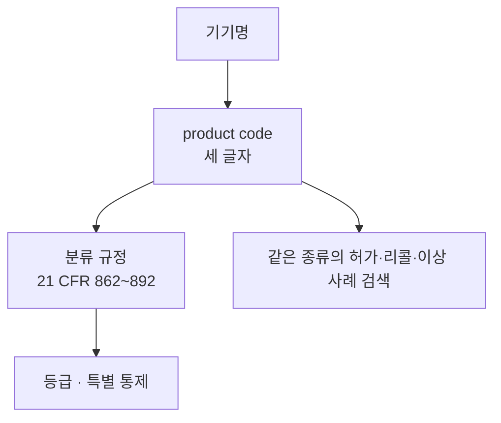

# 제품 코드

> FDA가 의료기기를 일반 범주별로 식별하는 코드. 기기명과 함께 쓰여 그 기기의 "일반적인 종류"를 가리키며, 21 CFR 862~892의 기기 분류 규정에 근거한다. 허가 조사에서 같은 종류의 기기를 모아 찾는 열쇠다.

## 쉽게 말하면
도서관의 분류 기호와 같다. 책 제목이 달라도 같은 분류 기호가 붙어 있으면 같은 서가에 꽂혀 있다. product code가 같은 기기들은 같은 종류의 기기로 취급되며, 서로의 predicate가 되기 쉽다.

## 자세히
출처: FDA Product Classification Database 안내 페이지(열어서 읽음), 21 CFR 892.2060(eCFR, 열어서 읽음), 앞서 읽은 Innolitics·FDA 시험 기대 해설.
- **정의(FDA 페이지)**: 기기명과 product code가 함께 "FDA에 대한 기기의 일반 범주를 식별"한다. 코드는 21 CFR Parts 862~892의 의료기기 분류에 기반한다.
- **데이터베이스**: CDRH가 관리하는 Product Classification Database가 기기명과 product code 등 관련 정보를 담고, 매주 일요일 갱신되며 온라인 검색과 내려받기가 된다.
- **이 페이지에 없던 것**: 코드가 세 글자라는 형식, 심사 패널·등급과의 연결은 해당 페이지가 설명하지 않았다. 세 글자 형식은 다른 FDA 페이지(의료기기 DB 목록)에서 확인했다.
- **연결 예(검색·해설 자료)**: 영상 AI 소프트웨어의 CADe는 코드 MYN(892.2070), CADx는 POK(892.2060), 분류(triage)는 QAS·QFM(892.2080) 등으로 소개된다(Innolitics 해설, 개별 코드는 FDA DB에서 재확인 필요).
- **AI 조사에서의 쓰임**: 같은 product code의 허가 건수·predicate·리콜·이상 사례를 모아 보고, 특별 통제가 무엇인지 해당 CFR 조문에서 확인한다([분류 규정](#classification-regulation)).
- **허가 비교 시 주의**: 다른 product code의 predicate를 인용하는 사례가 AI 510(k)에 적지 않다는 분석이 있다([predicate 사슬 문제](#predicate-creep)).

## 그림으로 보기

## 예시
- 연구: 관심 코드 하나를 510(k) DB에서 검색해 최근 3년 AI 기기 허가를 표로 만들고, 각 기기의 predicate 코드가 같은지 확인.
- 점검: 후보 AI 기기의 product code를 찾아 분류 규정 조문을 열어 필수 시험(예: 독자 연구)을 확인.

## 헷갈리는 것과 비교
| 개념 | 차이 |
|---|---|
| product code | 기기 종류 식별 코드 |
| 허가 번호(K·DEN·P) | 개별 제출 건 식별 번호 |
| [분류 규정](#classification-regulation) | 코드가 근거하는 법 조문 |
| [FDA 기기 데이터베이스](#fda-device-database) | 코드로 검색하는 도구 |

## 더 읽을거리
- [Product Classification Database (FDA)](https://www.fda.gov/medical-devices/classify-your-medical-device/product-code-classification-database) — product code 정의(열어서 확인)
- [21 CFR 892.2060 (eCFR)](https://www.ecfr.gov/current/title-21/chapter-I/subchapter-H/part-892/subpart-B/section-892.2060) — 코드에 연결된 분류 규정 예(열어서 확인)
