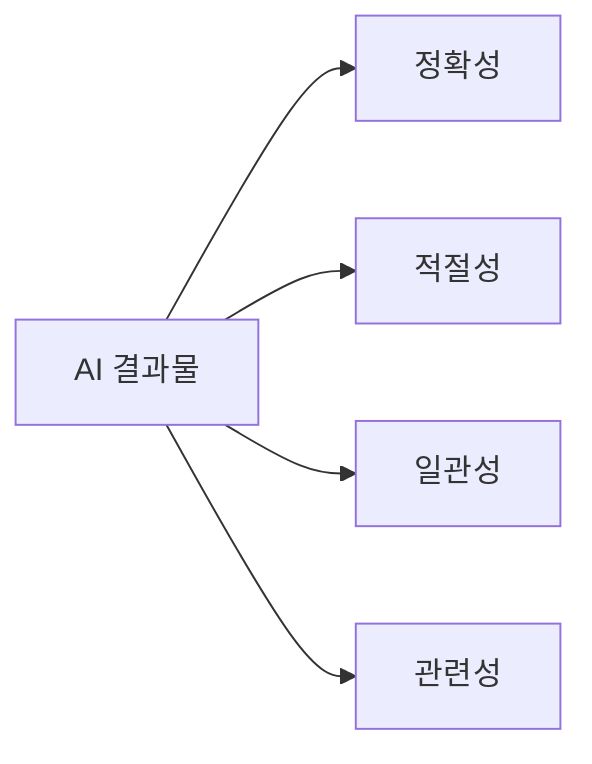
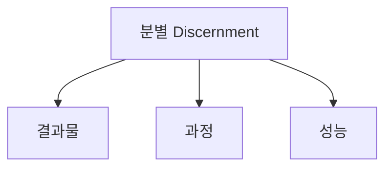

# 결과물 평가

> **AI가 만든 결과물의 질을 비판적으로 평가하는 역량**(Product Discernment). 정확성·적절성·일관성·관련성을 점검한다. (Anthropic AI Fluency 용어 요약 열람 2026-11-28)

## 쉽게 말하면
신입이 낸 보고서를 상사가 검토하듯, AI 답을 받자마자 쓰지 않고 "이게 맞나, 우리 상황에 맞나, 앞뒤가 맞나"를 따져 보는 일이다.

## 자세히
- 정의(문서): 분별(Discernment) 전체는 AI의 **결과물, 과정, 행동, 상호작용을 사려 깊고 비판적으로 평가**하는 것. 그중 결과물 평가는 AI가 만든 것의 질을 **정확성, 적절성, 일관성, 관련성** 관점에서 보는 것이다.
- 분별의 세 갈래(문서): 결과물 분별, [과정 분별](#process-discernment)(AI가 결과에 이른 방식), 성능 분별(상호작용 중 AI의 태도·소통 방식이 내게 효과적인가).
- 체크 질문(내 정리): ① 사실·수치·인용이 맞는가 ② 내가 요청한 형식·독자·톤에 맞는가 ③ 문서 안에서 모순이 없는가 ④ 빠뜨린 것이 없는가 ⑤ 근거를 확인했는가.
- 연결: 검증 단계는 [검증 체크리스트](#verification-checklist)로 구체화한다. 이 문서의 4D 중 책임(Diligence)의 "배포 diligence"는 **내가 쓰거나 공유하는 결과를 검증하고 보증할 책임**이라고 설명한다.
- 한계: 이 문서는 개념 정의 수준이며 구체 평가 절차나 수치는 제시하지 않는다.

## 그림으로 보기

## 예시
- AI가 쓴 시장 보고서의 통계 3개를 원 출처에서 직접 확인하고 형식이 요청과 맞는지 점검.
- 교육: AI 답에 일부러 오류를 숨겨 두고 수강생이 찾아내는 훈련.

## 헷갈리는 것과 비교
| 개념 | 차이 |
|---|---|
| 결과물 평가 | 무엇이 나왔는가 |
| [과정 평가](#process-discernment) | 어떻게 나왔는가 |
| [설명하기 역량](#description-skill) | 요청 단계의 역량, 평가와 짝 |

## 더 읽을거리
- [AI Fluency 용어 요약(Anthropic PDF)](https://www-cdn.anthropic.com/4396730ed190e691a3712cf2fd6bfe35509deca2.pdf) — 분별의 정의(읽음).
