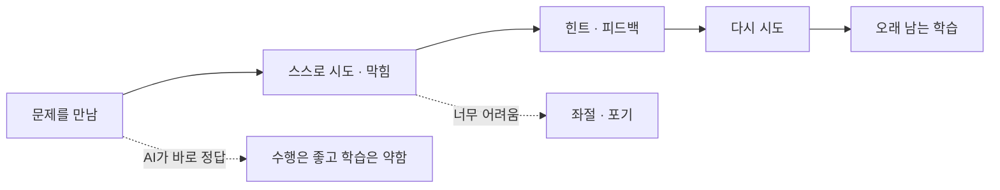

# 생산적 어려움

> 생산적 어려움은 학습자가 스스로 끙끙대며 풀어 보는 적당한 막힘으로, 당장은 성적이 덜 나와도 오래 남는 학습을 만드는 어려움이다.

## 쉽게 말하면
헬스장에서 기구를 대신 들어 주면 운동이 안 되는 것과 같다. 근육은 적당히 무거울 때 자란다. 공부도 머릿속에서 끄집어내고 헷갈려 보는 과정이 있어야 기억이 굳는다. 다만 너무 무거우면 다치므로 "적당히"가 핵심이다.

## 자세히
- Bjork 부부의 **바람직한 어려움(desirable difficulties)** 틀: 간격 두기·섞어 풀기(interleaving)·인출 연습(retrieval practice) 같은 어려움은 연습 중 수행을 낮추지만 장기 학습을 높인다.
- "바람직한" 어려움과 "비생산적" 어려움을 구분한다. 인출·구별·직접 생성을 요구하면 생산적이고, 불친절한 지시나 쓸데없는 복잡함은 그냥 좌절이다. 초보자는 오류를 스스로 진단하지 못하므로 피드백을 아예 끊으면 혼란만 커진다.
- AI는 매끈한 정답을 즉시 줘서 이 어려움을 없애기 쉽다. 반대로 잘 설계된 튜터는 학습자를 적당한 난이도에 붙들어 둘 수 있다(주장: 블로그 수준 논거가 많아 원 연구 확인 필요).
- 튜터 설계 연결: [AI 튜터 가드레일](#ai-tutor-guardrails)의 힌트 단계화는 "막힘은 두되 포기하지 않게" 하는 장치다.

## 그림으로 보기

## 예시
- 프롬프트: "답을 알려 주지 말고, 내가 푼 풀이의 첫 번째 막힌 지점만 질문으로 짚어 줘."
- 수업 설계: AI 사용 전에 5분 동안 혼자 풀기 → 막힌 부분만 AI에게 힌트 요청.

## 헷갈리는 것과 비교
| 개념 | 차이 |
|---|---|
| 생산적 어려움 | 인출·생성을 요구해 학습을 키움 |
| 비생산적 어려움 | 지시가 불명확하거나 피드백이 없어 좌절만 줌 |
| [AI 목발 효과](#ai-as-crutch) | 어려움을 AI가 대신 없애 생기는 결과 |
| [학습 vs 수행](#learning-vs-performance) | 어려움이 수행은 낮추고 학습은 높이는 이유 |

## 더 읽을거리
- [Retrieval Practice and Desirable Difficulty (iatrox)](https://www.iatrox.com/blog/retrieval-practice-desirable-difficulty-revision-science) — 인출 연습과 바람직한 어려움 개요(2차 정리).
- [World Bank blog: Is AI making us smarter or just making us look smart](https://blogs.worldbank.org/en/education/is-ai-making-us-smarter-or-just-making-us-look-smart-) — 수행과 학습의 차이를 AI 맥락에서 논함.
