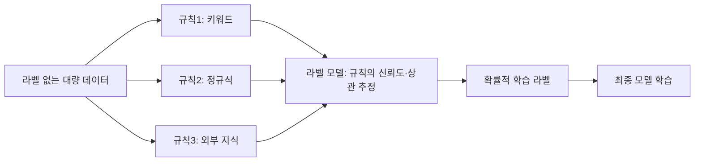
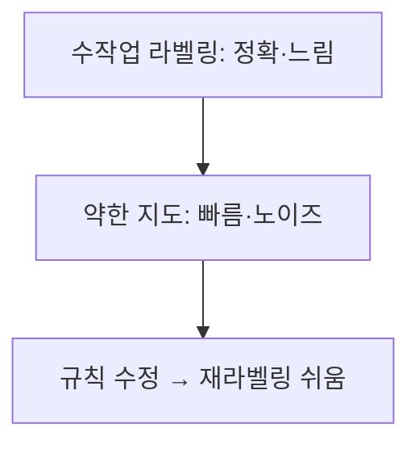

# 데이터 프로그래밍(Snorkel)

> 사람이 샘플마다 손으로 라벨을 다는 대신, "이 키워드가 있으면 스팸" 같은 규칙(라벨링 함수) 여러 개를 코드로 써서 대량의 데이터에 노이즈 섞인 라벨을 자동으로 붙이고, 그 노이즈를 통계 모델로 정리해 학습용 라벨을 만드는 방식이다. 약한 지도(weak supervision)의 대표 사례다.

## 쉽게 말하면
심사위원 100명을 구하는 대신 "허술한 심사 규칙" 수십 개를 만들어 모두에게 적용한다. 규칙 하나하나는 자주 틀리지만, 서로 어긋나는 정도와 겹치는 정도를 보고 "이 규칙은 믿을 만하다"를 계산해 하나의 점수로 합치는 것이다.

## 자세히
- **Snorkel 논문(Ratner 등, 2017, arXiv:1711.10160, 초록 직접 확인)**: 사용자가 정확도와 상관관계를 모르는 **임의의 휴리스틱**을 라벨링 함수로 표현하면, Snorkel이 정답 라벨 없이 이 노이즈 출력들을 데이터 프로그래밍으로 결합한다. 초록이 보고한 수치(논문 주장):
  - 사용자 연구에서 도메인 전문가가 7시간 손 라벨링보다 **2.8배 빠르게** 모델을 만들고 예측 성능이 평균 **45.5% 향상**.
  - 미국 보훈부·FDA와의 협업 2건과 공개 텍스트·이미지 데이터셋 4건에서 기존 휴리스틱 방식보다 평균 **132%** 성능 향상, 대규모 수작업 라벨 데이터로 학습한 모델에 평균 **3.60% 이내**로 근접.
  - 모델링 트레이드오프 최적화기로 파이프라인 실행당 최대 1.8배 속도 향상.
- **오픈소스 저장소 현황(README 직접 확인)**: 학습 데이터를 프로그래밍 방식으로 만들고 관리하는 시스템. Python 3.11 이상, `pip install snorkel` 또는 `conda install snorkel -c conda-forge`. 윈도우는 Docker나 WSL 권장. **프로젝트가 팀의 주력이 아니며** 상용 플랫폼 Snorkel Flow에 집중한다는 공지가 있고, 저장소는 여전히 이슈·PR을 받는다. 이 README에는 `@labeling_function`이나 LabelModel 설명·예제 코드가 없어 API 세부는 확인하지 못했다(튜토리얼 페이지는 403).
- **AltexSoft 정리**: 데이터 프로그래밍은 라벨링 함수 스크립트로 자동 라벨링하는 방식이며 수작업 라벨보다 덜 정확할 수 있다([데이터 라벨링](#data-labeling)).
- **강점·한계(일반적 이해)**: 규칙을 고치면 전체 데이터를 다시 라벨링할 수 있어 반복이 빠르다. 반면 규칙이 포착하지 못하는 사례(커버리지 밖)는 라벨이 없고, 규칙이 서로 같은 편향을 공유하면 합쳐도 편향이 남는다.
- **LLM 시대의 변화(제안)**: 라벨링 함수 자리에 "LLM 프롬프트"를 넣는 방식이 늘었으나 이번 조사에서 별도 출처를 확인하지 못했다.

## 그림으로 보기

## 예시
- 상담 로그 "환불 의도" 라벨: 규칙 ① "환불" 단어 ② "취소"+"결제" 동시 등장 ③ 반품 번호 패턴. 어느 규칙도 100%는 아니지만 합쳐 5만 건에 초벌 라벨을 붙이고, 표본 200건을 사람이 검수해 정확도를 확인한다(제안).
- 교육 소재: "허술한 규칙 여러 개 + 합치는 모델"이 사람 라벨의 대안이 되는 이유를 심사위원 비유로 설명.

## 헷갈리는 것과 비교
| 개념 | 차이 |
|---|---|
| 데이터 프로그래밍 | 규칙으로 노이즈 라벨 생성 후 정리 |
| [모델 보조 사전 라벨링](#model-assisted-prelabeling) | 모델이 라벨, 사람이 검수 |
| [데이터 라벨링](#data-labeling) | 상위 개념(모든 방식 포함) |
| 합성 데이터 | 데이터 자체를 생성 |

## 더 읽을거리
- [Snorkel: Rapid Training Data Creation with Weak Supervision (arXiv:1711.10160)](https://arxiv.org/abs/1711.10160) — 라벨링 함수와 약한 지도 결과(초록 직접 확인).
- [snorkel-team/snorkel](https://github.com/snorkel-team/snorkel) — 설치와 프로젝트 현황(README 직접 확인).
