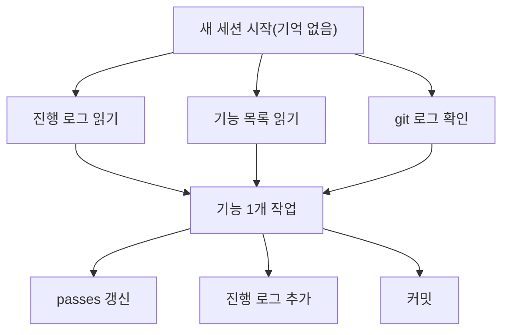

# 진행 로그와 기능 목록

> 기억이 없는 AI 세션들이 **일을 이어 가도록 저장소에 남기는 두 가지 문서**: ① 지금까지 한 일을 적는 **진행 로그**, ② 해야 할 기능과 완료 여부를 적는 **기능 목록**. 대화 기록이 아니라 **파일**이 세션 사이의 공식 인수인계 수단이다.

## 쉽게 말하면
교대 근무자가 매번 기억을 잃는 병원이라고 상상해 보자. 그래서 환자 차트(기능 목록)와 인수인계 노트(진행 로그)를 반드시 쓴다. 다음 근무자는 차트와 노트만 읽고 일을 이어 간다.

## 자세히
(Anthropic Engineering, "Effective harnesses for long-running agents" 기준)
- **진행 로그** `claude-progress.txt`: 초기화 에이전트가 만들고, 이후 코딩 에이전트가 세션마다 한 일을 덧붙인다. git 로그와 함께 읽어 "어디까지 했는지"를 파악한다.
- **기능 목록**(JSON): 요구사항 200개 이상을 처음엔 전부 "실패"로 두고, 항목마다 카테고리·설명·테스트 단계·`passes`를 둔다. 코딩 에이전트는 **`passes`만 수정 가능**하게 하여 항목을 지우거나 고쳐 쓰는 것을 막는다. 모델이 JSON을 마크다운보다 덜 엉성하게 덮어써서 JSON을 선택했다고 한다.
- **함께 쓰는 것**: git 커밋(되돌리기 가능한 이력), `init.sh`(개발 서버 시작), 세션 시작 루틴(노트·로그·목록 읽기 → 기본 E2E 테스트).
- **OpenAI의 변형**(2026-02): 복잡한 작업은 진행·결정 로그가 있는 **실행 계획(exec plan)** 을 `docs/exec-plans/active|completed/`에 커밋하고, `tech-debt-tracker.md`로 부채를 추적한다. 저장소 밖(Slack·구글 문서)에 있는 지식은 에이전트에게 "존재하지 않는" 것이므로 저장소에 넣어야 한다.
- **좋은 진행 로그의 성질**(실무 정리): 날짜·무엇을·왜·다음 할 일, 실패한 시도와 이유, 알려진 문제. 한 줄로 시작해 길어지면 요약. 사람도 읽을 수 있어야 한다.
- 한계: 로그가 길어지면 읽는 비용이 늘고 낡을 수 있으므로 정기적으로 요약·정리한다([드리프트 감지 루프](#drift-detection)).

## 그림으로 보기


## 예시
```markdown
# claude-progress.txt
2026-11-25 세션 3: F012 로그인 잠금 구현, 테스트 통과, passes=true.
  - 시도 실패: 쿠키 기반 잠금은 새로고침에서 풀림 → 서버 저장으로 변경
  - 다음: F013 비밀번호 재설정 메일
  - 알려진 문제: 모달 알림창은 E2E에서 감지 불가
```
- 일상 업무 응용: 긴 보고서를 AI와 며칠에 걸쳐 쓸 때 "진행 노트"와 "남은 작업 체크리스트" 파일을 항상 같이 둔다.

## 헷갈리는 것과 비교
| 개념 | 차이 |
|---|---|
| 진행 로그 | 한 일·다음 할 일을 적는 서술 기록 |
| 기능 목록 | 할 일 전체와 완료 여부(상태 중심) |
| [초기화·코딩 에이전트 패턴](#initializer-coding-agent) | 이 두 문서를 만드는 하네스 구조 |
| [작업 분해](#tasks-breakdown) | 기능 목록의 항목을 쪼개는 기술 |

## 더 읽을거리
- [Anthropic: Effective harnesses for long-running agents](https://www.anthropic.com/engineering/effective-harnesses-for-long-running-agents) — 진행 로그와 기능 목록 설계.
- [OpenAI: Harness engineering](https://openai.com/index/harness-engineering/) — 실행 계획과 기술 부채 추적.
