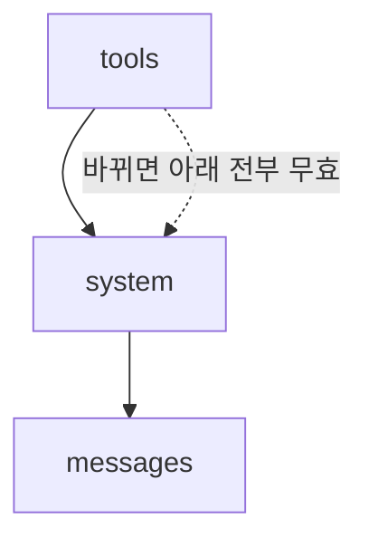

# 프롬프트 캐싱

> 요청마다 반복되는 앞부분(도구·시스템 프롬프트·긴 문서)을 서버에 저장해 두고 재사용해 비용과 지연을 줄이는 기능.

## 쉽게 말하면
매번 같은 교재 50쪽을 처음부터 다시 읽고 질문에 답하는 대신, 읽어 둔 상태를 메모해 두었다가 질문만 새로 받는 것이다. 메모를 읽는 값은 처음 읽는 값보다 훨씬 싸다.

## 자세히
Anthropic 공식 문서(2026-11 확인) 기준:
- 캐시 순서는 `tools` → `system` → `messages`. 한 단계가 바뀌면 그 뒤 전부 무효화된다(도구 정의를 고치면 전체 무효).
- 켜는 법: 최상위 `cache_control: {"type":"ephemeral"}`(자동) 또는 블록별 명시적 중단점(최대 4개).
- TTL: 기본 5분(읽을 때마다 연장), `ttl: "1h"` 선택 가능.
- 가격(기본 입력가 대비): 5분 쓰기 1.25배, 1시간 쓰기 2배, 읽기 0.1배(Opus 5.5·Sonnet 5.5는 0.05배, Fable 5.1은 0.025배).
- 최소 길이: 최신 모델 512토큰, 구형 1,024~4,096토큰. 미달이면 에러 없이 캐시가 안 된다.
- 확인: 응답 usage의 `cache_creation_input_tokens`, `cache_read_input_tokens`.
- 타임스탬프처럼 매번 바뀌는 내용 앞에 중단점을 두지 않는다. 병렬 요청은 첫 응답이 시작된 뒤에야 캐시를 읽을 수 있다.

## 그림으로 보기

## 예시
고객 지원 봇의 긴 정책 문서(3만 토큰)를 system에 두고 `cache_control`을 붙이면, 5분 안의 후속 질문은 그 부분을 싸게 읽는다.

## 헷갈리는 것과 비교
| 개념 | 차이 |
| --- | --- |
| 프롬프트 캐싱 | 서버가 입력 prefix 처리를 재사용, 비용 절감 |
| [KV 캐시](#kv-cache) | 모델 내부 어텐션 상태. 프롬프트 캐싱의 기술 기반 |
| 응답 캐시 | 같은 질문의 답 자체를 저장. 생성은 그대로 새로 함 |

## 더 읽을거리
- [Prompt caching (Claude docs)](https://platform.claude.com/docs/en/build-with-claude/prompt-caching) — 공식 사용법과 가격
