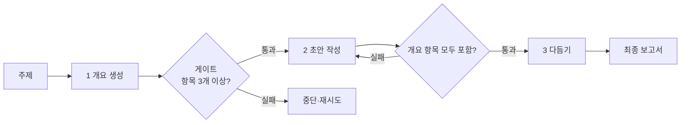

# 체이닝 실습: 보고서 3단계

> **개요 → 초안 → 다듬기**처럼 큰 작업을 고정된 순서의 작은 LLM 호출로 나누고, 단계 사이에 **자동 점검(게이트)** 을 끼우는 실습. Anthropic은 프롬프트 체이닝을 "지연 시간을 조금 내주고 정확도를 얻는 방식"으로 설명한다.

## 쉽게 말하면
보고서를 한 번에 "완성본"으로 쓰라고 하면 흔들리지만, 먼저 목차만 받아 확인하고, 그 목차로 초안을 쓰고, 마지막에 다듬게 하면 중간에 잘못된 방향을 일찍 잡을 수 있다. 공장 조립라인에서 단계마다 검수하는 것과 같다.

## 자세히
(Anthropic "Building effective agents"의 프롬프트 체이닝 정의 기준 + 직접 실행)
- **정의**: 작업을 **고정된 순서의 LLM 호출**로 나누고 각 호출이 앞 출력을 처리하며, 단계 사이에 **프로그램적 검사**를 둘 수 있다. 예로 문서 작성 시 "개요 작성 → 검증 → 본문 작성", 마케팅 문구 작성 후 번역이 든다.
- **언제 쓰나**: 작업이 깔끔하게 고정된 하위 단계로 쪼개질 때. 각 호출을 더 쉬운 일로 만들어 정확도를 높인다.
- **3단계 실습 설계**:

| 단계 | 입력 | 출력 | 게이트(자동 점검) |
|---|---|---|---|
| 1 개요 생성 | 주제 | 항목 3개 이상의 개요 | 항목 수·형식 확인 |
| 2 초안 작성 | 개요 | 항목별 문단 초안 | 개요 항목이 모두 포함됐는가 |
| 3 다듬기 | 초안 | 문체·오탈자 교정본 | 길이 한도·금칙어 점검 |

- **직접 실행한 구조 시연**(LLM 대신 가짜 함수로 흐름만 확인): ① `개요 생성` → `1. 배경 2. 문제 3. 제안`, ② **게이트**(마침표 3개 이상) 통과, ③ `초안 작성` → "배경... 문제... 제안...", ④ `다듬기` → "[교정됨] …". 게이트에 실패하면 `SystemExit`로 **중단**하는 코드도 포함했다. 실제 LLM에서는 각 단계의 품질이 별도로 달라지므로 게이트 설계가 핵심이다.
- **장단점**: 장점은 디버깅 쉬움(어느 단계가 틀렸는지 보임)·단계별 프롬프트 최적화·중간 사람 검토 삽입. 단점은 호출 수 증가로 **지연과 비용 증가**. Anthropic은 "가장 단순한 해법부터, 필요할 때만 복잡도를 더하라"고 조언하며, 많은 작업은 검색과 예시를 곁들인 **LLM 호출 한 번**으로 충분하다고 말한다.
- **팁**: 단계 사이 데이터는 **구조화된 형식(JSON·마크다운 목록)** 으로 넘기면 게이트 검사가 쉽다([JSON](#json-format)).

## 그림으로 보기


## 예시
```python
outline = llm("개요: 신규 서비스 보고서")
if outline.count(".") < 3:
    raise SystemExit("게이트 실패: 개요 부족")
draft = llm("초안: " + outline)
final = llm("다듬기: " + draft)
```
- 업무 응용: 회의록 → ①결정 사항 추출(JSON) → ②담당자별 할 일 표 → ③팀장용 3줄 요약.

## 헷갈리는 것과 비교
| 개념 | 차이 |
|---|---|
| 프롬프트 체이닝 | 고정된 단계 순서 |
| [라우팅](#routing-pattern) | 입력을 분류해 다른 경로로 |
| [Self-Refine](#self-refine) | 같은 결과를 반복 개선 |
| [오케스트레이터-워커](#orchestrator-workers) | 중앙이 하위 작업을 동적으로 결정 |

## 더 읽을거리
- [Anthropic: Building effective agents](https://www.anthropic.com/engineering/building-effective-agents) — 프롬프트 체이닝과 단순함 원칙.
