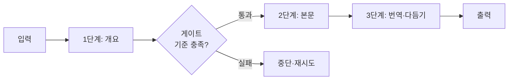

# 프롬프트 체이닝

> 큰 작업을 고정된 단계로 쪼개 한 LLM 호출의 출력을 다음 호출의 입력으로 넘기는 워크플로 패턴.

## 쉽게 말하면
조립 라인이다. 한 사람이 처음부터 끝까지 만들지 않고, 개요 담당 → 초안 담당 → 번역 담당이 차례로 맡는다. 각자 단순한 일이라 실수가 줄지만, 줄이 길어 시간은 더 걸린다.

## 자세히
Anthropic "Building effective agents" 기준:
- 작업이 **고정된 하위 작업**으로 깔끔히 나뉠 때 적합. 호출마다 단순해져 지연을 조금 늘리는 대신 정확도를 높인다.
- **게이트(gate)**: 중간에 코드로 하는 검사. 개요가 기준을 충족해야 다음 단계로 넘어간다.
- 예: 마케팅 문구 생성 → 다른 언어로 번역 / 개요 작성 → 기준 확인 → 개요대로 본문 작성.
- 경로가 코드로 정해지므로 [에이전트 루프](#agent-loop)와 달리 예측 가능하다([워크플로 vs 에이전트](#workflow-vs-agent)).

## 그림으로 보기

## 예시
- 보고서: ① 자료에서 핵심 수치 추출 → ② 표 생성 → ③ 경영진용 요약.
- 게이트 예: 추출한 수치가 JSON 형식인지 코드로 검사.

## 헷갈리는 것과 비교
| 개념 | 차이 |
| --- | --- |
| 프롬프트 체이닝 | 고정 순서 단계 |
| [라우팅](#routing-pattern) | 입력에 따라 갈림길 선택 |
| [에이전트 루프](#agent-loop) | 모델이 다음 행동을 스스로 결정 |

## 더 읽을거리
- [Building effective agents (Anthropic)](https://www.anthropic.com/engineering/building-effective-agents) — 워크플로 패턴 5종
