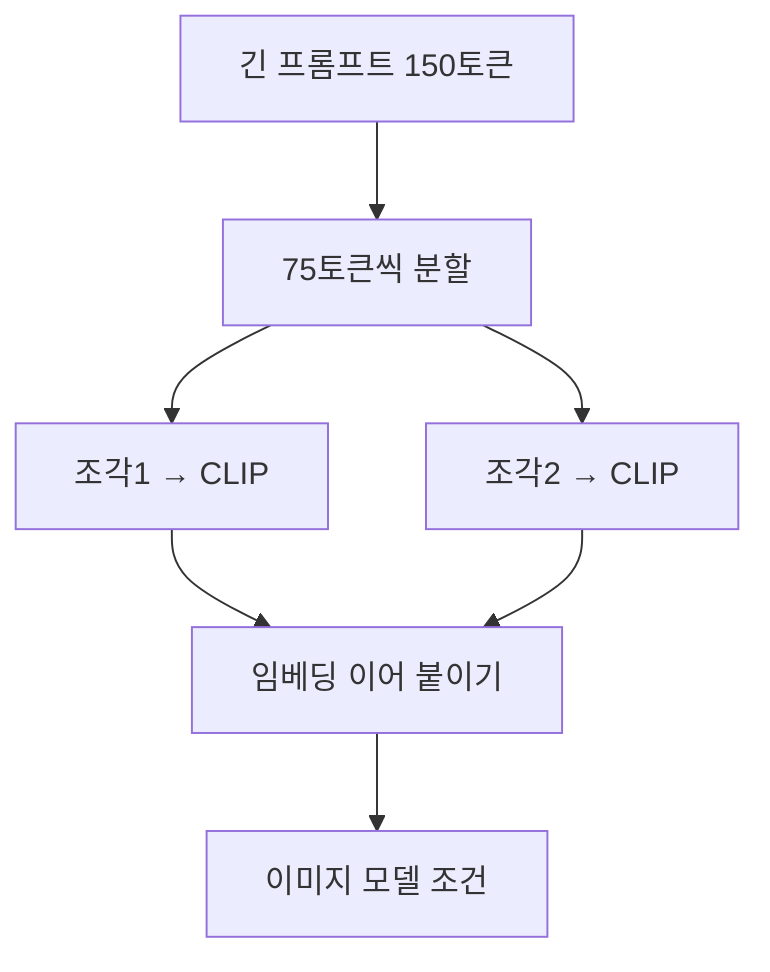

# 프롬프트 청킹

> 프롬프트 청킹은 인코더의 길이 한계(CLIP은 77토큰)를 넘는 긴 프롬프트를 조각(chunk)으로 나눠 각각 인코딩한 뒤 이어 붙이는 우회 방법이다.

## 쉽게 말하면
엽서에는 글자가 열 줄밖에 안 들어간다고 하자. 긴 편지를 여러 장의 엽서에 나눠 쓰고 한 묶음으로 보내는 것이 청킹이다. 대신 엽서 사이가 끊겨 문장이 중간에서 갈릴 수 있다.

## 자세히
- 문제: CLIP 텍스트 인코더는 입력을 77토큰(시작·끝 토큰 포함)까지만 받는다. Hugging Face의 SD3 문서도 CLIP 쪽 프롬프트는 77토큰에서 잘린다고 명시한다.
- 청킹 절차(일반적 구현 방식): ① 프롬프트를 토큰으로 나눈다 ② 75토큰 안팎으로 자른다 ③ 각 조각에 시작·끝 토큰을 붙여 CLIP에 넣는다 ④ 나온 임베딩을 길이 방향으로 이어 붙여 이미지 모델의 조건으로 쓴다. 일부 도구는 쉼표·문장 경계에서 자르려 한다.
- 한계(주장·일반론): 조각 사이 문맥은 서로 보이지 않아 한 조각 안의 단어끼리만 관계를 맺는다. 가장 중요한 지시는 앞쪽 조각에 두는 것이 안전하다.
- 대안: 애초에 긴 입력을 받는 [T5 인코더](#t5-text-encoder)를 쓴다. SD3는 T5에 기본 256토큰, 설정으로 더 길게 준다.
- 라이브러리마다 구현이 다르니 쓰는 도구의 문서를 확인한다.

## 그림으로 보기

## 예시
- 상세한 장면 묘사 120토큰을 그대로 넣으면 뒷부분이 잘린다. 청킹을 지원하는 도구는 2조각으로 나눠 모두 반영한다.
- 직접 해 보기: 토크나이저로 `len(tokenizer(prompt).input_ids)`를 세어 77을 넘는지 먼저 확인한다.

## 헷갈리는 것과 비교
| 개념 | 차이 |
| --- | --- |
| 청킹 | 조각별 인코딩 후 연결, 조각 간 문맥 단절 |
| [T5 병용](#t5-text-encoder) | 긴 입력을 한 번에 이해 |
| 프롬프트 요약 | 내용을 줄여 77토큰에 맞춤 |
| [77토큰 한계](#clip-77-token-limit) | 청킹이 푸는 문제 자체 |

## 더 읽을거리
- [Hugging Face: Stable Diffusion 3](https://huggingface.co/docs/diffusers/en/api/pipelines/stable_diffusion/stable_diffusion_3) — CLIP 77토큰 제한과 긴 프롬프트 처리 안내
