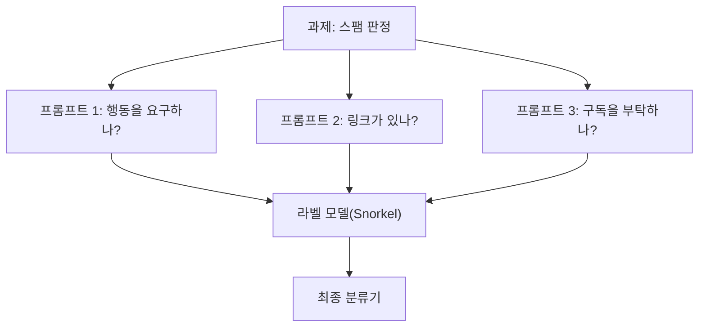
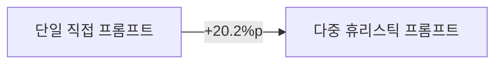

# LF용 프롬프트 다양화

> 언어모델을 라벨링 함수(LF)로 쓸 때 서로 다른 관점의 프롬프트를 여러 개 만들어 각각을 LF로 삼으면, 오류가 서로 다르게 나서 합쳤을 때 단일 프롬프트보다 훨씬 낫다.

## 쉽게 말하면
스팸 판정을 "광고 같나?" 하나만 묻지 않고 "행동을 요구하나?", "링크가 있나?", "구독을 부탁하나?"를 각각 묻는 것이다. 질문마다 놓치는 것이 달라 합치면 서로 보완된다.

## 자세히
(Smith 외, "Language Models in the Loop: Incorporating Prompting into Weak Supervision", arXiv 2205.02318 전문을 직접 읽고 확인.)
- **방법**: 서로 다른 휴리스틱을 묻는 여러 프롬프트(예: "댓글이 독자에게 무엇을 하라고 요구하는가?")를 LM에 입력하고 라벨 맵(Yes→SPAM, 그 외→ABSTAIN)을 적용해 프롬프트 LF를 만든다. Snorkel 라벨 모델로 노이즈를 제거한 뒤 최종 분류기를 학습.
- **보고 수치**: WRENCH 평균 **19.5% 오류 감소**(제로샷 대비, 손으로 만든 규칙과 비슷하거나 우수). **여러 휴리스틱 프롬프트가 단일 직접 프롬프트보다 평균 20.2%p** 높고, 코드 LF를 프롬프트로 번역하면 T0++에서 평균 +7.1점 추가.
- **데이터**: WRENCH 중 YouTube, SMS, Spouse(IMDB·Yelp·AG News·TREC는 T0++ 학습에 포함되어 제외). 약한 지도 결합이 제로샷보다 평균 18.2%(−26.7~100%), T0++만 보면 평균 39.5%. InstructGPT 계열은 이득이 YouTube에서만 일관되게 나타났고 T0++가 InstructGPT Curie보다 평균 37.2% 우세. Spouse에서 T0++가 WRENCH LF보다 25 F1 높았다.
- **핵심 주장**: 프롬프트 LF가 약하게 상관된 상보적 오류를 낸다. 프롬프트 LF의 보정이 결과를 개선한다. (데이터셋별 표는 확인하지 않았다.)
- **주의**: 같은 모델이 만든 LF는 오류가 상관될 수 있다([같은 LLM의 상관된 오류](#correlated-llm-errors)).

## 그림으로 보기

## 예시
- 상담 문의 분류: 환불 요구 / 배송 문의 / 불만 표현 각각을 묻는 프롬프트 5개를 LF로 사용.
- 교육 활용: "좋은 프롬프트 하나보다 다양한 질문 여러 개"의 효과를 실험.

## 헷갈리는 것과 비교
| 개념 | 차이 |
|---|---|
| 프롬프트 다양화 | 서로 다른 관점의 프롬프트 |
| 같은 프롬프트 다중 샘플 | 같은 관점을 여러 번 |
| [AMA](#ama-prompt-aggregation) | 형식 다양화 + 약한 지도 결합 |

## 더 읽을거리
- [Language Models in the Loop (arXiv 2205.02318)](https://arxiv.org/abs/2205.02318) — 프롬프트를 약한 지도에 넣는 방법.
