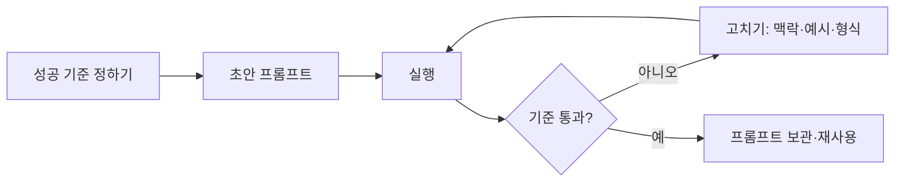
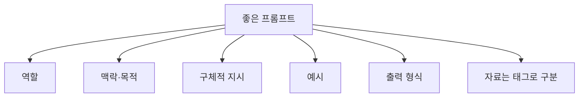

# 프롬프트 엔지니어링

> AI에게 원하는 결과를 안정적으로 얻도록 지시문(프롬프트)을 설계하고, 결과로 시험하며 고쳐 가는 기술.

## 쉽게 말하면
처음 온 신입 직원에게 업무를 맡기는 일과 같다. "알아서 해 줘"라고 하면 엉뚱한 결과가 나오고, 목적·배경·형식·예시를 주면 한 번에 맞는다. 그 신입은 당신의 머릿속을 읽지 못한다. 프롬프트는 머릿속을 글로 꺼내는 일이다.

## 자세히
Anthropic 공식 문서(Prompting best practices, 2026-10 확인)의 일반 원칙 구성:
- **명확하고 직접적으로**: 원하는 것을 구체적으로 쓴다.
- **맥락 주기**: 왜 필요한지, 누가 읽는지 알려 준다.
- **예시 활용**: 잘된 예를 몇 개 보여 준다(few-shot).
- **XML 태그로 구조화**: 지시·자료·예시를 `<document>` 같은 태그로 구분.
- **역할 주기**: "너는 ○○ 전문가야".
- **긴 문서**: 자료를 앞에, 질문을 뒤에 둔다.
- **형식 지정, 생각(thinking) 활용, 프롬프트 연쇄(큰 일을 여러 단계로 나눔)**, 도구 사용·하위 에이전트 지침 등.

공식 개요 문서의 선결 조건: **성공 기준 정의 → 그 기준으로 시험할 방법 → 초안 프롬프트** 순서가 먼저다. 모든 문제가 프롬프트로 풀리는 건 아니다. 지연·비용은 모델을 바꾸는 게 더 쉬울 수 있다.

모델마다 반응이 다르다(문서가 모델별 지침을 따로 둔다). 그래서 프롬프트는 한 번 쓰고 끝이 아니라 **평가하며 다듬는 자산**이다. 최근에는 프롬프트만이 아니라 모델에 줄 정보 전체를 설계하는 컨텍스트 엔지니어링, 그 둘레의 도구·검증을 설계하는 [하네스](#harness)로 관심이 넓어졌다.

## 그림으로 보기



## 예시
나쁜 프롬프트: "보고서 써줘."

좋은 프롬프트:
```
너는 B2B 교육 기획자야. (역할)
아래 <notes>는 고객사 인터뷰 메모야. 이걸로 경영진용 1쪽 요약을 써 줘. (맥락·목적)
형식: 문제 / 제안 / 기대효과 3개 소제목, 각 3문장 이내. (형식)
메모에 없는 수치는 지어내지 말고 "확인 필요"라고 적어. (환각 방지)
<notes>...</notes>
```

## 헷갈리는 것과 비교
| 개념 | 차이 |
| --- | --- |
| 프롬프트 엔지니어링 | 한 번의 지시문을 잘 쓰고 시험하는 기술 |
| 컨텍스트 엔지니어링 | 지시문 + 자료·기억·도구 결과 등 모델이 보는 정보 전체 설계 |
| [하네스](#harness) | 에이전트 둘레의 도구·권한·검증 구조 |
| 파인튜닝 | 모델 자체를 추가 학습. 프롬프트는 모델을 바꾸지 않음 |
| [SDD](#sdd) | 프롬프트 대신 스펙 문서를 기준으로 개발 |

## 더 읽을거리
- [Prompt engineering overview (Anthropic)](https://platform.claude.com/docs/en/build-with-claude/prompt-engineering/overview) — 선결 조건과 튜토리얼 링크
- [Prompting best practices (Anthropic)](https://platform.claude.com/docs/en/build-with-claude/prompt-engineering/claude-prompting-best-practices) — 모델별 최신 기법
- [Interactive tutorial (GitHub)](https://github.com/anthropics/prompt-eng-interactive-tutorial) — 예제 중심 실습
