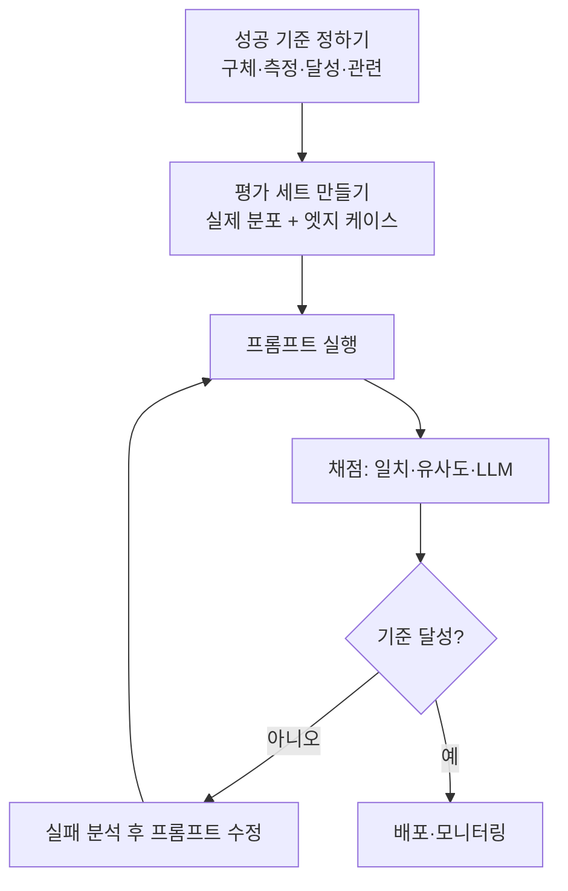
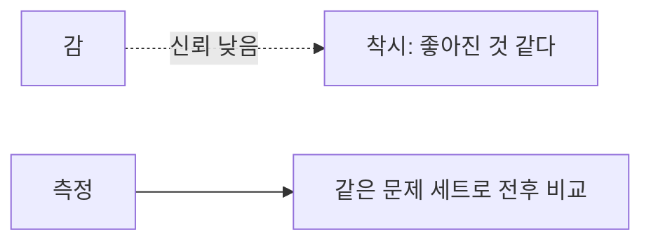

# 프롬프트 평가

> 프롬프트를 바꿀 때 "좋아진 것 같다"가 아니라 **성공 기준과 테스트 세트로 점수를 재서** 개선 여부를 판단하는 방법.

## 쉽게 말하면
다이어트를 하면서 체중계를 안 쓰고 "살 빠진 것 같아"라고 하면 알 수 없다. 프롬프트도 한두 번 써 보고 느낌으로 고르면 어제 좋아 보인 프롬프트가 오늘은 엉뚱한 입력에서 무너진다. 측정 기준(체중계)과 같은 문제 묶음(같은 점심 메뉴 기록)이 있어야 개선이 보인다.

## 자세히
**1단계 — 성공 기준 정하기(Claude 문서 "Define success")**
- 좋은 기준은 **구체적(Specific), 측정 가능(Measurable), 달성 가능(Achievable), 관련 있음(Relevant)**이다.
- 예: "감성 분류를 잘해야 한다" 대신 "다양한 트윗 1만 개의 보류 테스트 세트에서 F1 ≥ 0.85, 현재 기준선 대비 5% 개선". 모호한 안전도 "독성 필터에 걸리는 출력 0.1% 미만(1만 번 시도)"으로 바꿀 수 있다.
- 자주 쓰는 기준: 과업 충실도, 일관성, 관련성·논리성, 어조, 개인정보 보호, 문맥 활용, 지연 시간, 가격. 보통 여러 개를 동시에 건다. 예: F1 ≥ 0.85, 비독성 출력 99.5%, 오류의 90%는 불편 수준, 응답 95%가 200ms 이내.

**2단계 — 평가 설계 원칙**
1. **과업에 특화**: 실제 입력 분포를 반영하고 빈 입력·무관한 입력·너무 긴 입력·유해하거나 모호한 입력·사람도 의견이 갈리는 사례 같은 **엣지 케이스**를 넣는다.
2. **가능하면 자동화**: 객관식, 문자열 일치, 코드 검사, LLM 채점처럼 자동 채점되는 형식.
3. **질보다 양**: 신호가 다소 약해도 자동 채점되는 많은 문항이 손채점한 소수의 고품질 문항보다 낫다.

**3단계 — 채점 방식 고르기**
| 방식 | 예 | 용도 |
|---|---|---|
| 정확 일치(코드) | 공백 제거·소문자화 후 라벨 비교 | 범주형 답 |
| 코사인 유사도(코드) | 같은 뜻 질문들의 답변 임베딩 유사도 평균 | 일관성 |
| ROUGE-L(코드) | 정답 요약과 최장 공통 부분열 F1 | 요약 관련성 |
| LLM 리커트 척도 | 채점 모델이 어조를 1~5점 | 공감·전문성 같은 주관 품질 |
| LLM 이진 분류 | "이 응답에 개인 건강정보가 있나?" 예/아니오 | 규칙으로 놓치는 미묘한 문제 |

**LLM 채점 요령(문서 예시 기반)**: 가능하면 생성에 쓴 모델과 **다른 모델**로 채점, 출력은 "숫자만"/"yes 또는 no만"처럼 파싱하기 쉽게 요구하고 검증, 척도 양끝을 정의한 정밀한 채점표, 평가 대상은 `<response>` 같은 구분자로 감싸 지시와 혼동되지 않게.

**4단계 — 개선 루프**: 프롬프트 수정 → 같은 평가 세트 재실행 → 점수 비교(문제 수가 적으면 오차 범위 확인, [반복 실행과 신뢰구간](#sampling-temperature-eval)) → 실패 사례 분석 → 반복. 점수가 오르는 동안 이전에 잘 되던 항목이 깨지지 않는지(회귀)도 본다.

## 그림으로 보기




## 예시
```python
def evaluate_exact_match(output, answer):
    return output.strip().lower() == answer.lower()

accuracy = sum(evaluate_exact_match(o, t["sentiment"])
               for o, t in zip(outputs, tweets)) / len(tweets)
```
업무 예: 고객 후기 감성 분류 프롬프트를 200개 라벨 데이터(비꼬는 글, 복합 감정 글 포함)로 평가하고, 프롬프트 v1→v2→v3의 정확도·오류 유형을 표로 비교한다.

## 헷갈리는 것과 비교
| 개념 | 차이 |
|---|---|
| 프롬프트 평가 | 내 과업·내 데이터로 프롬프트 변경의 효과를 측정 |
| [벤치마크](#benchmarks) | 공개 시험으로 모델 일반 능력을 비교 |
| [LLM 심판](#llm-as-judge) | 평가의 채점 방법 중 하나 |
| [평가 세트](#eval-set) | 평가에 쓰는 문제 묶음 자체 |
| [프롬프트 엔지니어링](#prompt-engineering) | 평가는 그 반복 개선 루프의 측정 단계 |

## 더 읽을거리
- [Define success criteria (Claude 문서)](https://platform.claude.com/docs/en/test-and-evaluate/define-success) — SMART 기준과 다차원 목표
- [Building evals and test cases (Claude 문서)](https://platform.claude.com/docs/en/test-and-evaluate/develop-tests) — 설계 원칙과 채점 방식
