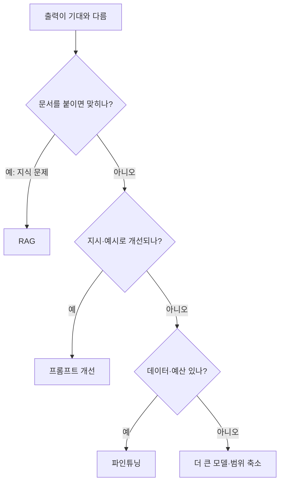

# 프롬프트·RAG·파인튜닝 선택

> 모델이 원하는 대로 안 나올 때, "무엇이 부족한가"에 따라 프롬프트 개선·RAG·파인튜닝 중 어느 것을 고를지 정하는 흐름.

## 쉽게 말하면
신입이 일을 못 할 때 원인이 셋일 수 있다. 지시를 못 알아들었다(프롬프트), 자료가 없다(RAG), 일하는 습관·말투 자체를 바꿔야 한다(파인튜닝). 원인에 맞는 처방을 해야 한다. 자료가 없는 사람에게 말투 교육을 시키면 소용없다.

## 자세히
검색으로 확인한 2026년 블로그들(공식 문서는 못 찾음, 2차 자료)이 공통으로 권하는 순서는 **프롬프트 → RAG → 파인튜닝 마지막**이다.

| 증상 | 원인 | 처방 |
|---|---|---|
| 형식·말투·역할이 틀림 | 지시 부족 | 프롬프트 개선, 예시(few-shot) |
| 최신·내부 사실을 모름·지어냄 | 지식 부족 | RAG(문서 검색해 컨텍스트에 넣기) |
| 위 둘로도 일관된 스타일·형식·특수 작업이 안 됨 | 행동 자체 | 파인튜닝(데이터·예산 필요) |

- **빠른 진단 질문**: "관련 문서를 프롬프트에 붙여 넣으면 모델이 맞히나?" 예 → RAG. 아니오 → 모델 능력·행동 문제라 파인튜닝·다른 모델 검토.
- **파인튜닝 한계**: 새 지식을 안정적으로 심는 용도가 아니라 행동·형식 조정용. 기반 모델이 바뀌면 재학습이 필요할 수 있다.
- **조합**: 출력 형식은 파인튜닝, 최신 데이터는 RAG로 넣는 방식이 흔하다.
- 먼저 평가 세트를 만들고, 처방 전후를 같은 세트로 비교한다([평가](#ai-evaluation)).

## 그림으로 보기

## 예시
- 사내 규정 챗봇이 규정을 지어냄 → RAG.
- 고객 응대 문체가 브랜드와 안 맞음 → 시스템 프롬프트와 예시 5개로 먼저 시도, 그래도 흔들리면 수백 건 파인튜닝.

## 헷갈리는 것과 비교
| 개념 | 차이 |
|---|---|
| [프롬프트 엔지니어링](#prompt-engineering) | 입력 지시를 다듬음. 비용 최저 |
| [RAG](#rag) | 지식을 외부에서 가져와 주입 |
| [파인튜닝 vs 프롬프팅](#fine-tuning-vs-prompting) | 모델 가중치를 바꾸는 방식과의 비교 |
| [자체 개발 vs 구매](#build-vs-buy-ai) | 이 선택의 상위 의사결정 |

## 더 읽을거리
- [Analytics Vidhya: Fine-Tuning vs RAG vs Prompt Engineering (2026-03)](https://www.analyticsvidhya.com/blog/2026/03/fine-tuning-vs-rag-vs-prompt-engineering/) — 비교 가이드
- [RaftLabs: When to Use Each](https://www.raftlabs.com/blog/llm-fine-tuning-guide) — 선택 기준
- [easy.bi: RAG vs Fine-Tuning vs Prompt Engineering](https://www.easy.bi/blog/rag-vs-fine-tuning-comparison/) — 조합 사례
