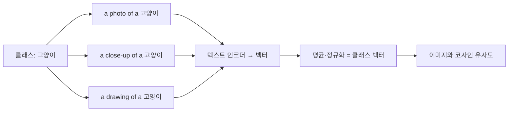

# 프롬프트 템플릿 앙상블

> CLIP 제로샷 분류에서 같은 클래스 이름을 여러 문장 틀(템플릿)에 끼워 각각 인코딩하고 평균 내 클래스 대표 벡터를 만드는 기법이다.

## 쉽게 말하면
"고양이"를 설명할 때 "고양이 사진", "귀여운 고양이", "집 안의 고양이"처럼 여러 말로 물어본 답을 평균내면 한 문장보다 흔들림이 적다. 질문 문구 하나에 점수가 휘둘리는 것을 줄이는 요령이다.

## 자세히
- 배경: CLIP은 이미지와 문장을 같은 공간에 놓는 모델이다(OpenAI, 2021, arXiv 2103.00020: 4억 쌍으로 학습, ImageNet에서 ResNet-50 수준의 제로샷 정확도). [제로샷 분류](#zero-shot-clip)는 클래스 이름을 문장으로 만들어 이미지와 가장 가까운 것을 고른다.
- 앙상블 방법(일반적으로 알려진 방식): 템플릿 여러 개(예: "a photo of a {label}.", "a close-up photo of a {label}.")로 문장을 만들고 → 각각 텍스트 인코더로 벡터화 → 정규화 후 평균 → 다시 정규화해 클래스 벡터로 쓴다. 이미지 벡터와의 코사인 유사도로 분류한다.
- 효과(주장): 문구 선택에 대한 민감도를 낮추고 정확도를 올린다고 알려져 있으나, 제가 열어 본 논문 초록 페이지에는 이 내용이 없어 수치는 확인하지 못했다. 본문(PDF)을 확인해야 한다.
- 장점은 추론 비용이 거의 늘지 않는다는 것: 클래스 벡터를 한 번 만들어 두면 된다.

## 그림으로 보기


## 예시
```python
templates = ["a photo of a {}.", "a close-up photo of a {}.", "a drawing of a {}."]
# 각 템플릿으로 인코딩 → 평균 → 정규화
```
한국어 상품 사진 분류라면 "{} 상품 사진", "{}이(가) 놓인 책상 위 사진"처럼 업무 상황에 맞는 템플릿을 섞는다.

## 헷갈리는 것과 비교
| 개념 | 차이 |
| --- | --- |
| [제로샷 CLIP](#zero-shot-clip) | 문장 하나로 분류 |
| 템플릿 앙상블 | 문장 여러 개 평균, 문구 민감도 감소 |
| 모델 앙상블 | 모델 여러 개 결합. 이것은 문장만 여러 개 |

## 더 읽을거리
- [CLIP 논문: Learning Transferable Visual Models From Natural Language Supervision](https://arxiv.org/abs/2103.00020) — 제로샷 전이의 출처(초록만 확인)
