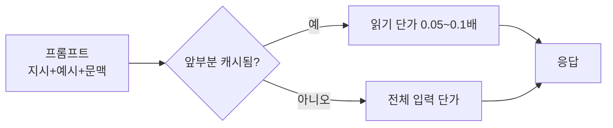
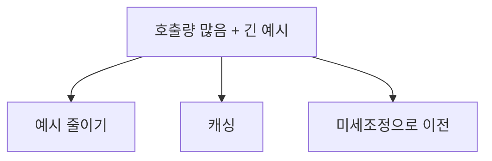

# 프롬프트 토큰 비용

> 프롬프트가 길수록(긴 지시문·few-shot 예시·검색 문서) 호출마다 입력 토큰 비용과 응답 지연이 늘어난다. 호출량이 많으면 이 고정비가 커져, 예시를 줄이거나 캐싱·미세조정으로 옮기는 판단 근거가 된다.

## 쉽게 말하면
전화 상담원에게 매 통화마다 20쪽짜리 매뉴얼을 처음부터 읽어 주는 것과 같다. 통화가 하루 10건이면 괜찮지만 10만 건이면 매뉴얼 읽는 시간만으로 큰 비용이다. 매뉴얼을 미리 외우게(미세조정) 하거나 앞부분을 기억해 두게(캐싱) 할 수 있다.

## 자세히
- **기본 구조**: 호출 한 번의 입력 비용 ≈ (시스템 지시 + 예시 + 문맥 + 질문 토큰) × 입력 단가. 같은 앞부분이 매번 반복되면 낭비다.
- **프롬프트 캐싱(Anthropic 문서, 열람, 확인 시점 2026-11-16)**: 반복되는 앞부분(prefix)의 처리 결과를 재사용. 기본 입력가 대비 5분 캐시 쓰기 1.25배, 1시간 캐시 쓰기 2배, 캐시 읽기 0.1배(Opus 5.5·Sonnet 5.5는 0.05배, Fable·Mythos 5.x 계열은 0.025배). 최소 캐시 가능 길이는 모델별로 512~4,096 토큰이고 짧으면 캐시 없이 처리되며 오류도 없다(응답의 `cache_creation_input_tokens`·`cache_read_input_tokens`가 0이면 캐시 안 됨). 기본 TTL 5분(사용할 때마다 무료 갱신), 순서는 tools → system → messages이며 중단점 앞이 정확히 일치해야 적중한다.
- **OpenAI 문서(열람)**: 지원 모델에서 자동 적용. 접두사가 1,024 토큰 이상이어야 하며(GPT-5.6 이후), 재사용 입력은 최대 95% 할인으로 표현되고 GPT-5.6 이후 읽기는 0.1배, 30분 쓰기 1.25배, 12시간 쓰기 2.5배로 적혀 있다. 캐시된 토큰도 분당 토큰 한도에는 계산되고 정확한 접두사 일치가 필요하다.
- **판단 포인트(해석)**: 예시를 늘리면 품질이 오를 수 있지만 비용·지연도 오른다. 호출량이 많으면 (1) 예시 수 줄이기, (2) 정적 부분을 앞에 두고 캐싱, (3) 충분한 데이터가 있으면 [미세조정](#examples-to-training-data)으로 예시를 모델에 옮기기를 비교한다.
- **주의**: 단가·배수·최소 길이·TTL은 모델과 날짜에 따라 바뀐다. 청구 직전엔 공식 가격표로 재확인한다.

## 그림으로 보기

## 예시
- 시스템 프롬프트 3,000토큰과 예시 5개를 매 호출 반복 → 정적 부분을 앞에 두고 캐시 사용 여부·적중 토큰을 응답 필드로 확인.
- 교육 실습: 호출 1만 건 기준으로 "예시 5개 포함"과 "예시 2개"의 입력 토큰 합계를 단가에 곱해 비교.

## 헷갈리는 것과 비교
| 개념 | 차이 |
|---|---|
| 프롬프트 토큰 비용 | 길수록 호출마다 늘어나는 비용 |
| 프롬프트 캐싱 | 반복 앞부분 재사용으로 비용·지연 감소 |
| 미세조정 | 예시를 가중치로 옮겨 프롬프트를 짧게 |
| [예시 고르기](#example-selection) | 어떤 예시를 몇 개 넣을지 |

## 더 읽을거리
- [Anthropic: Prompt caching](https://platform.claude.com/docs/en/build-with-claude/prompt-caching) — 배수·최소 길이·TTL(앞부분 열람)
- [OpenAI: Prompt caching](https://developers.openai.com/api/docs/guides/prompt-caching) — 자동 캐싱과 할인(열람)
