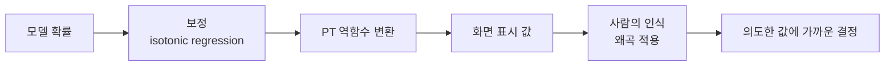
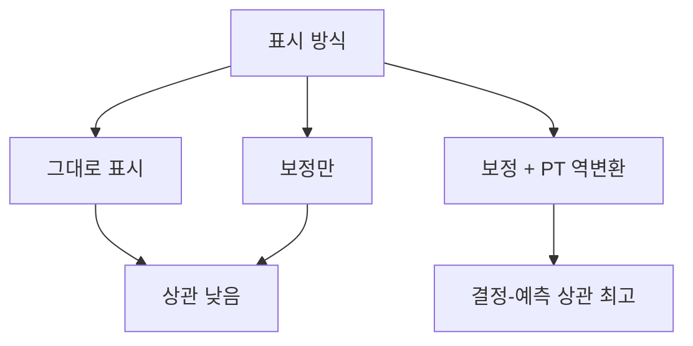

# 전망이론 기반 보정

> 사람은 "30%"나 "90%" 같은 확률을 실제 값 그대로 받아들이지 않고 낮은 확률은 크게, 높은 확률은 작게 느낀다. 전망이론 기반 보정은 모델이 내놓는 확률을 이 왜곡의 역함수로 한 번 더 바꿔 보여 줘서 사람이 의도한 값으로 받아들이게 하는 방법이다.

## 쉽게 말하면
안경 도수가 틀어져 보이는 사람에게 같은 방향으로 미리 틀어 인쇄한 글자를 주면 바로 읽힌다. 사람의 머릿속 확률 감각이 "휘어져" 있다면 숫자를 미리 반대로 휘어 보여 주는 셈이다.

## 자세히
- **배경**: Kahneman·Tversky의 전망이론은 확률 가중 함수 w(p) = p^γ / (p^γ + (1−p)^γ)^(1/γ)로 사람의 확률 왜곡을 모델링한다. 이 논문들에서 γ는 0~1 사이이며 작을수록 왜곡이 크다.
- **연구(Nizri 등, arXiv 2508.18317, 2025-08, 본문 열람)**: 분류기를 보정(isotonic regression)한 뒤 각 확률을 w의 근사 역함수에 통과시켜 표시했다. γ=0.71(Rieger 등 2017의 미국 응답자 추정치)을 썼고, 근사 오차는 확률 0~100에서 평균 절대오차 0.963(1% 미만)이다.
- **실험**: 비 예보(AWS 날씨 데이터 14만여 행, 150명)와 대출 승인(25만여 건, 175명) 과제, Mechanical Turk 참가자. 조건은 비보정·보정·전망이론 보정·전망이론만(미보정)·무작위 5개.
- **결과**: 보정만으로는 사람의 결정과 모델 예측의 상관이 거의 안 변했고, 전망이론 보정을 더하면 두 영역 모두에서 유의하게 높아졌다(대출에서 PT-미보정과는 차이 없음). **신뢰 평점은 방법 간 차이가 없었다**(무작위 조건만 낮음).
- **한계(저자 명시)**: 영역 2개, 가상 시나리오·낮은 이해관계, 모든 영역에 γ=0.71 하나 사용. 영역·집단별 γ 추정은 앞으로 과제다.
- **주의**: 이는 사람의 결정이 예측과 더 맞아지는 효과이며 최종 정확도 향상이 입증된 것은 아니다(본문 수치 미확인). 또 숫자를 일부러 바꿔 보여 주므로 표시 값이 "실제 확률"이 아니라는 윤리·투명성 논의가 따른다(해석).
- LLM 쪽에서는 전망이론이 LLM 의사결정을 일관되게 설명하지 못한다는 연구도 있다(arXiv 2508.08992, 검색 요약 기준). 사람용 보정과 모델 행동 설명은 별개 문제다.

## 그림으로 보기

## 예시
- 대출 심사 보조 화면에서 "상환 확률 85%"를 PT 역변환 값으로 표시해 심사역의 판단이 모델 예측과 더 가깝게 움직이는지 A/B로 본다.
- 교육 활용: "같은 숫자도 사람은 다르게 느낀다"를 설명하며 확률 표시 UI 설계 실습을 한다.

## 헷갈리는 것과 비교
| 개념 | 차이 |
| --- | --- |
| [신뢰 보정](#trust-calibration) | 상위 개념. 사람의 믿음을 AI 신뢰도에 맞춤 |
| 모델 확신 보정(isotonic·Platt) | 모델 숫자를 정답률에 맞춤. PT 보정은 그 위에 사람의 인식 왜곡을 보탬 |
| KTO(전망이론 기반 정렬 손실) | 모델 학습 방법. 이름만 비슷하고 목적이 다름 |

## 더 읽을거리
- [Does Calibration Affect Human Actions? (arXiv 2508.18317)](https://arxiv.org/html/2508.18317) — PT 보정 방법과 두 실험
