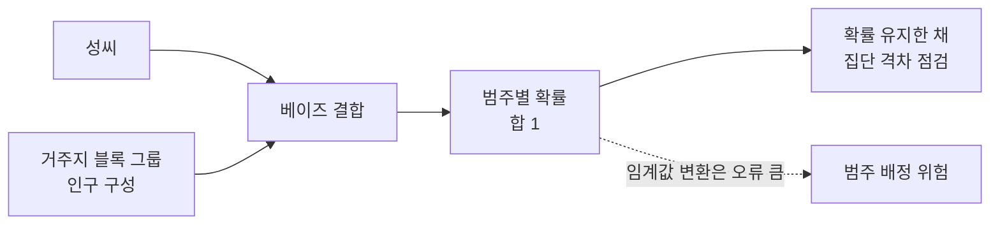

# 보호 속성 추정 (BISG 등)

> 인종·성별 같은 보호 속성이 데이터에 없을 때, **이름과 거주지 같은 공개 정보로 확률적으로 추정**해 공정성 점검에 쓰는 방법. 대표 사례가 미국 CFPB의 BISG(Bayesian Improved Surname Geocoding)다.

## 쉽게 말하면
설문에 인종을 묻지 못했는데 차별 여부를 확인해야 한다면, 성(姓)과 동네의 인구 구성을 단서로 "이 사람이 어느 집단일 확률이 얼마"라고 추정한다. 이름표가 아니라 확률표다.

## 자세히
출처: CFPB `proxy-methodology` GitHub README와 RATA Associates 해설 글(둘 다 본문 확인, 2026-11-18). CFPB 2014 원 보고서는 열지 못했다.
- **BISG 방식**: 성씨별 인종·민족 분포(센서스 성씨 목록)를 출발점으로, 개인이 사는 지역(센서스 블록 그룹·트랙·우편번호)의 인구 구성으로 베이즈 갱신해 범주별 확률(합 1)을 낸다. README는 수식을 적지 않았다.
- **CFPB 저장소 절차**: 주소를 지오코딩 → 성씨·지역 프록시 구성(Some Other Race는 IPF로 재배분) → 블록 그룹·트랙·우편번호별 BISG 계산 → 가장 정밀한 단위를 우선 결합. 성씨 목록은 2010 기반(2017-04 기준 167,409개), 2024-04에 2020 센서스 기반 코드가 추가됐다.
- **오차(RATA 해설, CFPB 모기지 시험군 기준)**: 확률을 범주로 임계값 처리하면 큰 오류가 난다. 확률 합산은 히스패닉 응답자를 4% 과대추정했고 80% 임계값은 25% 과소추정했다. 백인 비히스패닉 881명이 히스패닉 확률 80% 이상으로 분류됐다.
- **방향성 편향**: 세 프록시 모두 비히스패닉 백인을 과소, 다른 집단을 과대추정하는 경향. 센서스 인구와 실제 신청자 인구가 다르기 때문(예: 히스패닉은 성인의 14%지만 2010년 모기지 신청자의 7%).
- **약한 집단**: 아시아·태평양계와 다인종은 전통 방식보다 낫지 않았다.
- **업계 비판**: 업계 의뢰 연구들이 높은 오차를 주장했다(검색 요약, 원문 미확인).
- **실무 지침(해석)**: 범주 대신 확률을 유지, 지오코딩 일치율 점검, 쓴 성씨 목록과 센서스 연도 기록. 한국에서는 성씨 분포 구조가 달라 BISG를 그대로 적용할 수 없다.
- **윤리**: 추정은 감사·점검용이며 개인 단위 결정에 쓰면 오분류 피해가 생긴다.

## 그림으로 보기

## 예시
- 자동차 대출처럼 인종을 수집하지 못하는 상품에서 감독기관이 BISG 확률로 집단별 승인·금리 격차를 추정.
- 교육 활용: "보호 속성을 안 쓰면 공정한가?"에 대해 "점검하려면 오히려 추정이 필요할 수 있다"는 역설을 보여 주는 사례.

## 헷갈리는 것과 비교
| 개념 | 차이 |
|---|---|
| 보호 속성 추정 | 점검을 위해 속성을 추정 |
| [프록시 변수](#proxy-variable) | 모델이 의도치 않게 속성을 반영하는 입력 |
| 자기 신고 데이터 | 가장 정확하나 수집 제한 있음 |
| [프록시 탐지 모델](#proxy-detection-model) | 입력 변수로 속성이 예측되는지 시험 |

## 더 읽을거리
- [CFPB proxy-methodology (GitHub)](https://www.github.com/cfpb/proxy-methodology) — 코드·절차·갱신 이력
- [RATA: BISG 한계 해설](https://rataassociates.com/bisg-proxy-methodology-limits/) — 오차 수치와 실무 지침
