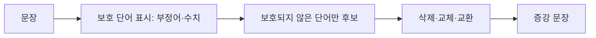
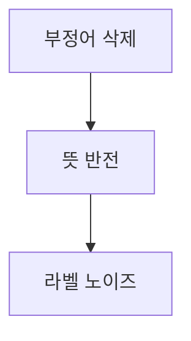

# 보호 단어 목록

> 텍스트 증강에서 **지우거나 바꾸거나 자리를 옮기면 뜻·라벨이 바뀌는 단어(부정어·수치·고유명사 등)를 미리 목록으로 만들어 증강 대상에서 제외하는** 방법이다.

## 쉽게 말하면
"이 호텔을 추천하지 **않는다**"에서 "않는다"를 무작위로 지우면 정반대 뜻의 문장이 된다. 건드리면 안 되는 단어에 "손대지 마시오" 표시를 붙이는 일이다.

## 자세히
- 문제 재현(내가 만든 간이 실험, 영어 문장 5개: `the service was not good at all`, `i do not recommend this hotel`, `the food never arrived on time`, `this movie is not bad it is great`, `no refund was given for the 120 dollar order`). [EDA](#eda-four-operations) 방식의 무작위 삭제(RD)·교환(RS)을 20,000번씩 적용한 결과:
  | 연산 | 부정어(not·never·no) 영향 |
  |---|---|
  | RD, p=0.05 | **5.1%**의 출력에서 부정어가 사라짐 |
  | RD, p=0.1 | 9.7% |
  | RD, p=0.2 | 19.9% |
  | RS, 교환 1회 | 52.0%의 출력에서 부정어가 원래 뒤따르던 단어 바로 앞에 있지 않음(교환에 부정어나 다음 단어가 걸리거나 위치가 바뀜) |
  - 수치도 같은 문제: RD p=0.1에서 숫자 `120`이 10.0% 삭제됐다. 삭제 확률 p는 모든 단어에 같게 적용되므로 **p가 곧 부정어·수치가 사라질 확률**이다.
- 이 정도 비율의 라벨 노이즈가 학습에 얼마나 영향을 주는지는 데이터·모델에 따라 다르다(이 실험에서 측정하지 않음). 감성·의도·사실 판별처럼 부정어가 라벨을 정하는 과제에서는 더 위험하다.
- 보호 목록 설계(제안):
  1. **부정어**: not, no, never, n't, 한국어 "않다·없다·아니다" 활용형.
  2. **수치·단위·날짜·고유명사**: 금액·수량이 정답인 과제(법률·재무 문서 분류).
  3. **도메인 핵심어**: 분류 라벨과 직결되는 키워드(토픽 분류의 주제어). [TF-IDF 단어 치환](#tfidf-word-replacement)처럼 중요도가 높은 단어를 보호하는 자동 방식도 있다.
  4. 구현은 "교체·삭제·교환 후보 선택 시 보호 단어를 제외"하고, 교환은 보호 단어 위치를 고정한다.
- 한계: 목록이 완전할 수 없다(문장 속 "도무지 ~지 않다" 같은 부정 표현). 한국어는 어미 활용이 많아 형태소 분석이 필요하다(추정). 증강 후 라벨이 유지되는지 표본을 사람이 검토한다([텍스트 증강의 라벨 보존](#text-augmentation-label-preservation)).

## 그림으로 보기



## 예시
```python
protected = {"not", "no", "never"}
cand = [i for i, w in enumerate(words) if w not in protected and not w.isdigit()]
```
- 교육: "증강도 의미를 지켜야 한다"는 사례로 부정어 삭제 예시를 보여 주는 실습.

## 헷갈리는 것과 비교
| 개념 | 차이 |
|---|---|
| 보호 단어 목록 | 변형 대상에서 제외할 단어 |
| 불용어 목록 | 교체 대상에서 제외하는 흔한 단어(주로 의미 약함) — 부정어는 보통 불용어 목록에 들어 있어 주의 |
| [EDA 연산](#eda-four-operations) | 보호 목록이 없으면 모든 단어에 동일 확률 적용 |

## 더 읽을거리
- [EDA (arXiv 1901.11196)](https://arxiv.org/abs/1901.11196) — 연산 정의(읽음).
- 직접 실행: 문장 5개·20,000회 시뮬레이션.
