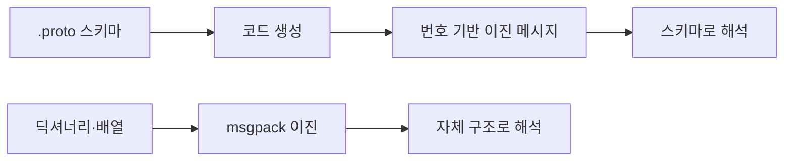

# Protocol Buffers와 msgpack

> 둘 다 JSON보다 작고 빠른 이진 직렬화 형식이다. Protocol Buffers는 `.proto` 스키마를 먼저 정해 코드를 생성하고, MessagePack은 스키마 없이 JSON처럼 값을 그대로 담는다.

## 쉽게 말하면
Protobuf는 양식(서식)이 미리 인쇄된 신청서다. 칸 번호만 적어 보내므로 짧고, 양식 파일이 있어야 읽을 수 있다. MessagePack은 JSON 메모를 작게 압축한 쪽지다. 양식 없이 누구나 쓸 수 있지만 칸 이름이 그대로 따라간다.

## 자세히
공식 문서(protobuf.dev, msgpack.org) 기준:
- **Protobuf**: 정의 언어 + 컴파일러가 만든 코드 + 런타임 + 이진 와이어 형식의 묶음. `.proto`에 필드마다 타입과 **필드 번호**를 부여한다. 번호는 재사용 금지이며, 필드를 지우면 번호를 `reserved`로 막는다.
- 하위 호환: 규칙을 지키면 옛 코드가 새 메시지를 문제없이 읽고(모르는 필드는 무시), 새 코드는 없는 필드에 기본값을 쓴다.
- 쓰지 말아야 할 때(공식): 수 MB 넘는 큰 데이터, 큰 부동소수점 배열 과학 데이터, 자기 서술(self-describing)이 필요한 경우, 공식 표준이 필요한 환경. 같은 데이터가 다른 바이트로 직렬화될 수 있어 바이트 비교로 동등성을 판단하면 안 된다.
- **MessagePack**: JSON처럼 맵·배열·숫자·문자열을 담는 이진 형식. 작은 정수는 1바이트, 짧은 문자열은 약 1바이트 오버헤드. 홈페이지는 "더 작고 빠르다"고만 주장하며 수치는 없다(주장). JSON이 못 담는 바이너리를 네이티브로 담는다.
- AI 쪽 활용: gRPC·TensorFlow 계열은 protobuf를 널리 쓰고, 에이전트 체크포인트 저장은 msgpack을 쓰기도 한다([serde](#langgraph-serde)).
- 보안: 둘 다 코드를 실행하지 않는 데이터 형식이라 [pickle](#pickle-security)과 다르다.

## 그림으로 보기


## 예시
```proto
message User {
  int32 id = 1;
  string name = 2;
  reserved 3;   // 지운 필드 번호 보호
}
```
```python
import msgpack
b = msgpack.packb({"id": 1, "name": "민"})
msgpack.unpackb(b)
```

## 헷갈리는 것과 비교
| 개념 | 차이 |
| --- | --- |
| Protobuf | 스키마 필수, 가장 작고 호환 규칙 명확 |
| msgpack | 스키마 불필요, JSON 대체로 간편 |
| [JSON](#msgpack-vs-json) | 사람이 읽는 텍스트, 가장 범용 |
| [JSON Lines](#json-lines) | 형식이 아니라 "한 줄에 JSON 하나" 관례 |

## 더 읽을거리
- [Protocol Buffers Overview](https://protobuf.dev/overview/) — 스키마·필드 번호·호환성·한계
- [MessagePack](https://msgpack.org/) — 형식 소개와 언어별 구현
