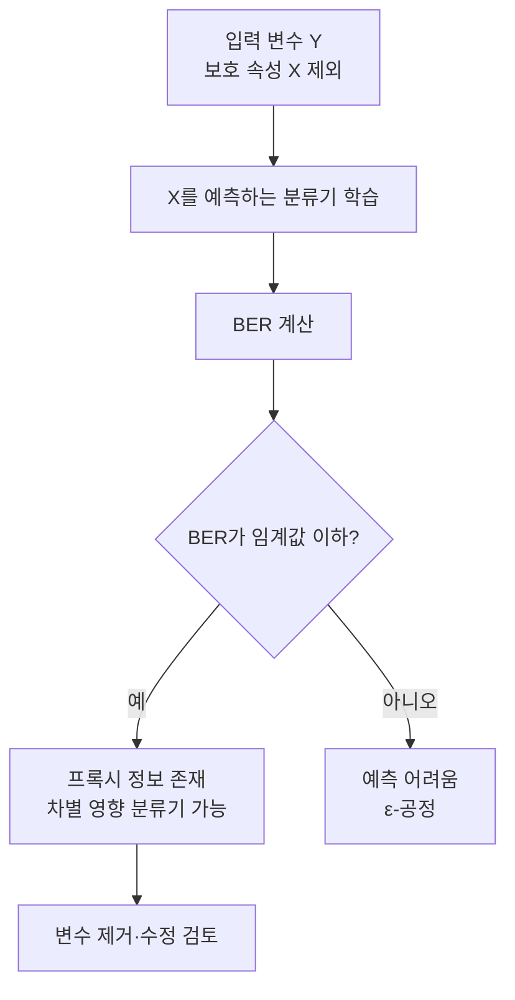

# 프록시 탐지 모델

> 모델이 쓰는 **다른 변수들로 보호 속성(인종·성별 등)을 얼마나 잘 맞힐 수 있는지** 시험해, 입력 데이터에 보호 속성 정보가 새어 들어 있는지 점검하는 방법. 예측이 잘 되면 프록시가 있다는 신호다.

## 쉽게 말하면
이름표를 가린 사진으로 누군지 맞힐 수 있다면, 가렸어도 정보는 남아 있는 것이다. 입력 변수들로 "이 사람이 어느 집단인가"를 잘 맞히는 분류기를 만들 수 있다면, 모델도 그 정보를 활용할 수 있다.

## 자세히
출처: Feldman 외, "Certifying and Removing Disparate Impact"(arXiv 1412.3756, PDF를 텍스트로 변환해 정의·정리를 직접 확인, 2026-11-18).
- **아이디어**: 알고리즘 자체를 보지 않고 **데이터에서 보호 속성이 얼마나 예측되는지**(정보 누출)를 잰다. 논문은 이를 법적 "차별 영향" 개념과 분류 정확도 지표로 연결한다.
- **지표 BER(균형 오류율)**: 보호 속성을 예측하는 분류기 f의 두 집단별 오류의 평균, `BER = (Pr[f(Y)=0|X=1] + Pr[f(Y)=1|X=0]) / 2`. 0.5면 동전 던지기 수준(예측 불가), 낮을수록 예측 가능.
- **ε-예측 가능**: BER ≤ ε인 f가 있으면 X는 Y로부터 ε-예측 가능. 어떤 분류기로도 BER > ε이면 ε-공정(예측 불가).
- **정리 4.1(논문)**: 데이터가 (1/2 − β/8)-예측 가능한 것과 차별 영향(80% 규칙, τ=0.8)이 존재하는 것은 동치다. β는 소수 집단(X=0)에서 선발(C=1)되는 비율. 일반 τ에서는 임계 BER이 1/2 − β(1/τ − 1)/2이다.
- **해석 예**: 소수 집단 선발률 β가 0.4라면 임계 BER = 0.5 − 0.4/8 = 0.45. 입력으로 보호 속성을 BER 0.45 이하로 맞힐 수 있으면 그 데이터에서 4/5 규칙 위반 가능성이 있는 분류기가 존재한다는 뜻이다(정리에서 계산한 값).
- **실험 데이터**: Ricci(118명 시험 응시자), German Credit, Adult Income 세 개로 완화 기법의 정확도-공정성 절충을 검증했다.
- **한계**: 예측 모델 선택에 따라 BER 추정이 달라진다(좋은 모델을 쓸수록 보수적 점검). 어떤 변수가 원인인지는 별도로 변수 제거·중요도 분석이 필요하다. 보호 속성 값을 가진 데이터가 있어야 한다([보호 속성 추정](#protected-attribute-inference)).

## 그림으로 보기


## 예시
```python
from sklearn.model_selection import cross_val_predict
from sklearn.ensemble import GradientBoostingClassifier
from sklearn.metrics import balanced_accuracy_score
pred = cross_val_predict(GradientBoostingClassifier(), Y_features, X_protected, cv=5)
ber = 1 - balanced_accuracy_score(X_protected, pred)   # BER = 1 - 균형 정확도(이진)
```
BER이 0.5에 가까우면 변수로부터 보호 속성이 거의 안 읽힌다. 예: 우편번호를 뺀 모델 대비 BER 변화를 비교해 어느 변수가 프록시인지 가늠한다.

## 헷갈리는 것과 비교
| 개념 | 차이 |
|---|---|
| 프록시 탐지 모델 | 변수 묶음이 속성을 얼마나 노출하는지 시험 |
| [프록시 변수](#proxy-variable) | 노출시키는 개별 변수 |
| [보호 속성 추정](#protected-attribute-inference) | 속성이 없을 때 외부 정보로 추정 |
| [불리한 영향 비율](#adverse-impact-ratio) | 결과 비율을 직접 재는 지표 |

## 더 읽을거리
- [Feldman 외 arXiv 1412.3756](https://arxiv.org/abs/1412.3756) — 예측 가능성과 차별 영향의 관계, 데이터 수리 방법
