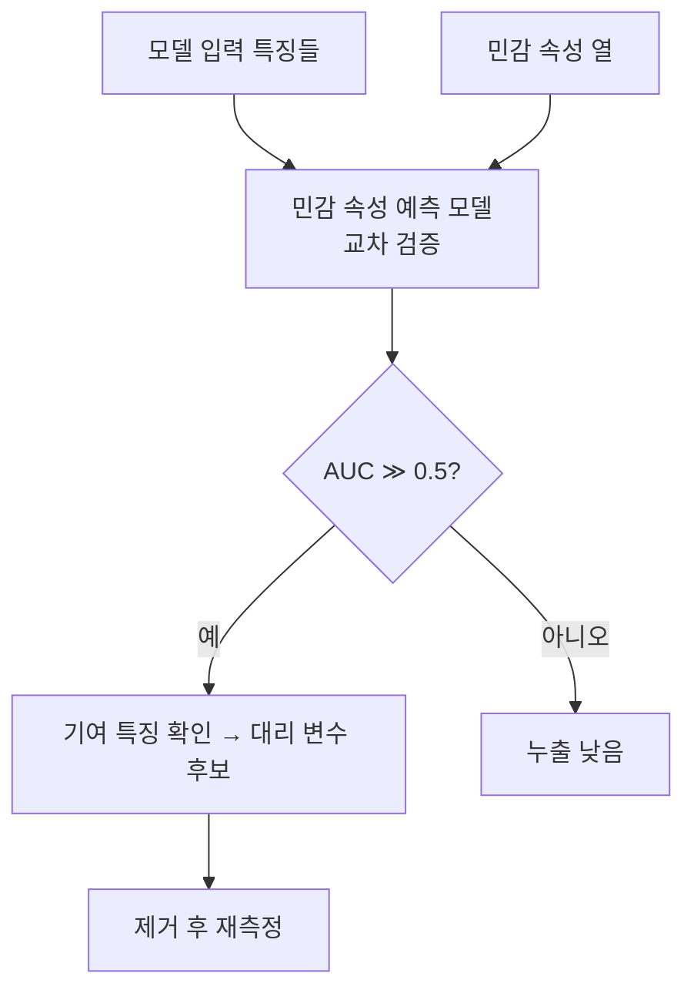

# 대리 변수 점검 테스트

> 민감 속성(성별·연령·인종 등)을 입력에서 뺐더라도, **다른 특징들만으로 그 민감 속성을 얼마나 잘 맞힐 수 있는지** 모델로 시험해 보는 점검이다. 잘 맞히면 그 특징들이 대리 변수 역할을 하고 있다는 뜻이다.

## 쉽게 말하면
이름표를 떼어 놓았는데도 신발 사이즈, 걸음걸이, 사는 동네로 누구인지 맞힐 수 있다면 이름표를 뗀 것이 별 의미가 없다. 대리 변수 테스트는 이름표 없이 "누구인지 맞혀 보기" 게임을 해 보는 것이다.

## 자세히
(Feldman 등 arXiv 1412.3756 초록을 직접 확인하고, 시험 절차는 scikit-learn 1.9.1로 직접 실행. 배경은 [대리 변수](#proxy-variables)에서 다룬 Barocas 등의 책 내용.)
- **아이디어(Feldman 등, 초록)**: 알고리즘 내부를 몰라도 **데이터에서 민감 속성이 다른 속성으로 얼마나 새어 나오는지(정보 누출)**를 재서 차별적 영향(disparate impact)을 인증하는 검사를 제안한다. 초록은 이 검사를 분류 정확도의 한 척도와 연결한다고만 설명한다(구체 척도 이름은 초록에서 확인하지 못했다). 또 데이터를 덜 편향되게 고치는 방법도 제안한다.
- **절차(제안)**
  1. 민감 속성 열을 **예측 대상**으로 두고, 모델이 쓸 특징들만 입력으로 둔다.
  2. 교차 검증으로 예측 성능(AUC 등)을 잰다. 0.5 근처면 누출이 적다.
  3. 성능이 높으면 어느 특징이 기여하는지(중요도)를 본다.
  4. 그 특징을 빼고 다시 재서 누출이 줄어드는지 확인한다.
  5. **널(null) 기준**으로 민감 속성 열을 섞어 같은 절차를 돌려 우연 수준(≈0.5)을 확인한다.
- **직접 실험(8,000명, 민감 속성 30%. 소득은 약한 상관, 우편번호형 변수는 80%가 속성과 일치+노이즈, 나이·근속은 무관. 5-겹 교차 검증, HGB)**
  | 사용한 특징 | 민감 속성 예측 AUC |
  |---|---|
  | 4개 전부 | **0.799** |
  | 우편번호형 대리 제외(소득·나이·근속) | 0.546 |
  | 무관 특징만(나이·근속) | 0.483 |
  | (널) 속성 열을 섞은 뒤 | 0.488~0.507(5회) |
  대리 변수를 뺄 때 AUC가 0.799→0.546으로 줄고, 널 분포는 0.5 근처라 0.799는 우연이 아님을 보여 준다. 민감 속성에 대한 순열 중요도는 우편번호형 변수가 0.348로 가장 컸고 소득이 0.087이었다(학습 데이터에서 계산한 값이라 무관 변수도 약간 값이 나옴).
- **해석과 한계(제안)**: ① 합쳐서 예측되는 정도는 **여러 약한 변수의 조합**일 수 있어 개별 변수 점검만으로는 부족 ② 예측이 된다는 것이 곧 불공정하다는 뜻은 아니다 — 의학처럼 속성과 인과적으로 얽힌 변수는 정당하게 쓰일 수 있다 ③ 누출이 큰 변수를 빼는 방법과 성능 손실의 균형을 확인 ④ 이 시험은 **입력 데이터 누출**을 보는 것이고 모델 출력의 집단 간 차이(합격률 격차)는 따로 잰다 ⑤ 민감 속성이 데이터에 없으면 시험 자체를 못 한다(추정값 사용은 별도 윤리·법적 검토).

## 그림으로 보기

## 예시
- 채용 점수 모델에서 성별 열을 제거하고도 "이전 직장 업종·경력 단절 기간"으로 성별을 AUC 0.78로 맞힌다면, 두 변수를 점검 대상으로 올린다.
- 교육 소재: "이름표를 떼도 소용없다" 실습 — 노트북에서 위 5단계를 돌려 보기(HR·마케팅 교육).

## 헷갈리는 것과 비교
| 개념 | 차이 |
|---|---|
| 대리 변수 점검 테스트 | 입력으로 민감 속성을 예측해 누출 측정 |
| [대리 변수](#proxy-variables) | 개념 설명 |
| [편향 라벨 정확도의 함정](#biased-label-accuracy-trap) | 정답 라벨이 편향돼 정확도가 속임 |
| [데이터 구성 표](#dataset-composition-table) | 집단 비율 점검 |

## 더 읽을거리
- [Certifying and Removing Disparate Impact (arXiv 1412.3756)](https://arxiv.org/abs/1412.3756) — 정보 누출로 차별적 영향을 인증하는 접근(초록 직접 확인).
- [Fairness and Machine Learning (fairmlbook.org)](https://fairmlbook.org/) — "No fairness through unawareness" 논의(상위 노드 작성 때 직접 확인).
