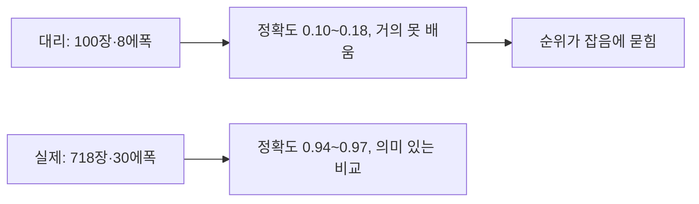
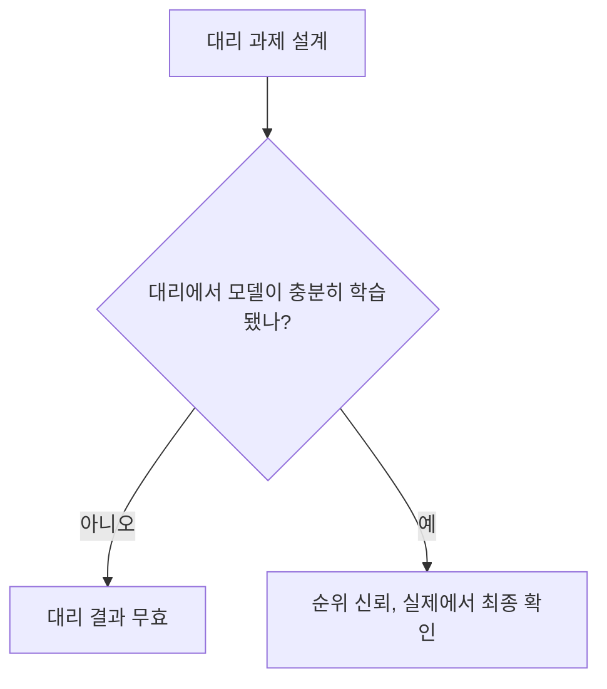

# 대리 과제 함정

> 증강 정책을 찾을 때 비용을 아끼려고 **작은 데이터·짧은 학습의 "대리 과제"**에서 고르면, 그 결과가 실제(큰 데이터·긴 학습)와 달라질 수 있다. 대리 과제가 실제와 같은 학습 상태에 도달하지 못하면 순위가 의미를 잃는다.

## 쉽게 말하면
마라톤 훈련법을 비교하려고 100m 달리기 기록으로 평가하는 것과 같다. 100m 기록이 좋은 훈련법이 마라톤에서도 좋다는 보장이 없고, 너무 짧게 재면 모두 비슷하거나 우연에 좌우된다.

## 자세히
- **연구 사례**: AutoAugment는 축소 CIFAR-10(학습 4,000장)과 축소 ImageNet(120개 클래스 부분집합)에서 정책을 찾았다(논문 확인, [탐색 공간](#autoaugment-search-space)). RandAugment 논문은 이런 **별도 대리 과제 탐색이 필요 없게** 탐색 공간을 줄였다고 주장한다(초록 확인).
- **직접 실행**(digits 손글씨를 16×16으로 확대, 작은 CNN, 4 시드 평균±표준편차). 대리 = 학습 100장·8 에폭, 실제 = 718장·30 에폭:

| 설정 | 대리 과제 정확도 | 실제 정확도 |
|---|---|---|
| N=0(증강 없음) | 0.143 ± 0.039 | 0.967 ± 0.003 |
| N=2, M=5 | 0.179 ± 0.075 | 0.968 ± 0.005 |
| N=2, M=15 | 0.123 ± 0.035 | 0.963 ± 0.005 |
| N=2, M=30 | 0.101 ± 0.000 | 0.940 ± 0.015 |

- 해석: 이 대리 과제는 **너무 짧고 작아서 모델이 거의 학습되지 않았다**(정확도 0.10~0.18, 무작위 기대치 0.10 근처). 그래서 순위가 시드 변동(표준편차 0.04~0.08)에 묻힌다. 두 가지 일치: M=30이 양쪽 모두 최저. 불일치·불확실: 대리에서 최고인 N=2·M=5(0.179)는 실제에서도 최고(0.968)이지만 기준선(0.967)과 차이가 없어 의미가 없고, 대리 값들은 서로 구별되지 않는다. 즉 **"학습이 충분히 된 상태"에서 재지 않으면 대리 과제는 정보가 없다**. 이 실험은 대리가 실패한 극단 사례이며 "대리 과제는 항상 틀린다"는 뜻이 아니다.
- **일반 위험(제안)**: ① 작은 데이터에서는 강한 증강이 도움이 되고 큰 데이터에서는 해가 되는 식으로 최적 강도가 데이터 크기에 따라 이동한다(RandAugment 초록: 모델·데이터 크기에 따라 정칙화 강도를 조절한다는 설명과 맞닿음). ② 작은 모델·짧은 학습의 최적이 큰 모델·긴 학습에 안 맞을 수 있다.
- **완화**: 대리를 실제와 같은 학습 상태(수렴 근처)까지 돌리고, 시드를 늘리고, 최종 후보는 반드시 실제 설정에서 재확인한다.

## 그림으로 보기

## 예시
- 큰 이미지 모델의 증강을 고를 때 10% 데이터·10 에폭으로 줄이려면, 그 설정에서 기준선 정확도가 의미 있는 수준(예: 실제의 80% 이상)인지부터 확인.
- 교육: 대리 크기를 키워 가며 순위가 안정되는 지점을 찾는 실습.

## 헷갈리는 것과 비교
| 개념 | 차이 |
|---|---|
| 대리 과제 | 비용 절감을 위한 축소판 |
| 직접 탐색 | 실제 설정에서 바로 조절(RandAugment 접근) |
| [AutoAugment](#autoaugment-search-space) | 축소 데이터에서 정책을 찾음 |
| [RandAugment 격자 탐색](#randaugment-grid-search) | 실제 설정에서 격자 비교 |

## 더 읽을거리
- [RandAugment 논문 초록](https://arxiv.org/abs/1909.13719) — 별도 대리 과제 없이 조절 가능하다는 주장(열어 확인).
- [AutoAugment 논문 — ar5iv](https://ar5iv.labs.arxiv.org/html/1805.09501) — 축소 CIFAR-10·ImageNet 탐색(열어 확인).
