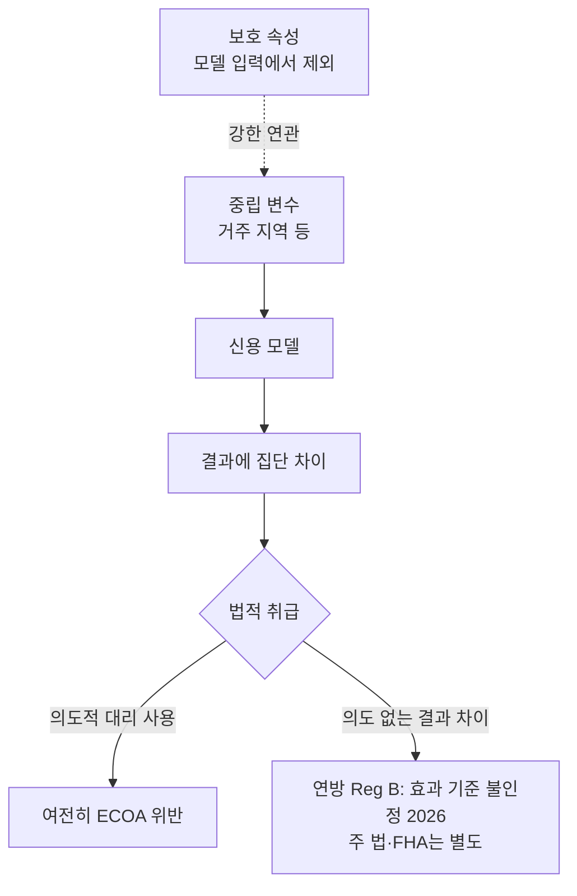

# 대리 변수

> 신용 심사에서 인종·성별 같은 **보호 속성을 직접 쓰지 않아도**, 그것과 강하게 연관된 중립적 변수(거주 지역 등)가 사실상 보호 속성을 대신하는 문제. 미국 ECOA·Reg B 맥락에서 법적 취급이 최근 바뀌어 현행 상태 확인이 필요하다. (법률 자문 아님)

## 쉽게 말하면
"인종은 입력하지 않았다"고 해도 우편번호가 인종 구성이 갈리는 동네를 알려 주면, 모델은 우편번호로 사실상 인종을 알아낼 수 있다. 이름표를 떼도 지문이 남는 것과 같다. 일반 개념은 [프록시 변수](#proxy-variable)에 있고, 이 글은 신용 분야의 법·규제 맥락을 다룬다.

## 자세히
출처: Reg B 1002.6 페이지(CFPB 사이트, 열어서 읽음), Husch Blackwell 해설(2026-04, 열어서 읽음), CFPB 2019-08-06 블로그(열어서 읽음), 이 세션의 직접 실험(아래).
- **현행 Reg B 문구(CFPB 사이트)**: 1002.6(a)는 채권자가 입수한 어떤 정보도 고려할 수 있되 보호 속성에 근거해 차별하는 데 쓰면 안 된다고 하고, "ECOA는 차별 여부 판단에 '효과 기준(effects test)'이 적용된다고 규정하지 않는다"는 문장을 둔다. 검색한 해설에 따르면 이는 CFPB가 **2026-04-22 확정, 2026-07-21 시행** 최종 규칙으로 기존 효과 기준 문구를 삭제하고 추가한 것이다.
- **대리 변수의 법적 취급(해설)**: 차별 **의도**가 있는 대리 변수 사용은 여전히 ECOA 위반이라고 해설한다. 의도 없이 결과 차이만 낳는 경우에 대한 연방 효과 기준 책임은 이 규칙으로 사라졌다는 것이 CFPB 입장이다. 다만 규칙이 소송에 직면했고(NFHA v. CFPB 등) 가처분 가능성이 언급돼 최종 결과는 불확실하다. 주(州) 법(캘리포니아·뉴욕·매사추세츠 등)과 공정주택법은 효과 기반 청구를 여전히 인정할 수 있다고 한다.
- **감시 자체는 허용**: CFPB는 채권자가 규정 준수·사업 목적으로 대리 변수를 분석하고 인구통계 결과를 모니터링하는 것을 여전히 할 수 있다고 시사한다(해설).
- **사례: Upstart 무조치 서한(CFPB 블로그, 2019-08-06)**: 학력·고용 이력 같은 대안 데이터와 머신러닝을 쓴 모델이 전통 모델보다 27% 더 많은 신청자를 승인하고 평균 금리가 16% 낮았으며, 인종·성별·62세 이상 승인율과 APR 분석에서 추가 공정 대출 분석이 필요한 격차는 나오지 않았다고 Upstart가 보고했다. CFPB는 결과를 독립적으로 재현하지 않았고, 이 서한은 특정 변수나 기법의 승인이 아니라고 밝혔다.
- **직접 실험(합성 데이터, 이 세션)**: 보호 속성(집단 0/1)은 모델 입력에서 제외하고, 거주 지역 10개와 소득만 사용. 집단별로 지역 분포가 다르게(주거 분리) 만들고 소득 차이는 작게 했다. 이 변수들로 집단을 맞히는 로지스틱 모델의 AUC는 **지역+소득 0.894, 지역만 0.886, 소득만 0.599**였다. 지역 변수가 집단 정보를 거의 다 담고 있어 보호 속성을 빼도 대리가 남는다는 점을 보여 준다. 만든 데이터의 구조에 따른 결과이므로 실제 시장의 크기를 뜻하지 않는다.

## 그림으로 보기

## 예시
- 점검 절차: ① 각 변수로 보호 속성을 예측해 보는 모델의 AUC 확인(높으면 대리 정보 있음) ② 변수 제거 후 격차·성능 변화 비교 ③ 사업 필요성 문서화.
- 이 실험의 해석: 지역만으로 AUC 0.886이면 지역 변수는 집단 정보를 거의 완전히 전달한다.

## 헷갈리는 것과 비교
| 개념 | 차이 |
|---|---|
| 대리 변수 | 중립처럼 보이나 보호 속성을 대신하는 변수 |
| [프록시 변수](#proxy-variable) | 일반 개념 노드 |
| [신용 차별 영향 분석](#disparate-impact-credit) | 결과 차이를 따지는 법리, 연방 Reg B에서는 2026 규칙으로 변경 |
| [덜 차별적 대안](#less-discriminatory-alternative) | 같은 목적에 더 공정한 모델을 찾는 활동 |

## 더 읽을거리
- [Reg B 1002.6 (CFPB)](https://www.consumerfinance.gov/rules-policy/regulations/1002/6/) — 현행 일반 규칙 문구(열어서 확인)
- [CFPB Finalizes Major Regulation B Overhaul (Husch Blackwell)](https://www.huschblackwell.com/newsandinsights/cfpb-finalizes-major-regulation-b-overhaul-disparate-impact-out-discouragement-narrowed-and-spcps-restricted) — 2026 최종 규칙 해설(열어서 확인)
- [Update on credit access and the no-action letter (CFPB, 2019-08-06)](https://www.consumerfinance.gov/about-us/blog/update-credit-access-and-no-action-letter) — Upstart 결과(열어서 확인)
